# Application Flow and User Journey Document
## Bangladesh Men's Fashion AI E-commerce Platform

---

## 1. Document Information

| Field | Detail |
|---|---|
| **Document Name** | APP_FLOW.md — Application Flow and User Journeys |
| **Version** | 1.2 (Reviewed Draft) |
| **Status** | Reviewed draft; aligned with PRD v1.1 session-scoped try-on photo lifecycle; business decisions listed in Section 26 remain open |
| **Source of Truth** | PRD.md v1.1 (Draft for Approval), dated 6 November 2026 |
| **Prepared For** | Business Owner, UI/UX Designers, Figma AI, Frontend, Backend and AI Feature Developers, Product Managers |
| **Last Updated** | 6 November 2026 |
| **Scope** | How users move through the website and how the system responds. Excludes code, database schema, UI visual specification, technical architecture and delivery plan. |

### Revision History

| Version | Date | Changes |
|---|---|---|
| 1.0 | 4 November 2026 | Initial comprehensive application-flow draft. |
| 1.1 | 4 November 2026 | Corrected traceability and open-question references; clarified try-on entry points, age-related safeguards, and proposed Saved Look renaming; reviewed Mermaid flow consistency. |
| 1.2 | 6 November 2026 | Aligned Virtual Try-On journeys, error states, privacy controls and open questions with PRD v1.1: one upload per active session, reuse across eligible products, and automatic deletion of the original photo and unsaved previews at session end/expiry. |

### Conventions

| Convention | Meaning |
|---|---|
| **FR-xxx / NFR-xxx / BR-xxx / OQ-xxx** | Requirement, rule or open-question IDs from PRD.md |
| **PG-xx** | Customer-facing page or screen ID defined in this document |
| **AD-xx** | Administration screen ID defined in this document |
| **AFQ-xx** | New open question raised by this document (the PRD has OQ-001 to OQ-037) |
| **TBD** | Not decided; no assumption has been made |
| **Proposed** | A recommendation in this document that is not stated in the PRD and needs approval |
| **MVP / Release 2 / Release 3** | Release phasing as proposed in PRD.md Section 24.4 |
| **Priority tags** | Must / Should / Could carry the PRD MoSCoW priority of the underlying requirement |

> **Rule followed:** Nothing in this document introduces a feature that contradicts PRD.md. Where the PRD is silent and a flow needs a decision, the item is tagged **Proposed** or **TBD** and listed in Section 25 or 26.

---

## 2. Table of Contents

1. [Document Information](#1-document-information)
2. [Table of Contents](#2-table-of-contents)
3. [Introduction](#3-introduction)
4. [Application Overview](#4-application-overview)
5. [User Roles](#5-user-roles)
6. [Website Sitemap](#6-website-sitemap)
7. [Navigation Architecture](#7-navigation-architecture)
8. [Overall Customer Journey](#8-overall-customer-journey)
9. [Homepage Flow](#9-homepage-flow)
10. [Product Discovery Flow](#10-product-discovery-flow)
11. [Product Details Flow](#11-product-details-flow)
12. [AI Virtual Try-On Flow](#12-ai-virtual-try-on-flow)
13. [Complete Outfit Try-On Flow](#13-complete-outfit-try-on-flow)
14. [AI Size Recommendation Flow](#14-ai-size-recommendation-flow)
15. [Wishlist and Saved Looks Flow](#15-wishlist-and-saved-looks-flow)
16. [Personalized Recommendation Flow](#16-personalized-recommendation-flow)
17. [Cart and Checkout Flow](#17-cart-and-checkout-flow)
18. [Authentication Flow](#18-authentication-flow)
19. [Customer Account Flow](#19-customer-account-flow)
20. [Order Management Flow](#20-order-management-flow)
21. [Mobile Application Flow](#21-mobile-application-flow)
22. [Error and Recovery Flows](#22-error-and-recovery-flows)
23. [System States](#23-system-states)
24. [Mermaid Diagrams](#24-mermaid-diagrams)
25. [PRD Traceability](#25-prd-traceability)
26. [Assumptions and TBD Decisions](#26-assumptions-and-tbd-decisions)

---

## 3. Introduction

### 3.1 Purpose

This document converts the product requirements in PRD.md into **application flows**: the pages that exist, how users navigate between them, what the user does at each step, and how the system responds, including failure and recovery paths.

### 3.2 How to Use This Document

| Reader | Use |
|---|---|
| UI/UX Designers and Figma AI | Page inventory (Section 6), navigation rules (Section 7), state tables (Section 23) and diagrams (Section 24) define which screens and states must be designed. Visual design is **not** specified here. |
| Frontend Developers | Flow tables define routing intent, user actions, system responses and error paths. |
| Backend Developers | System Response columns indicate what the system must validate, persist or reject. No schema or API design is given here. |
| AI Feature Developers | Sections 12 to 14 define the user-visible behaviour of try-on and size recommendation. No AI model or provider is assumed (PRD C-04, OQ-011). |
| Product Managers | Section 25 maps flows to requirements; Section 26 lists decisions needing approval. |

### 3.3 Flow Table Format

Every major journey uses this format:

| Step | User Action | System Response | Next Destination | Alternative / Error Path |
|---|---|---|---|---|

### 3.4 Global Rules Inherited from the PRD

| Rule | Source |
|---|---|
| All prices, discounts, delivery charges and totals are shown in BDT (৳). | BR-001, FR-011 |
| AI previews are approximate and never presented as a guarantee of exact fit; the disclaimer accompanies every preview. | BR-005, FR-040 |
| Visual try-on and size recommendation are separate features with separate entry points and disclaimers. | BR-006, FR-050 |
| No personal photo is processed without prior recorded explicit consent. | BR-007, FR-038 |
| Customers can use and buy from the site without using any AI feature; AI failure never blocks shopping. | BR-014, FR-048, NFR-029 |
| No delivery charge, timeline, discount, payment method or return policy is displayed unless confirmed by the business. | BR-004 |
| All sizes and measurements are in inches. | BR-016, FR-010 |
| AI-generated content is labelled as AI-generated. | BR-019, NFR-039 |

---

## 4. Application Overview

### 4.1 Product Summary

A responsive, Bangladesh-based men's fashion e-commerce website, launching in Dhaka and expanding nationwide, for men aged 15 to 40 in the mid-range and premium segments. The main differentiator is AI-powered virtual try-on (PRD Sections 3 and 4).

### 4.2 Functional Domains and Their Flows

| Domain | Flow Section | Release (PRD Section 24) |
|---|---|---|
| Homepage (21 sections) | 9 | MVP (all 21 present, with fallbacks) |
| Catalogue discovery (categories, search, filters, sorting) | 10 | MVP |
| Product details, colour, size, size guide, related products | 11 | MVP |
| AI Virtual Try-On (single garment) | 12 | MVP pilot (limited eligible products) |
| Outfit preview (curated) and Complete Outfit Try-On | 13 | Curated outfit preview: MVP (Should). Complete Outfit Try-On: Could in MVP, Release 2 to 3 subject to feasibility |
| AI Size Recommendation | 14 | MVP (Should; size-chart based) |
| Wishlist and Saved Looks | 15 | Wishlist: MVP (Must). Saved Looks: MVP (Should) |
| Personalised recommendations | 16 | MVP: rule-based (Should). Machine-learned: Future |
| Cart and checkout | 17 | MVP |
| Authentication | 18 | MVP |
| Customer account | 19 | MVP |
| Orders, tracking, returns | 20 | Order history: MVP (Must). Tracking, cancellation, exchange/return requests: Should |
| Administration | 5.4, 20.4 | MVP (Must and Should items per PRD Section 24.3) |

### 4.3 Cross-Cutting System Behaviours

| Behaviour | Description | PRD Reference |
|---|---|---|
| Announcement bar | Shown at the top of every page when a scheduled message is active | FR-054 |
| Header and navigation | Persistent on every page: brand, categories, search, account, wishlist, cart, try-on access | FR-055 |
| Cookie and analytics consent | Shown on first visit; choice honoured for analytics and personalisation | FR-078, NFR-032 |
| Try-On Welcome Popup | Shown to eligible visitors under display rules; never asks for photo or consent | FR-057 |
| Footer | Persistent on every page: categories, customer care, policies, contact | FR-074 |
| Language | English at minimum; Bangla is TBD | FR-077, OQ-010 |
| Notifications | Transactional messages after order events through confirmed channels (TBD) | FR-090, OQ-031 |

---

## 5. User Roles

### 5.1 Customer-Side Roles

The PRD defines **Visitor (Guest)** and **Customer** (registered). It does not define "Returning Customer" as a separate role. This document treats a Returning Customer as a **Registered Customer with prior activity** (orders, wishlist, saved looks or browsing history), not as a separate permission level (see AFQ-01).

| Capability | Guest Customer | Registered Customer | Returning Customer (registered, with history) |
|---|---|---|---|
| Browse, search, filter, sort | Yes | Yes | Yes |
| View product details, size guide | Yes | Yes | Yes |
| Wishlist | Limited; guest behaviour **TBD** (OQ-026) | Yes, persists across sessions | Yes, persisted items shown on return |
| Cart | Yes, within the session | Yes, persists across sessions | Yes, restored on login |
| Checkout | Only if guest checkout is approved (OQ-014); otherwise prompted to log in or register | Yes, with saved addresses | Yes, with saved addresses and order history |
| Virtual Try-On | Limited; whether an account is required is **TBD** (PRD Section 20) | Yes | Yes; previously saved looks available |
| Saved Looks | No (requires account) | Yes | Yes, reopen and compare earlier looks |
| AI Size Recommendation | Yes, for the session (saving measurements requires account and consent) | Yes, optional saved measurements with consent | Yes, uses saved measurements if the customer chose to save them |
| Personalised recommendations | Fallback (popular or curated) | Based on permitted signals, with opt-out | Richer signals after sufficient activity |
| Order history and tracking | No account view; guest order lookup is **TBD** (AFQ-02) | Yes | Yes |
| Reviews | No | Yes, if eligible (OQ-017) | Yes, if eligible |
| Profile, address book, privacy controls | No | Yes | Yes |

### 5.2 Guest versus Authenticated Experience

| Area | Guest | Authenticated |
|---|---|---|
| Header account area | "Login" and "Register" entry | Account entry showing the customer name, access to Customer Dashboard and Logout |
| Wishlist heart control | Prompts login, or works locally; depends on OQ-026 | Saves to account immediately |
| Cart | Held for the session | Persists across sessions; guest cart merged on login (merge rule **TBD**, AFQ-03) |
| Checkout | Enters delivery details manually | Selects saved address; delivery details prefilled |
| Try-on photos and looks | Original photo and unsaved previews exist only during the active session; an explicitly saved generated look requires an account and follows the approved retention policy (OQ-013) | Same session-only original-photo rule; explicitly saved generated looks follow the approved retention policy (OQ-013) |
| Recommendations | Fallback | Personalised where signals exist and consent permits |
| Privacy controls | Cookie choice only | Consent withdrawal, photo deletion, account deletion request |

### 5.3 Authentication Gates (Summary)

| Action | Gate |
|---|---|
| Browse, search, view products | No login |
| Add to cart | No login |
| Place order | Login required unless guest checkout approved (OQ-014) |
| Start Virtual Try-On | **TBD** (account requirement) |
| Save a look | Login required |
| Use wishlist | Login required, or session-only for guests (OQ-026) |
| Submit review | Login required and eligibility (OQ-017) |
| Open Customer Dashboard, Order History, Profile | Login required |

### 5.4 Administration Roles (Included in PRD Scope)

Administration is in scope (PRD Sections 20 and 21.7). Role names are proposed groupings in the PRD and final staff structure is TBD (OQ-036).

| Role | Primary Admin Flows |
|---|---|
| Super Admin | All admin areas, staff and roles, audit log, restricted access to customer photos (need-based, audit-logged) |
| Catalogue and Inventory Manager | Products, variants, prices, stock, size charts, try-on eligibility |
| Order Manager | Orders, statuses, tracking details, cancellations, exchanges, returns |
| Content and Marketing Manager | Homepage content, banners, collections, promotions, newsletter, social content |
| Customer Support Agent | Customer queries, order lookup (limited), review moderation if assigned |
| Analyst (Read-only) | Reports and dashboards, aggregated data only |

Admin flows are described in Section 20.4. Diagram 24.12 shows the staff status update alongside order tracking. Admin screens are listed in Section 6.2.

---

## 6. Website Sitemap

### 6.1 Customer-Facing Pages

Page names follow PRD terminology. Pages marked **Overlay** are panels or modals within another page; whether a feature opens as a page or an overlay is a design decision (TBD, AFQ-05).

| ID | Page / Screen | Purpose | Access | Release | PRD Reference |
|---|---|---|---|---|---|
| PG-01 | **Homepage** | Entry point; 21 sections | All | MVP | FR-054 to FR-074 |
| PG-02 | **All Products** | Full product listing with search results scope, filters and sorting | All | MVP | FR-001, FR-004, FR-005 |
| PG-03 | **Category Page** (nine categories) | Listing for one fashion category | All | MVP | FR-002 |
| PG-04 | **Collection Page** (Seasonal Collections, Premium Collections, Featured Collection) | Listing for a curated collection | All | MVP | FR-002, FR-064 |
| PG-05 | **New Arrivals** | Full list behind the homepage "View all" link | All | MVP | FR-060 |
| PG-06 | **Special Offers** | Currently discounted products. Dedicated page or filtered listing is **TBD** (AFQ-06) | All | MVP | FR-063, FR-012 |
| PG-07 | **Search Results** | Results for a keyword search | All | MVP | FR-003 |
| PG-08 | **Product Details** | Product information, variants, add-to-cart, try-on entry, reviews, related products | All | MVP | FR-006 to FR-014 |
| PG-09 | **Size Guide** (Overlay) | Size chart in inches and measuring guidance | All | MVP | FR-010 |
| PG-10 | **AI Size Recommendation** (Overlay or panel) | Collects inputs and returns a suggested size | All (see 5.1) | MVP (Should) | FR-049, FR-050 |
| PG-11 | **AI Virtual Try-On** | Photo selection, consent, generation, preview, colour change, compare, save, share | Per account decision | MVP pilot | FR-035 to FR-048, FR-053 |
| PG-12 | **Outfit / Look Detail** | A curated outfit ("Shop the Look") with items, total and add-to-cart | All | MVP (Should) | FR-042, FR-062 |
| PG-13 | **Wishlist** | Saved products | Registered (guest per OQ-026) | MVP | FR-030 |
| PG-14 | **Saved Looks** | Saved try-on results and outfits | Registered | MVP (Should) | FR-031 |
| PG-15 | **Shopping Cart** | Review and edit items; totals | All | MVP | FR-015 |
| PG-16 | **Checkout** | Delivery details, delivery charge, payment method, order review, placement | Per OQ-014 | MVP | FR-016 to FR-020 |
| PG-17 | **Order Confirmation** | Confirmation after placement | Order owner | MVP | FR-021 |
| PG-18 | **Login** | Customer login | Guest | MVP | FR-026 |
| PG-19 | **Registration** | Account creation | Guest | MVP | FR-025 |
| PG-20 | **Forgot Password** | Account access recovery | Guest | MVP | FR-027 |
| PG-21 | **Customer Dashboard** | Account hub | Registered | MVP | FR-028 (hub page is proposed, AFQ-07) |
| PG-22 | **Profile Management** (personal details, privacy controls, consent, saved measurements, photo deletion) | Manage profile and privacy | Registered | MVP | FR-028, FR-047 |
| PG-23 | **Address Book** | Manage delivery addresses | Registered | MVP (Should) | FR-029 |
| PG-24 | **Order History** | List of past orders | Registered | MVP | FR-022 |
| PG-25 | **Order Details and Tracking** ("Order Tracking") | Order summary, status, tracking information | Registered | MVP (Should for tracking) | FR-022, FR-023 |
| PG-26 | **Cancellation, Exchange and Return Request** | Customer-initiated request per confirmed policy | Registered | MVP (Should) | FR-024 |
| PG-27 | **Write a Review** | Submit rating and review (and optional photo) | Registered, eligible | MVP (Should); photo: Could | FR-032, FR-034 |
| PG-28 | **Contact and Support** | Support channels and contact | All | MVP | FR-075 |
| PG-29 | **Policy Pages** (Delivery, Payment, Returns and Exchange, Privacy Policy, Terms, AI Try-On Notice) | Business-approved policy content | All | MVP | FR-076 |
| PG-30 | **FAQ** | Questions and answers; homepage section is defined, standalone page is **TBD** | All | MVP | FR-073 |
| PG-31 | **Brand Story / About** | Brand story or featured brands; link target page is **TBD** | All | MVP (Should) | FR-070 |
| PG-32 | **Shared Look View** | Recipient view of a look the customer chose to share | Link holder | MVP (Should); share method TBD | FR-045 |

**Homepage-only components (not separate pages):** Announcement Bar, Hero Banner, AI Virtual Try-On Welcome Popup (overlay), Newsletter Subscription (inline form with confirmation message), Instagram and Social Media Feed (external links). Cookie consent banner appears site-wide (FR-078).

### 6.2 Administration Screens

| ID | Admin Screen | PRD Reference |
|---|---|---|
| AD-01 | Admin Login and Dashboard (reports, KPIs) | FR-087, FR-088 |
| AD-02 | Product Management | FR-079 |
| AD-03 | Inventory Management | FR-080 |
| AD-04 | Order Management (status, tracking, cancellation, return handling) | FR-081 |
| AD-05 | Customer Management | FR-082 |
| AD-06 | Homepage Content Management (all homepage sections) | FR-083 |
| AD-07 | Promotion and Coupon Management | FR-084 |
| AD-08 | Review and Customer Photo Moderation | FR-085 |
| AD-09 | Delivery Zone and Charge Configuration | FR-086 |
| AD-10 | Try-On Eligibility, AI Usage Monitoring and Content Moderation | FR-053, FR-089 |
| AD-11 | Staff Accounts, Roles and Audit Log | FR-088, NFR-027 |

### 6.3 Sitemap Tree

```
Website
├── Homepage (PG-01)
│   └── [21 sections; each links onward as defined in Section 9]
├── Shop
│   ├── All Products (PG-02)
│   ├── Categories (PG-03)
│   │   ├── Panjabi & Traditional Wear
│   │   ├── Western Wear
│   │   ├── Casual Wear
│   │   ├── Old Money Fashion
│   │   ├── Streetwear
│   │   ├── Formal Wear
│   │   └── Smart Casual
│   ├── Collections (PG-04)
│   │   ├── Seasonal Collections
│   │   └── Premium Collections
│   ├── New Arrivals (PG-05)
│   ├── Special Offers (PG-06)
│   ├── Search Results (PG-07)
│   └── Product Details (PG-08)
│       ├── Size Guide (PG-09, overlay)
│       ├── AI Size Recommendation (PG-10)
│       ├── AI Virtual Try-On (PG-11)
│       └── Write a Review (PG-27)
├── Style
│   ├── Shop the Look / Outfit Detail (PG-12)
│   └── Shared Look View (PG-32)
├── My Lists
│   ├── Wishlist (PG-13)
│   └── Saved Looks (PG-14)
├── Purchase
│   ├── Shopping Cart (PG-15)
│   ├── Checkout (PG-16)
│   └── Order Confirmation (PG-17)
├── Account
│   ├── Login (PG-18)
│   ├── Registration (PG-19)
│   ├── Forgot Password (PG-20)
│   └── Customer Dashboard (PG-21)
│       ├── Profile Management (PG-22)
│       ├── Address Book (PG-23)
│       ├── Order History (PG-24)
│       │   └── Order Details and Tracking (PG-25)
│       │       └── Cancellation / Exchange / Return Request (PG-26)
│       ├── Wishlist (PG-13)
│       └── Saved Looks (PG-14)
├── Information
│   ├── Contact and Support (PG-28)
│   ├── Policy Pages (PG-29)
│   ├── FAQ (PG-30)
│   └── Brand Story / About (PG-31)
└── Administration (AD-01 to AD-11)
```

Diagram 24.1 shows the same structure as a Mermaid diagram.

---

## 7. Navigation Architecture

> Navigation labels use PRD terms. Where the PRD does not specify a navigation element (breadcrumbs, mobile bottom navigation), the element is marked **Proposed**.

### 7.1 Main Navigation (FR-055)

| Element | Label | Destination | Behaviour |
|---|---|---|---|
| Brand logo | Brand name (final name TBD, OQ-003) | Homepage | Present on all pages |
| Category links | The nine categories (Section 7.2) | Category Page or Collection Page | Reachable within two interactions on desktop and mobile (Section 15 of the PRD, Homepage Section 2 criteria) |
| Search | Search | Search entry, then Search Results | Keyword search; handles empty and no-result queries |
| Virtual Try-On access | Virtual Try-On | Try-on entry (FR-035) | Opens the try-on entry; where no product is selected, the customer is asked to choose an eligible product (AFQ-08) |
| Account | Account (Login / Register for guests; Customer Dashboard for registered) | PG-18, PG-19 or PG-21 | State changes with authentication |
| Wishlist | Wishlist | Wishlist | Guest behaviour per OQ-026 |
| Cart | Cart (with item count) | Shopping Cart | Count updates immediately after add-to-cart |
| Announcement bar | Message text | Optional link | Not navigation; informational |

### 7.2 Category Navigation

| Label (PRD name) | Type | Destination |
|---|---|---|
| Panjabi & Traditional Wear | Style category | Category Page |
| Western Wear | Style category | Category Page |
| Casual Wear | Style category | Category Page |
| Old Money Fashion | Style category | Category Page |
| Streetwear | Style category | Category Page |
| Formal Wear | Style category | Category Page |
| Smart Casual | Style category | Category Page |
| Seasonal Collections | Cross-cutting collection | Collection Page |
| Premium Collections | Cross-cutting collection | Collection Page |

Rules:
- A product assigned to more than one category or collection appears on each corresponding page (FR-002).
- Whether product types (shirts, trousers, footwear and so on) appear as sub-navigation is **TBD** (OQ-002).
- A category with no active products can be hidden by an admin (Homepage Section 5 criteria).
- Selecting a category resets previously applied filters and sort to defaults.

### 7.3 Breadcrumb Navigation (Proposed)

The PRD does not define breadcrumbs. Proposed, subject to approval (AFQ-09):

| Page | Breadcrumb Pattern |
|---|---|
| Category Page | Home > Category name |
| Collection Page | Home > Collection name |
| Product Details | Home > Category name > Product name (category used is the one the customer came from; otherwise the primary category) |
| Search Results | Home > Search results for the keyword |
| Order Details | Home > Account > Order History > Order number |
| Policy Pages | Home > Policy name |

Each breadcrumb segment except the last links to its page.

### 7.4 Product-to-Product Navigation

| Origin | Destination | Rule |
|---|---|---|
| Related Products on Product Details | Another Product Details | Shows related items other than the current product; section hidden when none exist (FR-013) |
| Look / Outfit Detail items | Product Details of an item | Opens the item with the look context preserved for returning |
| Wishlist item | Product Details | Opens with the previously chosen variant where stored (AFQ-10) |
| Recommended for You item | Product Details | Same as listing card |
| Try-on result item | Product Details | Returns to try-on session where possible |
| Colour swatch change | Same product, different colour | Updates images and availability without leaving the page (FR-008) |

Back behaviour: using the browser or on-page Back returns to the previous listing with the same filters, sort and position preserved where possible.

### 7.5 Wishlist Navigation

| Action | Result |
|---|---|
| Header Wishlist | Opens Wishlist |
| Heart control on card or Product Details | Toggles saved state in place; does not navigate away |
| Wishlist item | Opens Product Details |
| Wishlist "Add to cart" (where offered) | Requires a size and colour; if not chosen, opens Product Details or a selection prompt (AFQ-10) |
| Customer Dashboard > Wishlist | Opens Wishlist |

### 7.6 Cart Navigation

| Action | Result |
|---|---|
| Header Cart | Opens Shopping Cart |
| After add-to-cart | Cart count updates; customer stays on page with confirmation. Whether a mini-cart opens is **TBD** (AFQ-11) |
| Cart line item | Opens Product Details |
| "Continue shopping" | Returns to the last listing or Homepage |
| "Proceed to checkout" | Checkout (guest or login gate per OQ-014) |

### 7.7 Checkout Navigation

| Rule | Description |
|---|---|
| Step order | Delivery details, delivery charge, payment method, order review, place order (Section 17) |
| Back within checkout | Previous step with entered data retained |
| Leave checkout | Cart remains intact; no order is created |
| Header and footer | Whether the full header is shown during checkout is a design decision (AFQ-05); cart edit link is always available |
| Try-On Welcome Popup | Never shown on checkout or account-sensitive pages (FR-057) |

### 7.8 Account Navigation

Customer Dashboard acts as the account hub (proposed page, AFQ-07).

| Item | Destination |
|---|---|
| Profile | Profile Management |
| Addresses | Address Book |
| Orders | Order History |
| Wishlist | Wishlist |
| Saved Looks | Saved Looks |
| Privacy and Consent | Profile Management, privacy section |
| Logout | Ends session; returns to Homepage |

### 7.9 Mobile Bottom Navigation (Proposed)

The PRD requires a mobile navigation pattern (FR-055, NFR-005) but does not define a bottom navigation bar. Proposed items (AFQ-12):

| Position | Label | Destination |
|---|---|---|
| 1 | Home | Homepage |
| 2 | Shop | Category navigation (nine categories) |
| 3 | Virtual Try-On | Try-on entry |
| 4 | Wishlist | Wishlist |
| 5 | Account | Login or Customer Dashboard |

Cart stays in the top header with its item count, because the PRD places cart in the header (FR-055). Bottom navigation is hidden during Checkout and during an active try-on to avoid accidental exit (AFQ-12).

---

## 8. Overall Customer Journey

### 8.1 Journey Stages

| Stage | Customer Goal | Main Pages | Key System Behaviour | PRD Reference |
|---|---|---|---|---|
| 1. Arrive | Understand what the brand offers | Homepage | Announcement, hero, try-on welcome popup, cookie choice | FR-054 to FR-057, FR-078 |
| 2. Discover | Find clothing that suits their style | Homepage, Category, Collection, Search Results, All Products | Categories, search, filters, sort, recommendations | FR-001 to FR-005, FR-051 |
| 3. Evaluate | Judge a product | Product Details, Size Guide, Size Recommendation | Gallery, colours, sizes, reviews, related products | FR-006 to FR-013, FR-049 |
| 4. Visualise | See the product on themselves or in an outfit | AI Virtual Try-On, Outfit / Look Detail | Photo, consent, preview with disclaimer | FR-035 to FR-048 |
| 5. Save | Keep favourites for later | Wishlist, Saved Looks | Persist per account | FR-030, FR-031 |
| 6. Buy | Purchase confidently | Cart, Checkout, Order Confirmation | Delivery charge, payment, confirmation | FR-015 to FR-021 |
| 7. Follow up | Track and manage the order | Order History, Order Details and Tracking, Return Request | Status, tracking, requests | FR-022 to FR-024 |
| 8. Return | Engage again | Customer Dashboard, Recommended for You, Reviews | Personalisation, reviews | FR-032, FR-051 |

### 8.2 Journey by Customer State

| Customer State | Typical Path |
|---|---|
| New guest, browse only | Homepage > Category > Product Details > leave. Wishlist or cart prompts register or login as defined in Section 5.3. |
| New guest, buys | Homepage > Category > Product Details > Cart > Checkout (guest checkout if approved, else Registration) > Order Confirmation |
| Guest, tries on | Homepage or Product Details > Virtual Try-On > (login if required, TBD) > consent > preview > Product Details or Cart |
| Registered, first order | Login > Product Details > Cart > Checkout with saved or new address > Order Confirmation > Order History |
| Returning customer | Login > Homepage with Recommended for You > Wishlist or Saved Looks > Product Details > Cart > Checkout > Order Details and Tracking |

Diagram 24.2 shows the overall journey. Detailed flows begin in Section 9.

---

## 9. Homepage Flow

### 9.1 Journey A: Homepage Journey

| Step | User Action | System Response | Next Destination | Alternative / Error Path |
|---|---|---|---|---|
| A1 | Enters the website | Loads Homepage (PG-01); shows cookie and analytics consent choice on first visit (FR-078); applies Try-On Welcome Popup display rules (FR-057) | Homepage | If the page loads slowly, content appears progressively with image placeholders (NFR-001, NFR-007). If a section's data fails to load, that section shows its fallback or is hidden; the page remains usable. |
| A2 | Views Announcement Bar and Header and Navigation | Shows the active scheduled message (FR-054) and the header with categories, search, account, wishlist, cart and try-on access (FR-055) | Stay on Homepage, or follow a link | No active message: the bar is not shown. Expired message disappears automatically. |
| A3 | Decides on the Try-On Welcome Popup (if shown) | Popup offers "Try it now" and "Not now"; it does not request a photo or consent (FR-057) | "Try it now" opens the try-on entry (Section 12). "Not now" or close dismisses it and suppresses reappearance for the configured period. | Popup is dismissible by click or tap, close control and keyboard. Admin can disable it. It never appears on checkout or account-sensitive pages. |
| A4 | Explores the Hero Banner | Shows the primary campaign visual with one CTA (FR-056) | CTA destination configured by staff: collection, category, product or try-on | Broken or missing link is a content error handled in admin (AD-06). |
| A5 | Browses Shop by Category | Shows entry tiles for the nine categories (FR-058) | Category Page or Collection Page | Empty or inactive categories can be hidden by admin. |
| A6 | Explores the AI Virtual Try-On Feature Section | Explains the try-on steps, states the approximate-preview disclaimer, summarises privacy and links to the privacy policy (FR-059) | "Try it now" opens the try-on entry (Section 12); privacy link opens Policy Pages (AI Try-On Notice, Privacy Policy) | None. |
| A7 | Explores New Arrivals | Shows the latest eligible products (FR-060) | Product Details, or "View all" to New Arrivals (PG-05) | Out-of-stock products are handled per BR-009 (display rule TBD, OQ-035). |
| A8 | Views Trending Now, Best Sellers or Top Rated tabs | Switching tabs updates the list without a full page reload (FR-061) | Product Details | If data is insufficient, staff-curated fallback is shown. Top Rated never shows unrated products. |
| A9 | Views Shop the Look | Shows curated outfits with items and total (FR-062) | Outfit / Look Detail (PG-12), or add selected items to cart | Unavailable items are marked and do not block others. |
| A10 | Views Special Offers and Discounts | Shows active discounted products with original and discounted prices (FR-063) | Product Details, or Special Offers (PG-06) | No active offers: the section is hidden. |
| A11 | Views Seasonal and Featured Collection | Shows the staff-managed collection (FR-064) | Collection Page | None. |
| A12 | Views Recommended for You | Shows personalised items where permitted, otherwise fallback (FR-065) | Product Details | See Section 16. |
| A13 | Reads trust content: Real Customer Photos, Customer Reviews and Ratings, Why Choose Us, Delivery, Payment and Return Benefits, Featured Brands or Brand Story | Shows only moderated and confirmed content (FR-066 to FR-070) | Product Details, Policy Pages, Brand Story | No approved photos or reviews: section hidden or shows a defined alternative. Unconfirmed policy details are not shown (BR-004). |
| A14 | Subscribes to the Newsletter | Validates the contact, requires explicit opt-in, shows confirmation (FR-071) | Stay on Homepage | Invalid email or phone shows an error. Duplicate subscriber gets a neutral message. |
| A15 | Views Instagram and Social Media Feed | Shows brand posts or a fallback; links open official accounts (FR-072) | External social page | Feed unavailable: fallback shown; page does not break. |
| A16 | Reads FAQ and Footer | Expandable FAQ; footer links to categories, customer care, policies and contact (FR-073, FR-074) | FAQ answers in place; Policy Pages, Contact and Support | None. |
| A17 | Opens a product | Loads Product Details (PG-08) | Product Details | Product unavailable or unpublished: "product not available" state with category suggestions (Section 22). |

### 9.2 Homepage Section Link Map

All 21 homepage sections and where each leads (PRD Section 15).

| # | Section | Primary Destination(s) | Release Priority |
|---|---|---|---|
| 1 | Announcement Bar | Optional link (page set by staff) | Must |
| 2 | Header and Navigation | All main navigation targets (Section 7.1) | Must |
| 3 | Hero Banner | Staff-configured destination | Must |
| 4 | AI Virtual Try-On Welcome Popup | Try-on entry or dismissal | Should |
| 5 | Shop by Category | Category and Collection Pages | Must |
| 6 | AI Virtual Try-On Feature Section | Try-on entry; Policy Pages | Must |
| 7 | New Arrivals | Product Details; New Arrivals | Must |
| 8 | Trending Now, Best Sellers, Top Rated (tabs) | Product Details | Should |
| 9 | Shop the Look | Outfit / Look Detail; Cart | Should |
| 10 | Special Offers and Discounts | Product Details; Special Offers | Must |
| 11 | Seasonal and Featured Collection | Collection Page | Must |
| 12 | Recommended for You | Product Details | Should |
| 13 | Real Customer Photos | Related Product Details | Should |
| 14 | Customer Reviews and Ratings | Full reviews on Product Details | Should |
| 15 | Why Choose Us | Informational; optional links | Must |
| 16 | Delivery, Payment and Return Benefits | Policy Pages | Must |
| 17 | Featured Brands or Brand Story | Brand Story or About (target TBD) | Should |
| 18 | Newsletter Subscription | Inline confirmation | Should |
| 19 | Instagram and Social Media Feed | External official accounts | Could |
| 20 | FAQ Section | In-place expand; FAQ page (TBD) | Must |
| 21 | Footer | Categories, policies, contact | Must |

Diagram 24.3 shows the homepage navigation flow.

---

## 10. Product Discovery Flow

### 10.1 Journey B: Product Discovery Journey

| Step | User Action | System Response | Next Destination | Alternative / Error Path |
|---|---|---|---|---|
| B1 | Browses a category from navigation or Shop by Category | Shows the Category Page with product cards: image, name, price in ৳, discount indicator, colour availability, wishlist control (FR-001, FR-002) | Category Page | No active products in the category: empty state with link to All Products. Load failure: error state with retry. |
| B2 | Or searches by keyword | Searches name, category and key attributes such as colour (FR-003) | Search Results | Empty query: no search is run and a prompt to enter a keyword is shown. No matches: "no results" message with alternative suggestions. |
| B3 | Applies filters: category, size, colour, price range (৳), availability (additional filters such as discount are TBD) | Reduces results to matching products only; combines filters; shows result count (FR-004) | Same listing, refined | Zero matches: empty state with "Clear filters". Clear filters restores the full list. |
| B4 | Sorts: newest, price low to high, price high to low (rating and popularity added when data exists) | Re-orders results; sort persists while paging (FR-005) | Same listing, re-ordered | None. |
| B5 | Views product cards and pages through results | Shows cards consistently; paging or load-more behaviour is **TBD** (PRD FR-001) | Same listing | Inactive products never appear. |
| B6 | Marks a product as a favourite (heart) | Saves to wishlist per Section 15 | Stay on listing | Guest: prompt to log in or session-only save (OQ-026). |
| B7 | Opens a product | Loads Product Details (FR-006) | Product Details | Product removed since listing: "product not available" state. |
| B8 | Selects colour and size | Updates images and availability (FR-007 to FR-009) | Product Details | Unavailable size or colour is marked and not selectable. |
| B9 | Adds to wishlist or cart | Wishlist: Section 15. Cart: Section 17. Cart count updates immediately (FR-055). | Stay on Product Details, or Cart | Add-to-cart without a required size prompts selection. |

### 10.2 Listing Page Behaviour Rules

| Rule | Description |
|---|---|
| Filters persist while navigating pages of one listing | Applied filters and sort remain until cleared or the category changes |
| Back from Product Details | Returns to the listing with filters and sort retained |
| Search within category | Whether search is scoped to the current category is **TBD** (AFQ-13); default is store-wide |
| Product card actions | Open product, toggle wishlist; card quick-add is not defined in the PRD and is **not** included |
| Out-of-stock products | Shown as unavailable or hidden per OQ-035; never purchasable (FR-014) |

---

## 11. Product Details Flow

### 11.1 Product Details Page Content Flow

The page presents, in a logical reading order (layout is a UI decision):

| Element | Behaviour | PRD |
|---|---|---|
| Image gallery | Multiple images, zoom, swipe on mobile; images follow selected colour where supplied | FR-007 |
| Name, price in ৳, discount | Original and discounted price when discounted | FR-011, FR-012 |
| Colour swatches | Update images and availability | FR-008 |
| Size selector | Per-size availability | FR-009 |
| Size Guide link | Opens Size Guide in inches | FR-010 |
| Size Recommendation entry | Opens AI Size Recommendation (Section 14); separate from try-on | FR-049, FR-050 |
| Virtual Try-On entry | Shown only on try-on-eligible products | FR-035, FR-053 |
| Stock status | Per variant; low-stock messaging only if confirmed | FR-014 |
| Add to cart, Add to wishlist | See Sections 15 and 17 | FR-015, FR-030 |
| Delivery and return summary | Shown only when confirmed (BR-004) | FR-069, FR-076 |
| Reviews and ratings | Approved reviews, aggregate rating, "No ratings yet" when none | FR-033 |
| Related products | Hidden if none exist | FR-013 |

### 11.2 Variant Selection Flow

| Step | User Action | System Response | Next | Alternative / Error Path |
|---|---|---|---|---|
| 1 | Opens a product | Shows default colour and no size pre-selected (default-selection rule TBD, AFQ-14) | Product Details | Missing optional data (for example, no reviews) does not break the page. |
| 2 | Selects a colour | Swaps images, shows colour availability | Same page | All sizes of this colour out of stock: colour marked unavailable; customer can choose another colour. |
| 3 | Selects a size | Marks size selected, shows availability | Same page | Unavailable size is not selectable. |
| 4 | Opens Size Guide (optional) | Shows inches chart and how-to-measure guidance | Overlay, then back to the same selection | Chart missing for the product: guide shows a message and support contact (AFQ-15). |
| 5 | Taps Add to Cart | Adds the selected variant; updates cart count (FR-015) | Stay on page; Cart via header | No size selected where sizes apply: inline prompt, nothing is added. Variant became unavailable: message, nothing is added. |
| 6 | Taps Wishlist heart | Toggles saved state | Stay on page | Guest: Section 15. |

### 11.3 Reviews Flow on Product Details

| Step | User Action | System Response | Next | Alternative / Error Path |
|---|---|---|---|---|
| 1 | Reads reviews and ratings | Shows approved reviews only; average and count from approved ratings | Same page | No reviews: "No ratings yet". |
| 2 | Selects "Write a review" | Checks eligibility (rule TBD, OQ-017) | Write a Review (PG-27) | Not logged in: Login then return. Not eligible: explanatory message. |
| 3 | Submits rating and text; optionally a photo with explicit permission for public display (photo is Could, FR-034) | Saves for moderation; confirms "submitted for review" | Product Details | Validation error: inline messages. Review is not shown until approved (BR-011). |

---

## 12. AI Virtual Try-On Flow

> **Release:** MVP pilot for a limited set of eligible products (FR-039, FR-053; PRD Section 16.3). Colour change, compare, save and share are Should Have (FR-041, FR-044, FR-045, FR-031). **No AI model, API or provider is assumed** (OQ-011).

### 12.1 Entry Points

| Entry Point | Origin | Starting Context |
|---|---|---|
| Virtual Try-On button | Product Details (eligible products only) | Product and selected colour carried into the session (FR-035) |
| Virtual Try-On in Header and Navigation | Any page | No product selected; the customer is asked to pick an eligible product (AFQ-08) |
| Try-On Welcome Popup, "Try it now" | Homepage | No product selected (FR-057) |
| AI Virtual Try-On Feature Section CTA | Homepage | No product selected (FR-059) |
| Preview link on a look | Outfit / Look Detail | Outfit context; Complete Outfit Try-On where supported (FR-043, Section 13) |
| Homepage product card or collection product card | Homepage, Category, Collection or Search Results | Selected product and colour, if any, carried into the session |
| Saved Looks | Saved Looks | Reopen an existing look (Section 15) |

If a product is not try-on eligible, no active try-on control is shown (FR-053). If a customer reaches try-on by link for an ineligible product, a "Try-on is not available for this product" state is shown with eligible alternatives and a link back to Product Details.

### 12.2 Authentication Decision

The PRD does not decide whether an account is required for try-on (PRD Section 20, "account requirement TBD"). The flow supports both and the business must choose (AFQ-04).

| Option | Behaviour |
|---|---|
| **Option 1: Account required** | A guest selecting Virtual Try-On is sent to Login or Registration, then returned to the try-on with product and selections preserved. |
| **Option 2: Account not required** | A guest proceeds. The original photo and unsaved previews exist only during the active session. Saving a generated look prompts login or registration and requires an explicit Save action; saved-image retention follows OQ-013. |

Consent (Section 12.3, step D6) is required under both options.

> **Age-related safeguard (launch blocker):** The target audience includes ages 15–17. The business must approve an age policy, registration/guardian requirements where applicable, and a legally reviewed consent approach before allowing minors to create accounts or upload personal photos. Until approved, the product must not infer that ordinary adult consent is sufficient; under-18 registration and photo-processing eligibility remain **TBD (PRD OQ-009)**. Do not enable under-18 photo processing by default.

### 12.3 Journey D: Virtual Try-On Journey (Single Garment)

The sequence follows the PRD journey (select product, open try-on, upload photo, consent, preview, colour change, outfits, compare, save or share, select, add to cart) and the user-requested flow. The consent step is placed **after the customer selects a photo and before any photo is transmitted or processed**, to satisfy BR-007 and FR-038 (AFQ-21).

| Step | User Action | System Response | Next Destination | Alternative / Error Path |
|---|---|---|---|---|
| D1 | Opens a product | Shows Product Details with Virtual Try-On shown only if eligible (FR-006, FR-053) | Product Details | Product ineligible: no try-on control. |
| D2 | Selects Virtual Try-On | Opens the try-on experience with the product and selected colour; shows a short explanation, the approximate-preview note and a privacy summary (FR-035, FR-040) | Try-On (PG-11) | Customer cancels: returns to Product Details. |
| D3 | (System check) Account requirement | Applies the decision in Section 12.2 | Try-On photo step, or Login / Registration if Option 1 and guest | Login or Registration abandoned: customer returns to Product Details; no photo state exists. |
| D4 | Reads photo guidance, then selects or uploads a personal photo once for this active session (camera capture is TBD) | Shows guidance: lighting, pose, one person, plain background (guidance content TBD, FR-037). Shows a local preview of the chosen photo for confirmation. **Nothing is transmitted yet.** The photo can be reused for multiple eligible products in this session. | File check, then Consent | Customer cancels: returns to Product Details. |
| D5 | (System check) File type and size | Checks permitted formats and size limits (values TBD) on the device before transmission | Consent step if valid | **Unsupported file** or oversized file: rejected with a clear message listing accepted formats and limits; customer chooses another file (FR-036). |
| D6 | Reviews and accepts photo-processing consent | Shows consent text: what is collected, why, who processes it, retention, how to delete or withdraw. Consent is separate from Terms acceptance. Optional extra uses (training, marketing, public display) appear as separate, optional, off-by-default choices (CR-1 to CR-5). Under-18 handling is **TBD** (OQ-009). Records consent with timestamp and consent-text version (FR-038). | Photo upload and server checks | **Customer declines:** no photo is sent; the local selection is discarded; customer returns to Product Details or can continue browsing. **Customer is under 18:** behaviour per the minors policy (TBD). |
| D7 | (System) Uploads and validates the selected photo after consent | Shows upload progress; performs content and quality validation (rules TBD, FR-037) and unsafe-content screening (FR-089, NFR-038). Keeps the validated photo available only for the active session so it can be reused for multiple eligible products without another upload. | Try-On workspace / generation | **Invalid photo:** explain the issue and ask for another photo. **Unsafe content:** neutral rejection; do not process. **Upload failure:** Retry or Cancel; no completed upload is assumed. |
| D8 | Waits while the system processes | Shows a progress indicator within 1 second of submission (NFR-003) and an estimate only if one is confirmed (TBD) | AI generation result | **Processing delay:** after a delay threshold (TBD), shows "taking longer than usual" with Keep waiting and Cancel. Whether processing continues if the customer leaves the page is **TBD** (AFQ-16). **Cancellation:** stops processing where possible and returns to Product Details. |
| D9 | AI generates the preview | Displays the garment on the customer's photo, labelled as AI-generated, with the "approximate visual representation, not a guarantee of exact fit" disclaimer and a link to the Size Guide (FR-039, FR-040, NFR-039) | Result view | **AI generation failure** or timeout: clear message with Retry, Try another photo, and Continue shopping (FR-048). **AI service unavailable:** same message; the rest of the site continues (NFR-029). **Usage limit reached** (limits TBD, OQ-024): message stating the limit; browsing and purchase unaffected. |
| D10 | Views the result | Shows result actions: Change colour, Try another eligible product using the same session photo, Compare, explicitly Save Look, Share (if enabled), Add to cart, Delete my photo, Try another photo. Unsaved generated previews remain session-only. | Result view / Try-On workspace | If the product has no supported colour variants for try-on, Change colour is not shown. |
| D11 | Changes colour (where supported; Should Have) | Regenerates or swaps the preview for the chosen colour; the colour matches a purchasable variant (FR-041) | Result view | Unsupported colour is shown as unavailable for try-on. Failure: as D9 failure, with the previous result kept. |
| D12 | Changes product or outfit (where supported) | Offers outfit options (Section 13). Single-garment try-on continues to work on its own. | Section 13 flow, or Result view | Unsupported combination: message; previous result kept. |
| D13 | Compares looks (Should Have) | Shows two or more looks side by side with their items and prices (FR-044) | Compare view | Fewer than two looks: prompt to generate or open another look. |
| D14 | Explicitly saves the generated look (Should Have) | Only after the customer selects Save Look, adds the generated image to Saved Looks; confirms (FR-031). This is the only flow that permits the generated image to persist beyond the active session, subject to the approved retention policy. | Result view | **Guest:** prompt to log in or register, then return and explicitly save. Save failure: message with Retry; result remains available only for the active session. |
| D15 | Shares the look (Should Have) | Asks for explicit confirmation of exactly what will be shared, then provides a private, revocable link or a downloadable image (method TBD). The disclaimer is retained on shared output (FR-045). | Share action | Customer cancels sharing: nothing is shared. Sharing requires a saved look or account where the method needs it (AFQ-22). |
| D16 | Selects the product and variant | Shows the product's size and colour selectors; recommends the Size Guide and Size Recommendation as separate options (FR-050) | Product Details, or directly add to cart | No size chosen: prompt before add-to-cart. |
| D17 | Adds the product to the cart | Adds the selected variant; updates cart count (FR-046, FR-015) | Shopping Cart, or stay in try-on | Variant unavailable: item flagged, nothing added; other items unaffected. |
| D18 | Exits | Returns to Product Details or the page the customer came from | Previous page | Unsaved results are lost on exit for guests; the customer is told before leaving if there is an unsaved result (AFQ-22). |

### 12.4 Alternative Paths in Detail

| Scenario | Trigger | What the Customer Sees | Actions Available | System Behaviour |
|---|---|---|---|---|
| **Invalid photo** | Validation rule fails (rules TBD) | A specific reason and short tips (for example, good lighting, one person) | Choose a different photo, Cancel | Photo is not used for generation; consent remains recorded; the invalid photo is discarded per the retention rule |
| **Unsupported file** | Format or size outside limits (TBD) | Accepted formats and size limits | Choose another file, Cancel | Rejected on the device before transmission |
| **Upload failure** | Connection loss or server error | "Upload did not complete" | Retry, Choose another photo, Cancel | Partial uploads are discarded; no result is created |
| **AI generation failure** | Generation error or timeout | "We could not create your preview" | Retry, Try another photo, Continue shopping | Failure is logged for staff (FR-048, FR-089); cart and browsing unaffected |
| **Processing delay** | Processing exceeds threshold (TBD) | "Taking longer than usual" | Keep waiting, Cancel | Progress remains visible; the page does not freeze (NFR-003) |
| **User cancellation** | Customer cancels at any step | Return to Product Details with a neutral message | Start again, Continue shopping | Processing is stopped where possible; incomplete data is discarded; consent record stays unless withdrawn |
| **Retry** | Customer chooses Retry after a failure within the same active session | Reuse the already uploaded photo and recorded consent if still valid and the consent version is unchanged (AFQ-17); do not ask for another upload unnecessarily | Retry again (retry limit TBD), Choose another photo, Cancel | If the session has ended/expired or the photo was deleted, require a new upload and consent; usage limits remain subject to OQ-024 |
| **Consent declined** | Customer declines at D6 | Explanation that try-on needs consent; shopping continues | Return to Product Details | No photo is transmitted or stored |
| **Photo deletion** | Customer selects Delete my photo during the active session or from Profile Management > Privacy | Confirmation explains that the original active-session photo and its unsaved generated previews will be deleted; separately saved looks are handled through Saved Looks deletion | Confirm delete, Cancel | On confirm: stop further use of the photo and trigger deletion of the original photo and unsaved previews according to the approved deletion window (TBD, FR-047); confirm the request without promising instant backend deletion |
| **Consent withdrawal** | Customer withdraws consent in Profile Management | Confirmation that processing stops and data is deleted per policy | Confirm, Cancel | Further processing stops; deletion is triggered (CR-4) |
| **Session end / expiry** | Active try-on session ends or expires (exact timeout/termination rule TBD, OQ-013) | Original uploaded photo and all unsaved generated previews become unavailable; a later session starts with a fresh upload | Start a new try-on session and upload a photo | Original photo and unsaved previews are automatically deleted according to the approved deletion process (FR-047) |
| **Saved Look retention** | Customer explicitly saved a generated image; its approved retention period ends or customer deletes it | Saved Look is marked unavailable or removed with an appropriate explanation | Return to Saved Looks or create a new preview | Delete retained generated image according to the approved policy; exact retention period remains TBD (OQ-013, FR-047) |
| **Session expiry** | Active try-on session times out or is terminated | Message that the session ended and that the original photo and unsaved previews are no longer available | Start a new try-on session and upload a new photo | Original photo and unsaved previews are automatically deleted under FR-047; explicitly saved looks remain subject to their separate approved retention policy |

### 12.5 Try-On States Summary

| State | What the Customer Sees | Actions |
|---|---|---|
| Initial | Explanation, photo guidance, privacy summary, disclaimer note | Select photo, Cancel |
| Loading (upload and processing) | Progress indicator, product and photo thumbnail | Cancel |
| Success | AI-labelled preview with disclaimer and result actions | Change colour, Compare, Save, Share, Add to cart, Delete photo |
| Empty (no photo yet, no saved looks) | Prompt to choose a photo | Select photo |
| Error | Specific message per Section 12.4 | Retry, Choose another, Continue shopping |
| Cancelled | Return to previous page, neutral message | Start again |
| Retry | Progress indicator again, same photo | Cancel |

Diagram 24.6 shows the full flow.

---

## 13. Complete Outfit Try-On Flow

### 13.1 Scope and Release Position

| Capability | PRD Requirement | Release |
|---|---|---|
| Curated outfit preview ("Outfit / Look Detail", Shop the Look), no personal photo needed | FR-042, FR-062 | MVP (Should) |
| Compare looks | FR-044 | MVP (Should) |
| Complete Outfit Try-On on the customer's photo (several garments together) | FR-043 | Could Have in MVP; Should Have in Release 2; subject to feasibility (OQ-012) |
| AI-generated outfit suggestions | Future Enhancement 2 | Future |

**Supported combinations:** The PRD gives example garment types (shirt, trousers, footwear, accessories) but states supported combinations are **TBD** (OQ-012, FR-043). This flow therefore describes the steps and leaves allowed combinations to be defined by staff configuration and the feasibility study. Compatibility in MVP is **curated by staff**, not generated by AI.

### 13.2 Journey E: Complete Outfit Try-On

Where Complete Outfit Try-On is not enabled, steps E5 and onward are replaced by the curated outfit preview (Section 13.3).

| Step | User Action | System Response | Next Destination | Alternative / Error Path |
|---|---|---|---|---|
| E1 | Selects a top garment (starting from Product Details, a look or a try-on result) | Sets it as the base item of the outfit | Outfit builder within Try-On or Look Detail | Product ineligible for try-on: only the curated outfit preview is offered. |
| E2 | Adds a compatible bottom garment | Offers compatible bottoms (curated in MVP) with price and availability | Outfit builder | No compatible items configured: message "No matching items available yet". |
| E3 | Adds compatible shoes or accessories where supported | Offers supported items only | Outfit builder | Category not supported for try-on: item can still be part of a curated look but is not rendered on the photo (rendering support TBD). |
| E4 | Reviews the outfit | Shows items, individual prices and total in ৳; flags unavailable items | Outfit builder | Unavailable item: flagged; customer can swap or continue without it. |
| E5 | Chooses to preview on their photo | If no photo or consent: follows Section 12 steps D4 to D7. If a consented photo exists: uses it. | Generation | Declines consent: curated preview remains available without a photo. |
| E6 | Generates the outfit preview | Shows progress, then the multi-garment preview with AI label and disclaimer (FR-043, FR-040) | Outfit result | **Unsupported combination:** clear explanation, previous selection kept. **Generation failure or delay:** same recovery as Section 12.4. Failure never blocks adding items to cart (FR-043). |
| E7 | Changes an individual product (swap item, change colour) | Updates the outfit and regenerates the preview | Outfit result | Failure keeps the previous preview. |
| E8 | Compares combinations | Side-by-side view of two or more outfits with items and totals (FR-044) | Compare view | Fewer than two outfits: prompt to create another. |
| E9 | Saves the final look | Adds to Saved Looks (login required) | Saved Looks | Guest: login or registration, then save. |
| E10 | Adds selected products to cart | Customer chooses all or selected items; each needs size and colour; items are added (FR-046) | Shopping Cart | Missing size: prompt per item. Unavailable item: flagged without blocking others. |

### 13.3 Curated Outfit Preview (MVP, No Photo)

| Step | User Action | System Response | Next Destination | Alternative / Error Path |
|---|---|---|---|---|
| 1 | Opens a look from Shop the Look, or a related look from Product Details | Shows Outfit / Look Detail: items, prices, total (FR-062, FR-042) | Outfit / Look Detail | Look no longer available: message with other looks. |
| 2 | Swaps an item where allowed | Updates item and total | Same page | No alternatives: swap not offered. |
| 3 | Selects size and colour for each item | Shows per-item availability | Same page | Unavailable variant marked. |
| 4 | Adds all or selected items to cart | Total in ৳ equals sum of item prices; cart updates | Shopping Cart | Unavailable item flagged; others still added. |
| 5 | Optionally previews on own photo (where supported) | Starts Section 12 flow with the outfit | Try-On | Not supported: option not shown. |

Diagram 24.7 shows the outfit flow.

---

## 14. AI Size Recommendation Flow

> **Release:** MVP, Should Have, size-chart based (FR-049). **Separate from visual try-on** (FR-050, BR-006). The try-on image is not used to determine size (PRD Section 31).

### 14.1 Journey F: AI Size Recommendation Journey

| Step | User Action | System Response | Next Destination | Alternative / Error Path |
|---|---|---|---|---|
| F1 | Opens a product | Shows Product Details with Size Recommendation as its own entry, separate from Virtual Try-On (FR-050) | Product Details | If no size chart exists for the product, Size Recommendation is not offered; a message directs to support (AFQ-15, OQ-020). |
| F2 | Selects Size Recommendation | Opens the recommendation panel; states it is guidance only and measurements are in inches | Size Recommendation (PG-10) | Customer closes the panel: returns to Product Details. |
| F3 | Provides inputs: height, weight, typical size, key body measurements in inches (exact required inputs TBD, OQ-020) or uses profile information if available and consented | Validates ranges; shows which inputs improve accuracy | Evaluation | Invalid or out-of-range input: inline message, no guess. Logged-in customer with saved measurements: fields prefilled, editable. |
| F4 | Submits | Evaluates the inputs against the product's size chart | Result | **Insufficient data:** clear message listing what is missing; no size is suggested (FR-049). Evaluation error: message with Retry; manual size selection remains available. |
| F5 | Views the recommended size | Shows the suggested size with the "guidance only, not a guarantee of perfect fit" statement and a link to the Size Guide | Result | Where the inputs sit between sizes or confidence is limited, the result explains the uncertainty; presentation format is **TBD** (AFQ-19). |
| F6 | Accepts, or chooses a different size manually | Accepting selects that size; the customer may select any size regardless of the suggestion (FR-049) | Product Details with size selected | Recommended size is out of stock: the result says so and shows availability of adjacent sizes without implying fit (AFQ-19). |
| F7 | Optionally saves measurements (login required; consent required; whether saving is offered is TBD) | Stores measurements with consent; confirms. They can be edited or deleted in Profile Management (NFR-014). | Product Details | Guest: login or registration prompt, or session-only use. Declines saving: used for this session only. |
| F8 | Adds to cart | Adds the chosen size | Shopping Cart | No size chosen: prompt. |

### 14.2 Rules

| Rule | Source |
|---|---|
| Size Recommendation works without a photo upload; try-on works without size inputs. | FR-050 |
| Every suggestion carries a guidance-only statement and a Size Guide link. | FR-049 |
| All measurements are in inches. | BR-016 |
| Customer can select any size. | FR-049 |
| Measurements are personal data: optional, stored only with consent, editable and deletable. | NFR-014 |

Diagram 24.8 shows the flow.

---

## 15. Wishlist and Saved Looks Flow

### 15.1 Journey G: Wishlist and Saved Looks Journey

| Step | User Action | System Response | Next Destination | Alternative / Error Path |
|---|---|---|---|---|
| G1 | Selects the heart on a product card or Product Details | **Logged in:** saves the product and shows saved state (FR-030). **Guest:** behaviour per OQ-026: either prompts login or registration, or saves for the session only. | Stay on page | Save failure: message with retry; state unchanged. |
| G2 | Opens Wishlist from the header or Customer Dashboard | Lists saved products with image, name, current price, discount and availability | Wishlist (PG-13) | **Empty:** message and link to browse categories. Guest: prompt to log in or the session list per OQ-026. |
| G3 | Removes a product | Removes it from the list and updates the heart state elsewhere | Wishlist | Remove failure: message; item stays. |
| G4 | Opens a saved product | Loads Product Details with the saved variant if stored (AFQ-10) | Product Details | Product unavailable: item shown as unavailable with similar suggestions; not purchasable (FR-014). |
| G5 | Adds a saved product to cart | Requires size and colour; adds the variant | Shopping Cart | No variant chosen: opens Product Details or selection prompt. |
| G6 | Saves an AI-generated look (from Section 12 or 13) | Adds to Saved Looks; confirms (FR-031) | Result view or Saved Looks | **Guest:** login or registration first. Storage limit reached (limit TBD): message to delete an older look. |
| G7 | Opens Saved Looks | Lists looks with thumbnail, name, items and date | Saved Looks (PG-14) | **Empty:** prompt to try a product on or browse looks. |
| G8 | Reopens a saved look | Shows the look with its AI label and disclaimer (FR-040) | Look view | Look expired by retention or photo deleted: message that it is no longer available. |
| G9 | Compares, shares or deletes a look; renaming is **Proposed / pending approval** | **Compare:** pick two or more (FR-044). **Share:** explicit confirmation of what is shared; revocable (FR-045). **Delete:** removes the look and its generated image (FR-031, FR-047). **Rename:** include only if approved by the business; otherwise omit from MVP. | Saved Looks | Delete confirmation required. Revoke sharing stops the link working. Rename remains out of confirmed scope until approved. |
| G10 | Navigates from a look to a product | Opens Product Details of an item in the look | Product Details | Item unavailable: flagged. |
| G11 | Adds a look's items to cart | Per Section 13.3 step 4 | Shopping Cart | As above. |

### 15.2 Rules

| Rule | Source |
|---|---|
| Wishlist and Saved Looks persist for logged-in customers across sessions. | FR-030, FR-031 |
| Saved looks that contain a customer's photo are private by default; sharing is explicit and revocable. | PRD Section 16.8, FR-045 |
| Wishlist items show current price and availability, not the price at the time of saving. | FR-030 |
| Maximum number of saved items and saved looks is TBD. | PRD Section 16.8 |
| Real Customer Photos on the homepage never use try-on images unless the customer gave separate explicit consent for public display. | PRD Section 15 #13, BR-008 |

Diagram 24.11 shows the wishlist flow.

---

## 16. Personalized Recommendation Flow

### 16.1 MVP versus Future

| Capability | MVP (Release 1) | Future |
|---|---|---|
| "Recommended for You" homepage section | Yes: rule-based on permitted signals, with fallback (FR-051, FR-052, FR-065; Should) | Machine-learned, predictive personalisation (Could / Future) |
| Related Products on Product Details | Yes (FR-013; Should) | Smarter ranking |
| Signals | Browsing, wishlist, purchases, optional style preferences; exact signals TBD | Style profile, richer behavioural data |
| Style preference questionnaire | **TBD** (PRD Section 16.9) | Future |
| Opt-out and reset | Yes (FR-052) | Same |
| Try-on photos as a signal | **Not used** unless separate consent exists (PRD Section 16.9) | Only with separate explicit consent |
| AI-generated outfit suggestions | No | Future Enhancement 2 |

### 16.2 Journey H: Personalized Recommendation Journey

| Step | User Action | System Response | Next Destination | Alternative / Error Path |
|---|---|---|---|---|
| H1 | Views Homepage or a page showing recommendations | **New or unidentified visitor:** fallback of popular or curated items. **Returning customer with sufficient activity and consent:** items reflecting activity (FR-051, FR-052). | Recommended for You | Tracking consent declined: fallback only (FR-078). Not enough data: fallback. Failure: section shows fallback or is hidden; page unaffected. |
| H2 | Explores the recommended items | Shows cards with price in ৳, discount and wishlist control; excludes unavailable items | Recommendation list | Items that sell out after display: marked unavailable (FR-014). |
| H3 | Opens a recommended product | Loads Product Details | Product Details | As Section 11. |
| H4 | Adds to wishlist or cart | As Sections 15 and 17 | Stay or Cart | As above. |
| H5 | Turns off or resets personalisation (control location proposed in Profile Management and on the section, AFQ-20) | Removes personalisation immediately; section switches to non-personalised content (FR-052) | Same page | Reset clears the signals used; confirmation shown. |

Diagram 24.2 and Diagram 24.3 include the recommendation entry point.

---

## 17. Cart and Checkout Flow

### 17.1 Journey C: Product Purchase Journey

| Step | User Action | System Response | Next Destination | Alternative / Error Path |
|---|---|---|---|---|
| C1 | Selects a product from any listing, look, wishlist or recommendation | Loads Product Details (FR-006) | Product Details | Product unavailable: "product not available" state. |
| C2 | Views product information | Shows name, price in ৳, discount, description, gallery, reviews, related products (FR-006, FR-007, FR-011, FR-012) | Product Details | Optional data missing: section omitted without breaking the page. |
| C3 | Selects colour and size | Updates images and availability; Size Guide and Size Recommendation available (FR-008 to FR-010, FR-049) | Product Details | See Section 11.2. |
| C4 | Checks availability | Shows per-variant stock status (FR-014) | Product Details | Out of stock: variant not purchasable; customer picks another variant or adds to wishlist. |
| C5 | Adds to cart | Adds the variant; updates cart count; confirmation shown | Stay on page, or Shopping Cart | No size selected: prompt. Variant sold out meanwhile: message; nothing added. |
| C6 | Opens and reviews the cart | Shows items with variant, price, quantity, line subtotal and cart total in ৳ (FR-015) | Shopping Cart (PG-15) | **Empty cart:** message and link to continue shopping. |
| C7 | Updates quantity, changes variant or removes an item | Recalculates totals; applies stock limits (maximum quantity per item is TBD) | Shopping Cart | Quantity exceeds stock: limited to available stock with a message. Removed item can be moved to wishlist if the customer is logged in (offered only if approved, AFQ-23). |
| C8 | Optionally applies a coupon code (Should Have, FR-020) | Validates code and shows the discount in totals; stacking rules TBD (OQ-016) | Shopping Cart | Invalid or expired code: clear message. Not eligible: reason shown. |
| C9 | Proceeds to checkout | **Logged in:** goes to Checkout. **Guest:** if guest checkout is approved, goes to Checkout; otherwise shown Login or Registration with the cart preserved (FR-016, OQ-014). | Checkout (PG-16) | Item became unavailable: flagged in cart before proceeding. |
| C10 | Enters delivery information | Collects recipient name, Bangladesh mobile number and Bangladesh-friendly address fields; logged-in customers select a saved address (FR-017, FR-029) | Delivery charge step | Invalid phone or missing required field: inline errors, no progress. |
| C11 | Reviews delivery charge | Shows the delivery charge for the configured zone and the order total (FR-018) | Payment step | **Non-serviceable location:** informed before payment, with option to change address (Section 17.3). |
| C12 | Selects an available payment method | Shows only the confirmed, enabled methods (FR-019) | Order review | No enabled method configured: checkout cannot proceed (launch blocker, PRD A-07). |
| C13 | Reviews the order | Shows items, delivery details, delivery charge, discounts, payment method and total | Place order | Customer edits any section: returns to that step with data kept. |
| C14 | Confirms the order | Validates stock and totals, creates the order once, processes the payment method flow | Order Confirmation or payment flow | Stock conflict, price change or payment failure: see Section 17.4. |
| C15 | Views confirmation | Shows order number, items, delivery details, payment method and totals; sends a notification (FR-021, FR-090) | Order Confirmation (PG-17) | Notification failure does not cancel the order; confirmation remains available in Order History for logged-in customers. |

### 17.2 Cart Rules

| Rule | Description | Source |
|---|---|---|
| Persistence | Guest cart persists for the session. Logged-in cart persists across sessions. Guest cart merging on login: rule TBD. | FR-015, AFQ-03 |
| Price consistency | Cart price equals the price shown on listing and Product Details at that time. | BR-002 |
| Stock | Unavailable variants cannot remain purchasable in checkout. | FR-014 |
| Currency | All amounts in ৳. | BR-001 |
| Quantity limits | TBD | AFQ-23 |

### 17.3 Checkout Step Detail

| Checkout Step | Customer Inputs | System Behaviour | Items TBD |
|---|---|---|---|
| 1. Account | Log in, register, or continue as guest (only if approved) | Preserves cart; returns to checkout after authentication | Guest checkout (OQ-014) |
| 2. Delivery details | Recipient name, mobile number, division, district, area or thana, detailed address; optional landmark and postal code | Validates Bangladesh phone formats (local and +880) and required fields; determines delivery zone (Dhaka, outside Dhaka, future zones) | Final field list (BD-3); Dhaka service area (BD-4) |
| 3. Delivery charge | None (display only) | Shows the charge for the zone; shows delivery time information only if confirmed | Charges, timelines, partners (OQ-005, OQ-006) |
| 4. Payment | Choose method | Shows confirmed methods only: Cash on Delivery, Mobile Financial Services, online payment (each TBD) | Methods and providers (OQ-007); COD rules (BR-015) |
| 5. Review and place | Confirm | Creates the order; prevents duplicate orders on repeated clicks or reloads (NFR-030) | Return and exchange summary shown only if confirmed |
| 6. Confirmation | None | Order Confirmation; notification via confirmed channel(s) | Channels (OQ-031) |

Non-serviceable location: at step 2 or 3, if the address is in a zone not enabled for delivery, the customer sees a clear message and can change the address or continue shopping. The order cannot proceed to payment (FR-086, BD-4).

### 17.4 Checkout Exceptions

| Exception | What the Customer Sees | Actions | System Behaviour |
|---|---|---|---|
| Item sold out during checkout | Message naming the item | Remove item, choose another variant, return to cart | Order is not placed with unavailable stock |
| Price or discount changed since adding to cart (Proposed handling, AFQ-24) | Message showing the updated price before payment | Accept and continue, or return to cart | Order uses the price confirmed by the customer at review (BR-002) |
| Payment fails or is cancelled | "Payment was not completed" | Retry, choose another method, return to cart | Customer returns to checkout with the cart intact (FR-019); no duplicate order |
| Payment status unknown (online or MFS timeout) | Message that confirmation is pending (wording TBD) | Check order status in Order History, contact support | Reconciliation behaviour is TBD (AFQ-25) |
| Coupon invalid | Inline message | Remove code, try another | Totals unchanged |
| Session expired | Message | Log in again | Cart restored; entered details preserved where possible |
| Network loss | Message with Retry | Retry | No order is created until placement succeeds; repeat submission safe (NFR-030) |
| Duplicate submission | Single confirmation | None | Only one order is created |

Diagram 24.5 shows the purchase flow; Diagram 24.10 shows checkout.

---

## 18. Authentication Flow

> Verification method (phone OTP, email link, or both) is **TBD** (OQ-015). Flows below use "verification" generically.

### 18.1 Journey I: Authentication Journey

| Step | User Action | System Response | Next Destination | Alternative / Error Path |
|---|---|---|---|---|
| I1 | Opens Login (header Account, or after a gated action) | Shows Login with links to Registration and Forgot Password | Login (PG-18) | Already logged in: redirected to Customer Dashboard. |
| I2 | Submits credentials | Validates input; authenticates (FR-026) | Return destination, otherwise Customer Dashboard or Homepage | **Validation errors:** missing or malformed fields shown inline. **Incorrect credentials:** generic message that does not reveal which field is wrong. **Repeated failures:** protective measure applied (NFR-023; mechanism TBD). |
| I3 | Opens Registration | Shows Registration: name, phone and/or email (method TBD), password where applicable, acceptance of Terms and Privacy Policy | Registration (PG-19) | None. |
| I4 | Submits Registration | Validates fields, validates Bangladesh phone format, checks duplicates, records policy acceptance (FR-025) | Verification if required, then logged-in state | **Duplicate phone or email:** message with Login and Forgot Password options. **Invalid phone format:** inline error. **Terms not accepted:** cannot submit. **Under 18:** per minors policy (TBD, OQ-009). |
| I5 | Completes verification (if used) | Verifies code or link; account becomes active | Logged-in state | **Wrong or expired code:** error with resend option; limits on resend attempts TBD. |
| I6 | Opens Forgot Password | Asks for the registered email or phone | Forgot Password (PG-20) | None. |
| I7 | Submits recovery request | Sends a time-limited link or code to the registered channel; shows a neutral confirmation whether or not the account exists (FR-027) | Reset step | **Unknown account:** same neutral message. **Delivery failure:** message with Resend. |
| I8 | Uses the link or code and sets a new password | Validates and updates; invalidates used code; confirms | Login | **Expired or used code:** error with option to request a new one. **Weak password:** inline rule message (rules TBD). |
| I9 | Successful authentication | Merges guest cart (rule TBD, AFQ-03), restores wishlist, loads saved looks, updates header | Original intended destination (Section 18.2) | None. |
| I10 | Logs out | Ends the session; clears account-specific data from the screen; returns to Homepage | Homepage | If logout fails, the session is treated as ended on the device and the customer is told to retry. |

### 18.2 Return-to-Origin Rule

When authentication is triggered by a gated action, the customer returns to the same place after success:

| Triggering Action | Return Destination |
|---|---|
| Checkout (if guest checkout not approved) | Checkout with cart preserved |
| Virtual Try-On (if account required) | Try-on with product and selections preserved |
| Save a look | The look, saved on return |
| Wishlist heart | Previous page, product saved |
| Write a review | Write a Review |
| Customer Dashboard and Order History | Requested account page |

If the customer abandons authentication, they return to the page they came from, with no action completed.

### 18.3 Session Behaviour

| Situation | Behaviour |
|---|---|
| Session expires while browsing | Browsing continues as guest; gated actions prompt login |
| Session expires during checkout or try-on | See Sections 17.4 and 12.4 |
| Duration of sessions and remember-me | TBD (not defined in the PRD, AFQ-26) |

Diagram 24.9 shows the authentication flow.

---

## 19. Customer Account Flow

### 19.1 Journey J: Customer Account Journey

| Step | User Action | System Response | Next Destination | Alternative / Error Path |
|---|---|---|---|---|
| J1 | Opens Account from the header | Opens Customer Dashboard (PG-21) | Customer Dashboard | Guest: Login. |
| J2 | Views profile | Shows name, phone, email, optional style preferences, optional saved measurements, marketing preferences (FR-028) | Profile Management (PG-22) | Load failure: error with retry. |
| J3 | Updates personal information | Validates and saves; confirms (FR-028) | Profile Management | Invalid phone or email: inline errors. Duplicate phone or email: message. Changing the login phone or email may need re-verification (TBD, AFQ-27). |
| J4 | Manages addresses | Add, edit, delete, set default (FR-029); edits do not alter past orders | Address Book (PG-23) | Required address field missing: error. Deleting the default: another default is requested or the default is cleared. |
| J5 | Views orders | Lists the customer's own orders, newest first, with date, items summary, total and status (FR-022) | Order History (PG-24) | **No orders:** empty state with link to browse. |
| J6 | Tracks an order | Shows status and tracking information if available (FR-023) | Order Details and Tracking (PG-25) | Tracking not yet available: states that tracking details will appear when provided. |
| J7 | Manages wishlist | Section 15 | Wishlist | As Section 15. |
| J8 | Manages saved looks | Section 15 | Saved Looks | As Section 15. |
| J9 | Manages privacy and consent | Shows try-on consent state, saved photo and measurements, marketing preferences; allows withdrawal of consent, deletion of photo and measurements, and an account deletion request (FR-028, FR-047) | Profile Management, privacy section | **Account deletion:** request logged and handled per policy (TBD, OQ-019); legally required retention may apply. |
| J10 | Manages recommendation personalisation | Opt-out or reset (FR-052) | Profile Management, or the section itself (AFQ-20) | None. |

### 19.2 Customer Dashboard Contents

| Item | Destination | Release |
|---|---|---|
| Profile | Profile Management | MVP |
| Addresses | Address Book | MVP (Should) |
| Orders | Order History | MVP |
| Wishlist | Wishlist | MVP |
| Saved Looks | Saved Looks | MVP (Should) |
| Privacy and Consent | Profile Management | MVP |
| Reviews written | Whether a "My Reviews" list is offered is TBD (AFQ-28) | TBD |

---

## 20. Order Management Flow

### 20.1 Customer Order Flow

| Step | User Action | System Response | Next Destination | Alternative / Error Path |
|---|---|---|---|---|
| O1 | Places an order | Order created; confirmation shown; notification sent (FR-021, FR-090) | Order Confirmation | See Section 17.4. |
| O2 | Opens Order History | Lists own orders only (FR-022) | Order History | Empty state if none. |
| O3 | Opens an order | Shows items, variants, prices, delivery details, payment method, totals, status | Order Details and Tracking | Order not found or not owned: access denied message. |
| O4 | Views tracking | Shows status progression (status names TBD) and a courier tracking reference or link if provided; courier integration versus manual updates is TBD (FR-023, OQ-022) | Order Details and Tracking | No tracking info yet: explanatory message. |
| O5 | Requests cancellation, exchange or return (Should Have; policy TBD) | Offers the option only where the confirmed policy allows; collects reason and details; submits (FR-024) | Request page, then confirmation | **Ineligible item or time:** reason shown. **Policy not yet confirmed:** option not displayed (BR-004). Submission failure: retry. |
| O6 | Views request status | Shows request and its status | Order Details and Tracking | None. |
| O7 | Writes a review for a purchased product (Should Have) | Opens Write a Review if eligible (OQ-017); submits for moderation | Product Details or Order Details | Not eligible or not yet delivered: message. |
| O8 | Receives notifications | Status-change messages via confirmed channels (OQ-031) | External channel | Not received: customer can check status in Order Details. |

### 20.2 Guest Order Lookup

The PRD does not define order tracking for guests. If guest checkout is approved (OQ-014), how a guest views or tracks an order (for example, by order number plus phone) is **TBD** (AFQ-02). Order tracking is described for registered customers only.

### 20.3 Order Statuses

Status names, their order and the notifications tied to them are **TBD** (OQ-006, OQ-022, FR-023). Flows refer to "status" generically; a status change by staff is always visible to the customer on Order Details and Tracking.

### 20.4 Administrator Flows (PRD Scope: Sections 20 and 21.7)

| Flow | Actor | Steps | Result for Customer-Side Flow | PRD |
|---|---|---|---|---|
| Admin login and access | All staff | Log in with strong authentication (MFA proposed); role determines visible screens; unauthorised access is denied and logged | None | FR-088, NFR-026, NFR-027 |
| Publish a product | Catalogue and Inventory Manager | Create product with images, colours, sizes, prices, categories, descriptions and size chart > set try-on eligibility > publish | Product appears in listings, search and Product Details; try-on shown only if eligible | FR-079, FR-053 |
| Update stock | Catalogue and Inventory Manager | Edit stock per variant | Availability changes on the site; orders reduce stock | FR-080 |
| Process an order | Order Manager | Find order by number, phone or date > update status > add tracking details | Customer sees the new status and tracking | FR-081, FR-023 |
| Handle cancellation, exchange or return | Order Manager | Review request > approve or reject > update status | Customer sees the request status | FR-081, FR-024 |
| Manage homepage content | Content and Marketing Manager | Edit announcement, hero, collections, FAQ, brand story > publish | Changes appear on Homepage | FR-083 |
| Create a promotion | Content and Marketing Manager | Create discount or coupon, set schedule > activate | Discounts appear and expire automatically | FR-084 |
| Moderate reviews and customer photos | Support Agent or Super Admin | Review > approve, reject or remove | Only approved content is public | FR-085 |
| Configure delivery zones | Super Admin (Order Manager if assigned, TBD) | Define zones, charges, availability | Checkout shows the configured charge; disabled zones block orders with a message | FR-086 |
| Monitor try-on | Super Admin, Catalogue Manager | View usage, failure counts, rejected photos | None directly; informs eligibility and limits | FR-089 |
| View reports | Analyst, Super Admin | Choose date range > view KPIs | None | FR-087 |
| Manage staff and roles | Super Admin | Create staff, assign roles, view audit log | None | FR-088, NFR-027 |
| Restricted access to a customer photo | Super Admin only, need-based | Request access > reason recorded > view > access logged (policy TBD) | None | PRD Section 20.2, NFR-012 |

---

## 21. Mobile Application Flow

> The product is a **responsive website**, not a native app (PRD C-01). "Mobile Application Flow" here means how the website's journeys work on mobile devices. Layout is not specified (UI specification is a separate document).

### 21.1 Journey K: Mobile Shopping Journey

| Step | Mobile User Action | System Response | Next Destination | Alternative / Error Path |
|---|---|---|---|---|
| K1 | Opens the site on a phone | Loads Homepage, prioritising content for slow networks and mid-range devices; cookie choice shown (NFR-001, NFR-007) | Homepage | Slow network: progressive loading with placeholders. Offline: message with retry. |
| K2 | Uses mobile navigation | Compact menu with the nine categories reachable within two interactions; proposed bottom navigation (Section 7.9) | Category Page | Menu fails to open: page remains usable via search and links. |
| K3 | Searches | Search entry from the header; results as Search Results | Search Results | No results: suggestions. |
| K4 | Filters and sorts | Filter and sort controls available in a compact form without leaving the listing; applied filters visible and removable | Listing | Zero results: "Clear filters". |
| K5 | Views a product | Swipeable gallery, tap to zoom; sticky access to add-to-cart is a design decision | Product Details | As desktop. |
| K6 | Selects size, uses Size Guide or Size Recommendation | Same logic as desktop; numeric input suited for height, weight and inches | Product Details | As Section 14. |
| K7 | Uses Virtual Try-On | Photo selected from the device gallery; camera capture only if approved (TBD); consent screen readable without horizontal scrolling; progress screen remains stable if the customer switches apps briefly (resume behaviour TBD, AFQ-16) | Try-On | Phone interrupted or connection lost: Retry using the same photo (Section 12.4). |
| K8 | Saves to wishlist or saved looks | Same as desktop; wishlist in proposed bottom navigation | Wishlist or Saved Looks | Guest: prompt per OQ-026. |
| K9 | Adds to cart and checks out | Cart accessed from the header; checkout steps one at a time; mobile number entry; saved address selection | Order Confirmation | Payment app switching (MFS or online) returns to checkout or confirmation; interruption handling per Section 17.4. |
| K10 | Tracks an order | Account > Orders > Order Details and Tracking | Order Details | As Section 20. |
| K11 | Logs in or registers | Verification code entry (if OTP is used) works with the phone's keyboard and autofill where available | Return destination | Wrong code: resend. |

### 21.2 Mobile Rules from the PRD

| Rule | Source |
|---|---|
| No horizontal scrolling of the main page content | NFR-005 |
| Interactive elements operable by touch and keyboard; popups dismissible and non-obstructive | NFR-017, NFR-019 |
| Welcome popup must not block essential navigation on mobile | FR-057 |
| Tabs, FAQ and gallery usable by touch | FR-061, FR-073, FR-007 |
| Usable on slower networks and mid-range Android devices | NFR-007, BD-18 |

---

## 22. Error and Recovery Flows

| # | Situation | Where | What the Customer Sees | Recovery Actions | PRD Basis |
|---|---|---|---|---|---|
| E-01 | Page or section fails to load | Any | Section-level error or fallback; page otherwise usable | Retry, continue browsing | NFR-029, FR-065 |
| E-02 | Search returns nothing | Search Results | "No results" with suggestions | Clear filters, browse categories | FR-003 |
| E-03 | Filters return nothing | Listing | Empty state | Clear filters | FR-004 |
| E-04 | Product unavailable or unpublished | Product Details | "Product not available" with category suggestions | Go to category, view related items | FR-014 |
| E-05 | Variant out of stock | Product Details, Cart, Checkout | Variant marked unavailable | Choose another variant; wishlist | FR-014 |
| E-06 | Add-to-cart without size | Product Details | Prompt to choose a size | Select size | FR-009 |
| E-07 | Invalid phone, address or required field | Registration, Checkout, Profile | Inline message | Correct and resubmit | FR-017, FR-025 |
| E-08 | Non-serviceable location | Checkout | Message before payment | Change address | BD-4, FR-086 |
| E-09 | Payment failed or cancelled | Checkout | Failure message | Retry or choose another method; cart intact | FR-019 |
| E-10 | Login failure | Login | Generic error | Retry, Forgot Password | FR-026 |
| E-11 | Verification code expired | Registration, Recovery | Error and Resend | Request a new code | FR-027 |
| E-12 | Session expired | Any gated page | Login prompt | Log in; return to origin | Section 18.2 |
| E-13 | Photo unsupported or invalid | Try-On | Specific reason | Choose another photo | FR-036, FR-037 |
| E-14 | Upload failure | Try-On | Failure message | Retry, choose another, cancel | FR-048 |
| E-15 | AI generation failed, delayed or unavailable | Try-On | Failure or delay message | Retry, try another photo, continue shopping | FR-048, NFR-029 |
| E-16 | Consent declined or withdrawn | Try-On, Profile | Explanation | Continue shopping; delete data | FR-038, CR-4 |
| E-17 | Usage limit reached | Try-On | Limit message | Browse and buy normally | NFR-010, OQ-024 |
| E-18 | Size recommendation has insufficient data | Size Recommendation | Missing-input message | Add inputs, or choose size manually | FR-049 |
| E-19 | Wishlist or look item unavailable | Wishlist, Saved Looks | Item marked unavailable | Remove, view similar | FR-030, FR-031 |
| E-20 | Saved look expired or photo deleted | Saved Looks | "No longer available" | Create a new look | FR-047 |
| E-21 | Order not found or not owned | Order Details | Access denied | Return to Order History | NFR-012 |
| E-22 | Request not allowed by policy | Return Request | Reason shown | Contact support | FR-024 |
| E-23 | Newsletter input invalid | Homepage | Inline error | Correct and resubmit | FR-071 |
| E-24 | Unknown page address | Any | "Page not found" with navigation and search | Go to Homepage | Proposed (AFQ-29) |
| E-25 | Server or system error | Any | Generic message that does not expose internals | Retry; contact support | NFR-021 |
| E-26 | Staff access denied | Admin | Access denied message; event logged | Request access from Super Admin | FR-088, NFR-027 |

Error messages follow NFR-021: specific, polite and actionable.

---

## 23. System States

### 23.1 State Matrix for Major Flows

| Flow | Initial | Loading | Success | Empty | Error | Cancelled | Retry |
|---|---|---|---|---|---|---|---|
| **Homepage** | Sections render with content or fallbacks | Progressive loading with placeholders | All applicable sections visible | A section with no data is hidden or shows its defined alternative | Section fallback; page still works | Popup dismissed | Reload |
| **Listing** | Product grid, default sort | Grid placeholders | Matching products and count | "No products" with link to All Products | Error message | Filter panel closed without applying | Retry load |
| **Search** | Search entry | Results loading | Matching results | "No results" with suggestions | Error with retry | Search cleared | Retry search |
| **Product Details** | Default colour, no size chosen | Gallery and data loading | Full details visible | No reviews: "No ratings yet"; no related items: section hidden | Product not available | Selection abandoned | Reload |
| **Cart** | Items listed with totals | Recalculating totals | Updated cart | Empty cart message | Item or coupon error | Item removal undone only if offered (TBD) | Update again |
| **Checkout** | First incomplete step | Validating and calculating | Order placed | Not applicable (empty cart redirects to Cart) | Validation, stock, payment, coverage errors | Customer leaves; cart intact | Retry payment or step |
| **Payment** | Methods listed | Processing | Payment completed | No enabled method (launch blocker) | Failed or cancelled | Customer cancels at provider | Retry or change method |
| **Order Tracking** | Order status shown | Loading status | Status and tracking shown | Tracking not yet available | Status failed to load | Not applicable | Reload |
| **Wishlist** | Saved items | Loading | Items with current price and availability | Empty with browse link | Load or save error | Remove cancelled | Retry |
| **Saved Looks** | Saved looks list | Loading | Looks shown | Empty with try-on prompt | Load error; look unavailable | Delete cancelled | Retry |
| **AI Virtual Try-On** | Guidance and privacy summary | Upload and processing progress | AI-labelled preview with disclaimer | No photo yet | Per Section 12.4 | Customer exits; incomplete data discarded | Retry with the same photo |
| **Outfit (Look Detail or Complete Try-On)** | Items and total | Generating preview | Outfit shown | No compatible items | Unsupported combination or generation error | Exit without saving | Regenerate |
| **Size Recommendation** | Input prompt | Evaluating | Suggested size with guidance-only note | Not offered (no size chart) | Insufficient or invalid input; evaluation error | Panel closed | Resubmit |
| **Recommendations** | Fallback or personalised items | Loading | Items shown | Section hidden or fallback | Fallback shown | Opt-out selected | Reload |
| **Authentication** | Form shown | Submitting | Logged in; return to origin | Not applicable | Validation, credentials, code errors | Customer abandons | Resubmit or resend |
| **Customer Dashboard** | Account hub | Loading | Data displayed | No orders, wishlist or looks (each has its own empty state) | Load error | Not applicable | Reload |
| **Return Request** | Eligible items shown | Submitting | Request received with status | No eligible items | Ineligible or submission failure | Customer cancels request | Resubmit |

### 23.2 Notes

- "Empty" for sections that depend on data not yet available at launch follows PRD Section 24.2 (fallbacks, never an empty block).
- States involving **TBD** values (limits, thresholds, retention, statuses) are marked in the relevant flow sections and in Section 26.

---

## 24. Mermaid Diagrams

> Diagram labels follow PRD page and feature names. Steps marked TBD depend on open decisions listed in Section 26. Each diagram uses start and end nodes, user actions, system responses, decision points, success paths, failure paths and retry paths where relevant.

### 24.1 Overall Application Sitemap

```mermaid
flowchart TD
    W(["Website"])
    W --> HOME["Homepage PG-01"]
    W --> SHOP["Shop"]
    W --> STYLE["Style"]
    W --> LISTS["My Lists"]
    W --> BUY["Purchase"]
    W --> ACC["Account"]
    W --> INFO["Information"]
    W --> ADM["Administration AD-01 to AD-11"]

    SHOP --> ALLP["All Products PG-02"]
    SHOP --> CATP["Category Pages PG-03 - nine categories"]
    SHOP --> COLP["Collection Pages PG-04 - Seasonal and Premium"]
    SHOP --> NEWP["New Arrivals PG-05"]
    SHOP --> OFFP["Special Offers PG-06"]
    SHOP --> SRP["Search Results PG-07"]
    SHOP --> PDP["Product Details PG-08"]
    PDP --> SGP["Size Guide PG-09"]
    PDP --> SZR["AI Size Recommendation PG-10"]
    PDP --> TRY["AI Virtual Try-On PG-11"]
    PDP --> REV["Write a Review PG-27"]

    STYLE --> LOOK["Outfit or Look Detail PG-12"]
    STYLE --> SHARED["Shared Look View PG-32"]

    LISTS --> WISH["Wishlist PG-13"]
    LISTS --> SAVED["Saved Looks PG-14"]

    BUY --> CART["Shopping Cart PG-15"]
    CART --> CHK["Checkout PG-16"]
    CHK --> CONF["Order Confirmation PG-17"]

    ACC --> LOGIN["Login PG-18"]
    ACC --> REG["Registration PG-19"]
    ACC --> FORGOT["Forgot Password PG-20"]
    ACC --> DASH["Customer Dashboard PG-21"]
    DASH --> PROF["Profile Management PG-22"]
    DASH --> ADDR["Address Book PG-23"]
    DASH --> OH["Order History PG-24"]
    OH --> OD["Order Details and Tracking PG-25"]
    OD --> RET["Cancellation, Exchange or Return Request PG-26"]
    DASH --> WISH
    DASH --> SAVED

    INFO --> SUP["Contact and Support PG-28"]
    INFO --> POL["Policy Pages PG-29"]
    INFO --> FAQ["FAQ PG-30"]
    INFO --> ABT["Brand Story or About PG-31"]
```

### 24.2 Overall Customer Journey

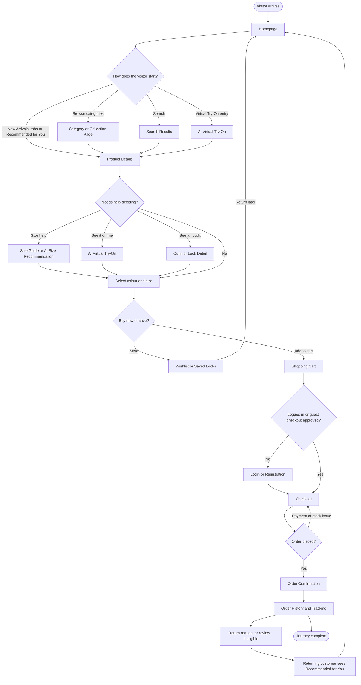

### 24.3 Homepage Navigation Flow

```mermaid
flowchart TD
    S(["Visitor enters Homepage"]) --> CK["Cookie and analytics consent choice"]
    CK --> TOP

    subgraph TOP["A. Top Section"]
        AB["1. Announcement Bar"]
        HN["2. Header and Navigation"]
        HB["3. Hero Banner"]
        WP["4. Try-On Welcome Popup"]
        SC["5. Shop by Category"]
    end

    subgraph DISC["B. Shopping and Product Discovery"]
        TF["6. AI Virtual Try-On Feature Section"]
        NA["7. New Arrivals"]
        TB["8. Trending, Best Sellers, Top Rated tabs"]
        SL["9. Shop the Look"]
        SO["10. Special Offers and Discounts"]
        SF["11. Seasonal and Featured Collection"]
        RY["12. Recommended for You"]
    end

    subgraph TRUST["C. Customer Experience and Trust"]
        RP["13. Real Customer Photos"]
        CR["14. Customer Reviews and Ratings"]
        WC["15. Why Choose Us"]
        DP["16. Delivery, Payment and Return Benefits"]
        BS["17. Featured Brands or Brand Story"]
    end

    subgraph ENG["D. Engagement and Footer"]
        NL["18. Newsletter Subscription"]
        IG["19. Instagram and Social Media Feed"]
        FQ["20. FAQ Section"]
        FT["21. Footer"]
    end

    TOP --> DISC --> TRUST --> ENG

    AB -->|"Optional link"| DEST1["Configured page"]
    HN --> CATP["Category or Collection Page"]
    HN --> SRCH["Search Results"]
    HN --> ACCT["Login or Customer Dashboard"]
    HN --> WISH["Wishlist"]
    HN --> CARTP["Shopping Cart"]
    HN --> TRYE["Try-On entry"]
    HB -->|"CTA"| DEST2["Collection, category, product or try-on"]
    WP -->|"Try it now"| TRYE
    WP -->|"Not now or close"| SUPP["Popup suppressed for configured period"]
    SC --> CATP
    TF --> TRYE
    TF -->|"Privacy link"| POL["Policy Pages"]
    NA --> PDP["Product Details"]
    NA -->|"View all"| NAP["New Arrivals page"]
    TB --> PDP
    SL --> LOOKP["Outfit or Look Detail"]
    SL -->|"Add items"| CARTP
    SO --> PDP
    SF --> COLP["Collection Page"]
    RY --> PDP
    RP --> PDP
    CR --> PDP
    DP --> POL
    BS --> ABT["Brand Story page - TBD"]
    NL --> NLC["Confirmation message"]
    IG --> EXT["Official social accounts"]
    FQ --> FAQP["Answers expand in place"]
    FT --> POL
    FT --> SUPP2["Contact and Support"]
    LOOKP --> PDP
    PDP --> E(["Customer continues to Product Details journey"])
```

### 24.4 Product Discovery Flow

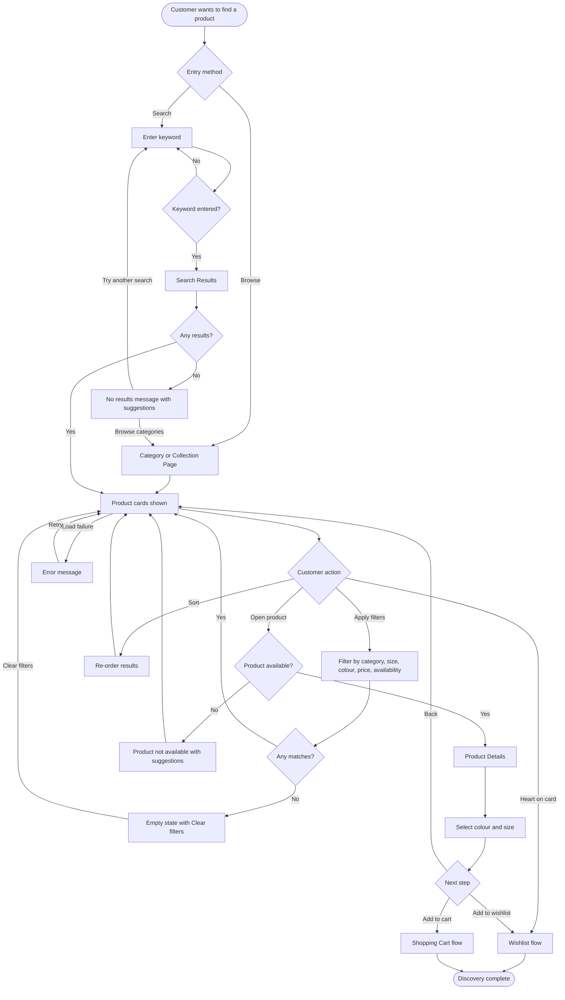

### 24.5 Product Purchase Flow

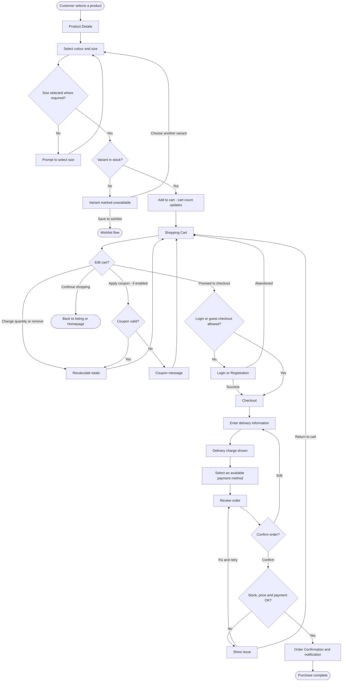

### 24.6 AI Virtual Try-On Flow

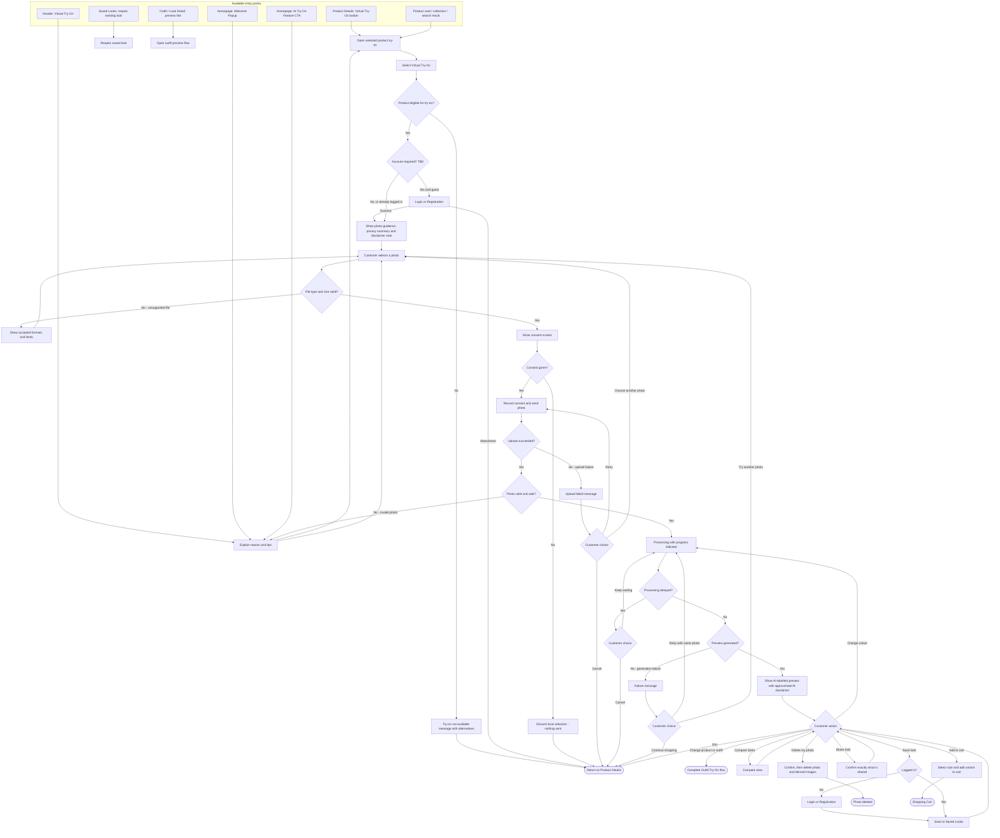

### 24.7 Complete Outfit Try-On Flow

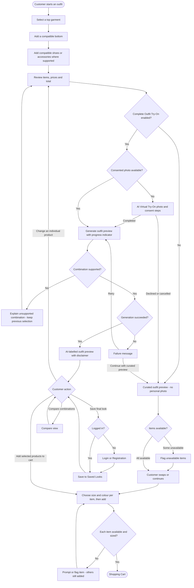

### 24.8 AI Size Recommendation Flow

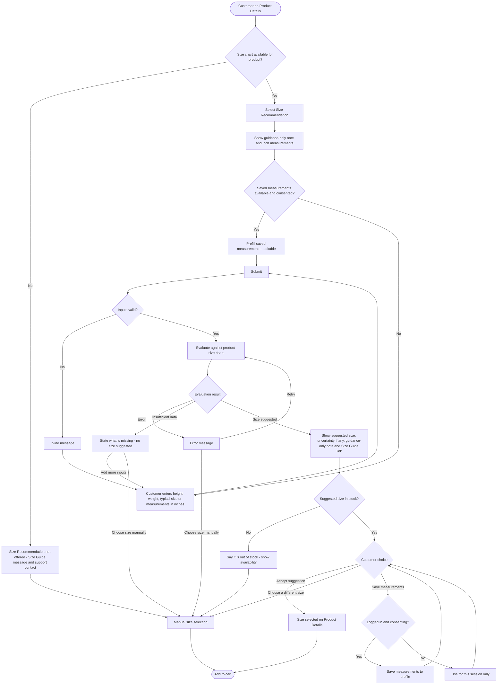

### 24.9 Authentication Flow

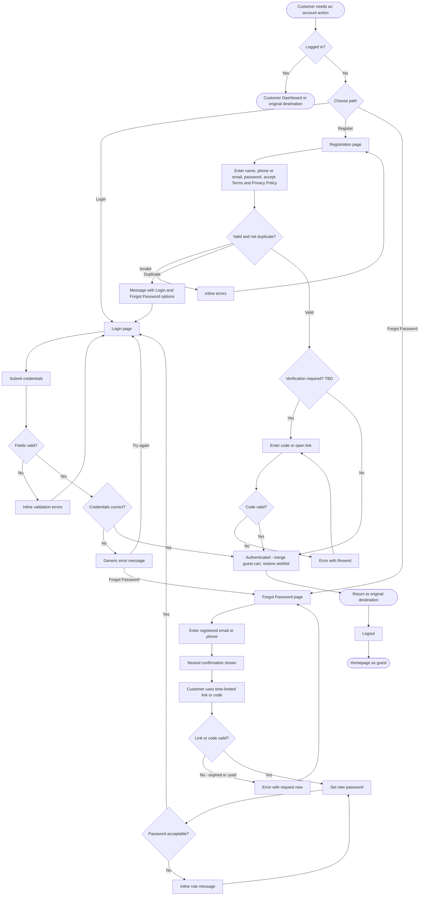

### 24.10 Checkout Flow

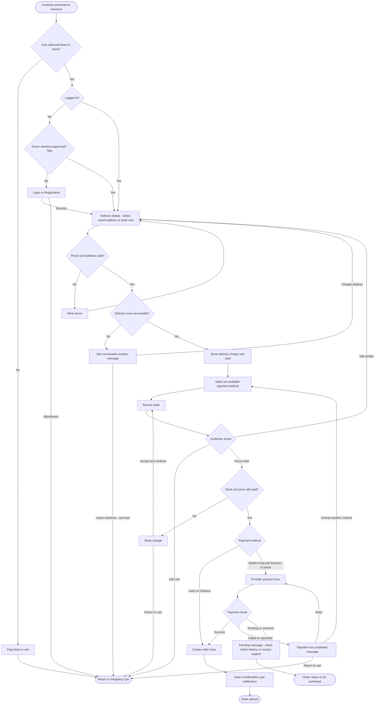

### 24.11 Wishlist Flow

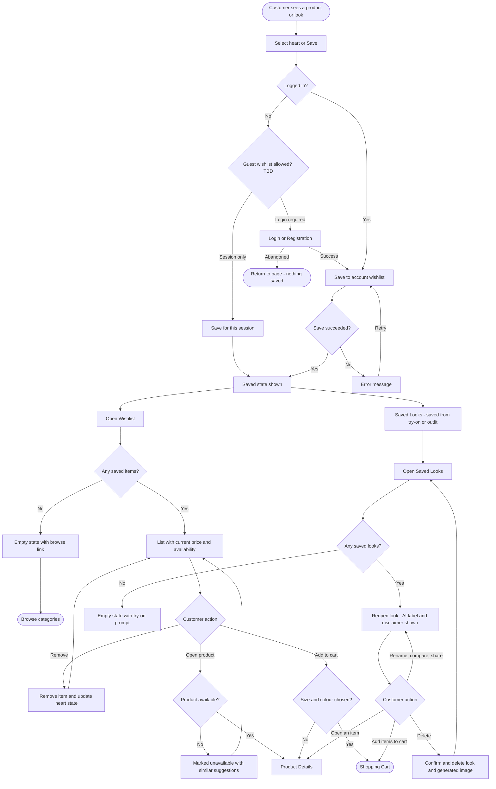

### 24.12 Order Tracking Flow (with Staff Status Update)

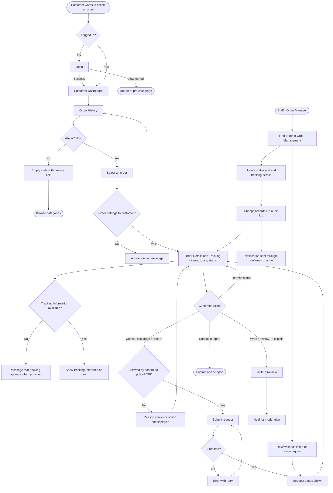

---

## 25. PRD Traceability

### 25.1 Flow-to-Requirement Matrix

| APP_FLOW Section | Journeys / Flows | Functional Requirements | Related NFR / BR |
|---|---|---|---|
| 6, 7 | Sitemap, navigation | FR-002, FR-055, FR-058, FR-076 | NFR-005, NFR-017 |
| 8 | Overall journey | All applicable customer-facing FRs | Applicable business rules (BRs) and cross-cutting requirements |
| 9 | Journey A: Homepage (21 sections) | FR-054 to FR-074 | NFR-001, NFR-007, NFR-019, BR-003, BR-004 |
| 10 | Journey B: Product Discovery | FR-001 to FR-005, FR-030 | NFR-004 |
| 11 | Product Details, variants, reviews | FR-006 to FR-014, FR-032, FR-033, FR-034 | BR-002, BR-009, BR-011, BR-016 |
| 12 | Journey D: AI Virtual Try-On | FR-035 to FR-041, FR-044 to FR-048, FR-053, FR-089 | NFR-003, NFR-010, NFR-012 to NFR-015, NFR-022, NFR-029, NFR-038 to NFR-040, BR-005, BR-007, BR-008, BR-013, BR-014, BR-018, BR-019 |
| 13 | Journey E: Outfit preview and Complete Outfit Try-On | FR-042, FR-043, FR-044, FR-046, FR-062 | BR-005, BR-014 |
| 14 | Journey F: AI Size Recommendation | FR-010, FR-049, FR-050 | NFR-014, BR-006, BR-016 |
| 15 | Journey G: Wishlist and Saved Looks | FR-030, FR-031, FR-045, FR-047 | BR-008, BR-018 |
| 16 | Journey H: Personalized Recommendations | FR-013, FR-051, FR-052, FR-065, FR-078 | NFR-032 |
| 17 | Journey C: Purchase; Cart and Checkout | FR-015 to FR-021, FR-029, FR-086, FR-090 | BR-001, BR-002, BR-004, BR-010, BR-015, NFR-024, NFR-030 |
| 18 | Journey I: Authentication | FR-025, FR-026, FR-027 | NFR-023, BR-013 |
| 19 | Journey J: Customer Account | FR-028, FR-029, FR-022, FR-023, FR-031, FR-052 | NFR-014, NFR-015 |
| 20 | Order management and Admin | FR-022, FR-023, FR-024, FR-079 to FR-089 | NFR-012, NFR-026, NFR-027, BR-020 |
| 21 | Journey K: Mobile | FR-055, FR-057, FR-061, FR-073 | NFR-005, NFR-007, NFR-017, NFR-019, BD-18 |
| 22, 23 | Errors and states | FR-048, FR-014, FR-019 | NFR-021, NFR-029 |

### 25.2 Coverage Checks Against the PRD

| PRD Item | Covered In |
|---|---|
| All 21 homepage sections | Section 9.1 (steps A2 to A16) and Section 9.2 (full link map); Diagram 24.3 |
| Seven AI features: Virtual Try-On, Personal Photo Upload, AI Outfit Preview, Complete Outfit Try-On, AI Size Recommendation, Wishlist and Saved Looks, Personalized Recommendations | Sections 12 (first two), 13 (Outfit Preview and Complete Outfit Try-On), 14, 15, 16 |
| 12-step PRD try-on customer journey | Section 12.3 (steps D1 to D17); Diagram 24.6 |
| E-commerce requirements (listing, categories, search, filters, sorting, details, gallery, colours, sizes, size guide, pricing, discounts, wishlist, cart, checkout, registration, login, profile, order confirmation, history, tracking, reviews, ratings, related products) | Sections 10, 11, 15, 17 to 20 |
| Bangladesh-specific requirements (BDT, phone format, addresses, Dhaka and outside-Dhaka delivery, COD, MFS, online payments, delivery charges, returns, inches, support, trust) | Sections 11.1, 14, 17.3, 17.4, 20, 22 |
| Roles: Visitor, Customer, admin roles | Section 5, 20.4 |
| Consent, privacy and deletion rules | Sections 12.3 (D6), 12.4, 19.1 (J9), 15.2 |
| Nine fashion categories | Section 7.2 |
| MVP versus future | Sections 4.2, 13.1, 16.1 |
| Failure and recovery paths for try-on | Sections 12.4, 22; Diagram 24.6 |

### 25.3 Items Proposed by This Document (Not Stated in the PRD)

These do not contradict the PRD. They are flow decisions needed to connect requirements, and they need approval.

| Item | Why Proposed | Reference |
|---|---|---|
| Customer Dashboard as an account hub page | PRD defines account capabilities but no hub page | AFQ-07 |
| Breadcrumb navigation | Useful for category and product orientation | AFQ-09 |
| Mobile bottom navigation | PRD requires a mobile navigation pattern only | AFQ-12 |
| Consent step placed after photo selection and before transmission | Reconciles the PRD journey order with FR-038 and BR-007 | AFQ-21 |
| Price-change handling at checkout | BR-002 requires price consistency; behaviour at change is undefined | AFQ-24 |
| "Page not found" state | Standard recovery path | AFQ-29 |
| Returning Customer treated as a registered customer with history | PRD defines no separate role | AFQ-01 |

### 25.4 PRD Requirements That Are Unclear or Need Decisions Before Flows Can Be Finalised

**Reference rule:** OQ-026 is retained only for guest wishlist behaviour as referenced in the source flow. Sharing and unsaved-result warning are tracked as AFQ-22 in this document; do not reuse OQ-026 for sharing. Confirm any additional PRD-level share question against the current PRD before assigning an OQ ID.

| PRD Requirement | Unclear Point | Effect on Flow | PRD Ref |
|---|---|---|---|
| FR-035, FR-038 (account requirement) | Is an account required to try on? | Section 12.2 shows both options | PRD Section 20, AFQ-04 |
| FR-016 | Is guest checkout allowed? | Checkout gating, order lookup | OQ-014 |
| FR-030 | Guest wishlist behaviour | Heart control flow for guests | OQ-026 |
| FR-019, FR-018 | Payment methods, delivery charges, timelines | Checkout steps 3 and 4 content | OQ-005 to OQ-007 |
| FR-024 | Return, exchange, cancellation policy | Return Request availability | OQ-008 |
| FR-025, FR-038 | Minors (ages 15 to 17) | Registration, guardian/age-verification policy, consent and try-on/photo-upload gating | OQ-009; launch blocker until approved |
| FR-026 | Verification method | Registration and recovery steps | OQ-015 |
| FR-036, FR-037 | Photo formats, limits, validation rules, camera capture, one upload per active session and reuse across eligible products | Try-on steps D4 to D7 | OQ-013, OQ-024 |
| FR-043 | Supported outfit combinations and feasibility | Section 13.2 availability | OQ-012 |
| FR-045 | Share method and link expiry | Try-on step D15 | AFQ-22 (share access and unsaved-result warning); confirm whether a separate PRD OQ applies |
| FR-047 | Active-session-only retention of original photo and unsaved previews; retention of explicitly saved generated images; deletion window | Photo deletion, session-end/expiry and Saved Look deletion states | OQ-013 |
| FR-049 | Required inputs and recommendation method | Size Recommendation inputs and result | OQ-020 |
| FR-051 | Signals used, style questionnaire | Personalised section behaviour | PRD Section 16.9 |
| FR-023 | Status names, courier integration | Order tracking display | OQ-006, OQ-022 |
| FR-057 | Popup display frequency | Homepage step A3 | OQ-037 |
| FR-077 | Bangla language | Language switch flow | OQ-010 |
| FR-060, FR-061 | Rules for "New", "Trending", "Best Seller" | Homepage section content | OQ-034 |
| BR-009 | Out-of-stock display | Listings and wishlist | OQ-035 |

---

## 26. Assumptions and TBD Decisions

### 26.1 Assumptions Used in This Document

| ID | Assumption | If Wrong |
|---|---|---|
| AS-01 | PRD.md v1.1 (Draft for Approval) is the current source of truth for scope and priorities. | Flows need review after PRD changes |
| AS-02 | Both try-on authentication options are possible; no default is chosen. | Section 12.2 reduced to one option |
| AS-03 | A photo is selected once per active try-on session; local format and size checks happen before consent, and the photo is not transmitted before consent. The same photo can be reused for multiple eligible products in that session. | Consent placement and server-side validation order change |
| AS-04 | Try-on eligibility is configured by staff per product (FR-053); the customer only sees try-on where enabled. | Entry-point logic changes |
| AS-05 | Curated outfits are the MVP outfit capability; AI-generated outfit suggestions are not in MVP. | Section 13 expands |
| AS-06 | Only confirmed payment methods, delivery details and policies are displayed (BR-004). | Checkout content changes |
| AS-07 | The website is responsive; mobile flows are the same journeys with mobile presentation (PRD C-01). | None |
| AS-08 | No AI model or provider is assumed; processing time, limits and quality are provider-dependent. | Try-on thresholds change |
| AS-09 | Administrator roles follow PRD Section 20. | Admin flows change |
| AS-10 | Notifications use whichever channels the business confirms (OQ-031). | Notification steps change |

### 26.2 New Open Questions Raised by This Document

All require business-owner or design-team approval. "Document default" is what the flows currently show. The under-18 policy (PRD OQ-009) is a launch blocker for any account creation or personal-photo processing by users aged 15–17.

| ID | Question | Document Default | Related |
|---|---|---|---|
| AFQ-01 | Should "Returning Customer" be a distinct role or just a registered customer with history? | Registered customer with history | Section 5 |
| AFQ-02 | If guest checkout is approved, how do guests view or track orders (for example, order number plus phone)? | Not defined; registered only | OQ-014, FR-023 |
| AFQ-03 | How is a guest cart merged with a saved cart on login? | Not defined | FR-015 |
| AFQ-04 | Is an account required to start Virtual Try-On? | Both authentication options shown; regardless of account status, the original photo and unsaved previews are active-session-only. Saving a generated look requires an account. | PRD Section 20 |
| AFQ-05 | Which features open as pages and which as overlays (Size Guide, Size Recommendation, Try-On, Look Detail)? Is the full header shown on Checkout? | Overlay for Size Guide and Size Recommendation; page for Try-On | Design phase |
| AFQ-06 | Is Special Offers a dedicated page or a filtered All Products view? | Dedicated page shown as PG-06; may be a filtered view | FR-063 |
| AFQ-07 | Is a Customer Dashboard hub page approved? | Yes, proposed | FR-028 |
| AFQ-08 | When Virtual Try-On is opened from the header with no product, how is a product chosen? | Customer is asked to pick an eligible product | FR-035 |
| AFQ-09 | Are breadcrumbs approved? | Yes, proposed | Section 7.3 |
| AFQ-10 | Does the wishlist store a chosen colour and size per item? | Stored where available | FR-030 |
| AFQ-11 | Does add-to-cart open a mini-cart or only update the count? | Count update with confirmation | FR-015 |
| AFQ-12 | Is a mobile bottom navigation approved, and which items? | Home, Shop, Virtual Try-On, Wishlist, Account | FR-055 |
| AFQ-13 | Is search scoped to a category when started inside one? | Store-wide | FR-003 |
| AFQ-14 | Is a default colour pre-selected, and is size left unselected? | Default colour, no default size | FR-008, FR-009 |
| AFQ-15 | What happens when a product has no size chart? | Size Recommendation not offered; support message | OQ-020 |
| AFQ-16 | Does try-on processing continue if the customer leaves the page or switches apps, and can they return to the result? | Not defined | FR-039, NFR-003 |
| AFQ-17 | Does a retry reuse the existing consent, and when is re-consent needed (new consent-text version)? | Reuse unless the version changed | FR-038 |
| AFQ-18 | When a photo is deleted, are saved looks generated from it also deleted? | Yes, with a warning | FR-047, FR-031 |
| AFQ-19 | How are uncertainty and "between sizes" results presented, and are alternatives shown when the suggestion is out of stock? | Explain uncertainty; show availability without implying fit | FR-049 |
| AFQ-20 | Where is the personalisation opt-out and reset control? | Profile Management and the section | FR-052 |
| AFQ-21 | Is consent placed after photo selection and before transmission? | Yes | FR-038, BR-007 |
| AFQ-22 | Does sharing require a saved look or account, and are customers warned about losing unsaved results? | Warned; share method TBD | FR-045 |
| AFQ-23 | Are quantity limits and "move to wishlist" from cart approved? | Limits TBD; move-to-wishlist only if approved | FR-015 |
| AFQ-24 | How are price or discount changes handled between cart and order placement? | Show change, require acceptance | BR-002 |
| AFQ-25 | How is an unknown payment status reconciled (MFS or online)? | Pending message; check Order History or contact support | FR-019 |
| AFQ-26 | Session length and remember-me? | Not defined | FR-026 |
| AFQ-27 | Does changing login phone or email require re-verification? | Possibly; TBD | FR-028 |
| AFQ-28 | Is a "My Reviews" list offered in the account? | Not included | FR-032 |
| AFQ-29 | Is a standard "Page not found" experience approved? | Yes, proposed | NFR-021 |

### 26.3 PRD Decisions That Block Finalisation of Specific Flows

| Flow | Blocking PRD Decisions |
|---|---|
| Checkout | OQ-005, OQ-006, OQ-007, OQ-014, BR-015 |
| Authentication | OQ-009, OQ-015 |
| Virtual Try-On | OQ-009, OQ-011, OQ-013, OQ-024, AFQ-04 |
| Complete Outfit Try-On | OQ-012 |
| Size Recommendation | OQ-020 |
| Order Tracking and Returns | OQ-006, OQ-008, OQ-022 |
| Homepage content rules | OQ-034, OQ-037, OQ-025, OQ-033 |
| Language | OQ-010 |

---
## Security & Authentication Flow

### 1. User Authentication Flow
Registration / Login
    ↓
Input Validation
    ↓
Credential Verification
    ↓
Authentication Success
    ↓
Create Secure Session
    ↓
Redirect to Authorized Page

Authentication Failure
    ↓
Display Safe Error Message
    ↓
Apply Login Attempt Protection

### 2. Authorization Flow
User Requests Protected Resource
    ↓
Verify Authentication
    ↓
Check User Role & Permissions
    ↓
Authorized?
    ├── Yes → Continue Request
    └── No → Deny Access

### 3. AI Virtual Try-On Secure Flow
User Selects Product
    ↓
Uploads Personal Photo
    ↓
Validate File Type & Size
    ↓
Display Privacy Notice
    ↓
User Confirms Processing
    ↓
Upload to Temporary Secure Storage
    ↓
Backend Sends Request to AI API
    ↓
Receive AI Result
    ↓
Display Result to User
    ↓
Delete Temporary Original Image

If Processing Fails:
    ↓
Delete Temporary Image
    ↓
Display Safe Error Message

### 4. Secure API Request Flow
Frontend Request
    ↓
Backend Authentication
    ↓
Authorization Check
    ↓
Input Validation
    ↓
Rate Limit Check
    ↓
Secure API Processing
    ↓
Return Safe Response

### 5. Secure Session & Logout Flow
User Activity
    ↓
Session Validity Check
    ↓
Session Expired?
    ├── Yes → Redirect to Login
    └── No → Continue

Logout
    ↓
Invalidate Session
    ↓
Clear Authentication Cookies
    ↓
Redirect to Login

*End of document — APP_FLOW.md v1.2 (Reviewed Draft)*
