# Development Roadmap (PLAN.md)
## Bangladesh Men's Fashion AI E-Commerce Platform

| Field | Detail |
|---|---|
| **Document** | PLAN.md |
| **Version** | 1.0 (Draft) |
| **Last Updated** | 6 November 2026 |
| **Source of truth** | `PRD.md`, `APP_FLOW.md`, `UI_SPEC.md` |
| **Companions** | `TRD.md` (architecture), `SCHEMA.md` (database), `COMPONENTS.md` (UI), `TESTING.md` (QA), `README.md` |

> **No dates or team sizes are given.** The PRD marks budget, timeline and team size as **TBD (OQ-029, C-05)**, so this plan uses **sequence and relative size** (S = days, M = 1–2 weeks, L = several weeks, for one developer) rather than a calendar. Convert to dates once the team and launch date are known.
>
> **Naming.** *MVP* = PRD "Release 1". *Phase 2* = PRD "Release 2". *Future* = PRD "Release 3" and beyond (PRD §24.4). MVP work is split into numbered **stages (M0–M12)** so a beginner can follow it in order.

---

## Table of Contents

1. How to Use This Plan (Beginner Guide)
2. Roadmap Overview
3. Launch Blockers (Decisions Needed from the Business)
4. MVP Stages M0–M12
5. Phase 2
6. Future Enhancements
7. Cross-Cutting Practices
8. Risk Watch-List
9. Master Checklist

---

## 1. How to Use This Plan (Beginner Guide)

1. **Work stage by stage.** Each stage lists *objectives, tasks, dependencies, deliverables and completion criteria*. Do not start a stage until its dependencies are complete.
2. **Build the shop first, AI second.** Revenue depends on browsing, checkout and trust (PRD §24.2). AI try-on is built after the core shop works, and the shop must keep working if AI fails (AP-6, NFR-029).
3. **Security is part of every stage**, not a final step. Each stage has a *Security tasks* line.
4. **Use the mock AI provider** during development (`TRD.md` §8.1). Never use real customer photos in development.
5. **Keep a definition of done** for every task: code written → tests written and passing → reviewed → documented → no secrets committed.
6. **Suggested learning order** for a beginner: Git basics → TypeScript → React/Next.js → Node/Express → SQL + Prisma → HTTP security basics (OWASP Top 10) → Docker basics → Playwright testing.
7. **When a requirement is TBD**, build it as *configuration* (feature flag or admin-managed setting) and move on (TRD §1 P7). Do not guess business policies (BR-004).

---

## 2. Roadmap Overview

```mermaid
gantt
    title Relative Sequence (not calendar dates)
    dateFormat  X
    axisFormat  %s
    section Prepare
    M0 Decisions and prerequisites      :m0, 0, 2
    M1 Environment and tooling          :m1, after m0, 2
    section Foundation
    M2 Database and backend foundation  :m2, after m1, 3
    M3 Authentication and authorization :m3, after m2, 3
    M4 Design system and frontend base  :m4, after m1, 3
    section Shop
    M5 Catalogue and product management :m5, after m3, 4
    M6 Cart, checkout and orders        :m6, after m5, 4
    M7 Account, wishlist, reviews, sizing :m7, after m6, 3
    section AI
    M8 AI Virtual Try-On (privacy pipeline) :m8, after m5, 5
    section Release
    M9 Security hardening               :m9, after m7, 2
    M10 Testing and QA                  :m10, after m9, 3
    M11 Deployment and launch           :m11, after m10, 2
    M12 Maintenance (ongoing)           :m12, after m11, 2
```

*Bars show order and rough relative size only. M4 can run in parallel with M2/M3, and M8 can start once the catalogue (M5) exists.*

### 2.1 Release Scope Summary

| Release | Scope (from PRD §24.3 and TRD §25) |
|---|---|
| **MVP (Release 1, Dhaka)** | Full storefront (all 21 homepage sections with fallbacks), nine categories, search/filter/sort, product pages, cart, checkout (confirmed payment methods, COD if confirmed), accounts, wishlist, **single-garment AI try-on pilot** with temporary photo processing, privacy controls, rule-based size recommendation (Should), curated outfits (Should), saved looks (Should), reviews (Should), admin back-office, security baseline |
| **Phase 2 (Release 2)** | MFS/online payments, try-on colour change, compare and share looks, reviews with photos, expanded rule-based personalisation, Bangla (if approved), customer-management and reporting polish |
| **Future (Release 3+)** | Complete outfit try-on (if feasible), AI outfit suggestions, ML size/fit and personalisation, nationwide logistics integration, video/AR try-on, native apps, loyalty, advanced analytics |

---

## 3. Launch Blockers (Decisions Needed from the Business)

These PRD/APP_FLOW open questions block specific work. Build around them with configuration until answered; **launch cannot happen** while any "Launch blocker" remains unresolved.

| Decision | PRD ref | Blocks | Launch blocker? | Interim technical default |
|---|---|---|:--:|---|
| Under-18 policy (registration, photos, parental consent) | OQ-009 | Try-on for ages 15–17 | **Yes** (for try-on) | Try-on only for users confirming 18+ (TA-01) |
| AI provider/model, budget, per-user limits | OQ-011, OQ-024 | M8 real integration | **Yes** (for try-on) | Mock provider; try-on feature flag off in production |
| Photo/result retention & consent wording | OQ-013, OQ-019 | Privacy notice, consent text | **Yes** | Per-request deletion; proposed TTLs (TA-10) |
| Legal review of privacy, consent, terms | OQ-019, D-06 | All policy pages | **Yes** | Placeholder policy pages are **not** published (FR-076) |
| Payment methods (COD / MFS / gateway) | OQ-007 | Checkout | **Yes** | COD adapter only if confirmed (TA-07) |
| Delivery partner, charges, timelines, zones | OQ-005/006 | Checkout, delivery info | **Yes** | Zones as admin config, no seeded amounts |
| Return / exchange / cancellation policy | OQ-008 | PG-26, policy pages | **Yes** | Request form hidden until approved |
| Size charts in inches for each product type | OQ-020, D-05 | Size guide/recommendation | **Yes** | Feature hidden where no chart |
| Product catalogue + photography incl. try-on-suitable garment images | D-04, D-13, A-02 | Launch content | **Yes** | Seed with synthetic demo data in dev only |
| Account verification method (OTP vs email) | OQ-015 | M3 | Yes | Adapter with email default |
| Guest checkout | OQ-014 | M6 | No | Disabled flag |
| Language (English only vs + Bangla) | OQ-010 | Content | No | English; i18n-ready |
| Notification channels | OQ-031 | M6 | Yes (≥1 channel) | Email |
| Product types per category | OQ-002 | Taxonomy | No | Free attribute |

---

## 4. MVP Stages

### Stage M0 — Decisions, Accounts and Prerequisites *(Size: S, mostly non-code)*

| | |
|---|---|
| **Objectives** | Remove blockers that would cause rework; agree on the technical stack and working rules. |
| **Tasks** | 1. Review `TRD.md` assumptions (TA-01…TA-18) and conflicts (C-1…C-4) with the business owner; record approvals. 2. Confirm age policy approach (C-1) and the try-on account requirement (TA-03). 3. Start **AI provider evaluation** using TRD §8.2 criteria with real (consenting-volunteer) test photos in a sandbox — never customer data. 4. Request legal review of consent text and privacy notice. 5. Collect business inputs: catalogue, images, size charts, delivery partner/charges, payment methods, policies (Section 3). 6. Register accounts: domain, git hosting, cloud/hosting, object storage, email/SMS provider, error monitoring, secret manager. 7. Decide team roles (who reviews code, who owns security, who approves content). |
| **Dependencies** | Business owner availability. |
| **Deliverables** | Signed-off assumption register; blocker tracker; provider shortlist; account list stored in a password manager (never in the repo). |
| **Completion criteria** | Every item in Section 3 has an owner and a due date; the stack in `TRD.md` §4 is approved or amended. |
| **Security tasks** | Create a password manager vault and enable MFA on every account created (git, cloud, DNS, registrar). |

### Stage M1 — Environment and Tool Setup *(Size: S)*

| | |
|---|---|
| **Objectives** | A repeatable development environment so every developer runs the same thing. |
| **Tasks** | 1. Install Node.js LTS, Git, Docker Desktop, VS Code (ESLint, Prettier, Prisma, Tailwind extensions). 2. Create the monorepo: `apps/web`, `apps/api`, `packages/shared` (Zod schemas/types), `docs/`. 3. Place the six documents plus PRD/APP_FLOW/UI_SPEC in `docs/`. 4. Initialise TypeScript, ESLint, Prettier, commit hooks (lint, type-check, **secret scan**). 5. Write `docker-compose.yml`: PostgreSQL, Redis, S3-compatible local storage, (mock AI is code, not a container). 6. Create `.env.example` for each app (placeholders only, per `TRD.md` §13); add `.env*` to `.gitignore`. 7. Set up CI: install → lint → type-check → unit tests → dependency audit → secret scan. 8. Adopt Git workflow: `main` protected, feature branches, pull requests with at least one review, conventional commit messages. 9. Create `README` quick start and verify a fresh clone can run in under 30 minutes. |
| **Dependencies** | M0 accounts. |
| **Deliverables** | Running skeleton (web shows a page, API answers `/healthz`), CI pipeline green, `.env.example`, contribution rules. |
| **Completion criteria** | A new developer can clone, copy `.env.example` → `.env`, run `docker compose up` and `npm run dev`, and see both apps; CI fails when a fake secret is committed (test it). |
| **Security tasks** | Branch protection; secret scanning in CI and pre-commit; dependabot/renovate for updates. |

### Stage M2 — Database and Backend Foundation *(Size: M)*

| | |
|---|---|
| **Objectives** | Implement the schema and the API skeleton with security middleware in place from day one. |
| **Tasks** | 1. Translate `SCHEMA.md` into `prisma/schema.prisma`; add raw SQL migrations for CHECK constraints, partial indexes, `pg_trgm`, `tsvector`. 2. Create DB roles (`app_rw`, `migrator`, `reporting_ro`); make `audit_logs` insert-only. 3. Write seed scripts: nine categories, delivery-zone *structure* (no amounts), sample **synthetic** products for development. 4. Build typed config loader (Zod) that fails fast. 5. Build the middleware chain: request ID, `helmet` headers, CORS allow-list, rate limiter (Redis), body-size limits, validator, central error handler, `pino` logger with redaction (`TRD.md` §6.2, §19, §20). 6. Create module folders and the route-registry test ("every route has an auth policy"). 7. Add `/healthz` and `/readyz`. 8. Create provider adapter interfaces (`StorageProvider`, `NotificationProvider`, `TryOnProvider`, `PaymentProvider`) with **mock** implementations. 9. Generate OpenAPI docs from Zod schemas. |
| **Dependencies** | M1. |
| **Deliverables** | Migrated database; API skeleton with middleware; mock providers; seed data; OpenAPI document. |
| **Completion criteria** | Migrations apply to an empty DB and roll forward cleanly; constraints reject invalid data in tests (negative stock, bad phone, bad rating); response bodies contain only DTO fields; error responses contain no stack traces; logs show redacted secrets. |
| **Security tasks** | Parameterised queries only (ban `$queryRawUnsafe` via lint); DB reachable only from local app network; verify headers with an automated test. |

### Stage M3 — Authentication and Authorization *(Size: M)*

| | |
|---|---|
| **Objectives** | Secure customer and staff identity before any private data exists. |
| **Tasks** | 1. Customer registration, login, logout (FR-025, 026) with Argon2id, Bangladesh phone normalisation, duplicate handling, terms acceptance record. 2. Verification flow via `NotificationProvider` (email link and/or OTP; OQ-015). 3. Password recovery with neutral responses, hashed single-use tokens, session revocation (FR-027). 4. Server-side sessions (hashed token, cookie flags, rotation, idle/absolute expiry, logout). 5. CSRF protection (token + Origin check). 6. Brute-force protection: per-account/IP throttling, lockout, generic error messages. 7. RBAC: permission map from PRD §20.2, `requirePermission()` middleware, ownership checks, 404 for foreign resources. 8. Staff login at a separate endpoint with **TOTP MFA**, short sessions, Super-Admin-only staff creation; bootstrap first Super Admin via a one-time CLI command. 9. `consent_records` API (grant/withdraw) and `age_status` confirmation. 10. Audit-log writer and security-event logging. |
| **Dependencies** | M2. |
| **Deliverables** | Working register/login/logout/reset/verify; admin login with MFA; RBAC middleware; consent API; audit logging. |
| **Completion criteria** | All auth test cases in `TESTING.md` §8–9 pass; no password/token ever appears in logs or responses; a customer session cannot call any `/admin` route; IDOR tests return 404; brute-force test triggers throttling. |
| **Security tasks** | Cookie flags verified; session fixation test; account-enumeration test; MFA enforced for all staff in staging/production. |

### Stage M4 — Design System and Frontend Foundation *(Size: M; parallel with M2/M3)*

| | |
|---|---|
| **Objectives** | Encode the existing UI_SPEC/Figma design as reusable components — no redesign. |
| **Tasks** | 1. Configure Tailwind with the exact token mapping in UI_SPEC §13.1 (colours, fonts, radii); add shadows, spacing, breakpoints (320/768/1024). 2. Load fonts with `next/font`; add Lucide icons. 3. Build core components per `COMPONENTS.md`: buttons, inputs, selects, badges, toasts, modal/drawer, skeletons, accordion, pagination. 4. Build global layout: announcement bar, navbar (desktop + mobile drawer + mobile bottom bar), footer, search overlay, cookie-consent banner. 5. Build page templates: Listing, Collection (with `theme_key` palettes), PDP, Form page, Account hub, Admin shell. 6. Set up component workbench (Storybook or equivalent) to review states (default/hover/focus/disabled/loading/error). 7. Create `lib/format` (৳ currency, dates `Asia/Dhaka`), phone helpers, API client with CSRF header. 8. Build the "Page not found" and "Something went wrong" pages (AFQ-29). 9. Run an accessibility check (axe) on the component workbench. |
| **Dependencies** | M1 (UI_SPEC and Figma available). |
| **Deliverables** | Component library, templates, tokens; visual match with Figma for reviewed components. |
| **Completion criteria** | Design review confirms token/colour parity with UI_SPEC §3; every component has documented states and keyboard behaviour; touch targets ≥ 44 px; no horizontal overflow at 320 px. |
| **Security tasks** | Lint rule against `dangerouslySetInnerHTML`; CSP nonce wiring in Next.js; confirm no secrets in `NEXT_PUBLIC_*`. |

### Stage M5 — Catalogue, Product Management and Browsing *(Size: L)*

| | |
|---|---|
| **Objectives** | Staff can manage products; customers can find and evaluate them. |
| **Tasks** | **Admin:** 1. Product CRUD with variants (colour × size), images (alt text required), categories, size chart, scheduled discounts, publish/unpublish, `tryon_eligible` flags (FR-079, 053). 2. Inventory screen (FR-080). 3. Image upload pipeline for products (type check, re-encode, resize, WebP/AVIF) to the public bucket. 4. Size chart editor with inch validation. 5. Content management: homepage sections, banners, announcement, FAQ, policy pages with versioning (FR-083). **Storefront:** 6. Homepage with all 21 sections and defined fallbacks (no fabricated reviews/photos). 7. All Products, Category and Collection pages with filters, sorting, pagination, result count (FR-001–005). 8. Search with suggestions, empty/no-result states. 9. PDP: gallery, colour swatches, size selector, size guide overlay, price/discount, availability, related products (FR-006–014). 10. Special Offers, New Arrivals pages. 11. SEO: titles, meta, structured product data, sitemap (NFR-036). 12. Performance pass: image sizing, caching, LCP checks. |
| **Dependencies** | M3 (admin auth), M4 (components). |
| **Deliverables** | Admin catalogue and content tools; complete browsing experience with real/seeded data. |
| **Completion criteria** | Acceptance criteria of FR-001–014 and FR-054–074 (MVP-priority items) pass; unpublished products never appear; out-of-stock variants cannot be selected; sale price reverts automatically at `sale_ends_at`; staff changes appear without developer help (NFR-037). |
| **Security tasks** | Sanitise CMS content on write and render; admin image upload tests (malicious files); audit log entries for price/stock/content changes. |

### Stage M6 — Cart, Checkout, Orders and Delivery *(Size: L)*

| | |
|---|---|
| **Objectives** | A trustworthy, duplicate-safe purchase flow for Dhaka. |
| **Tasks** | 1. Cart API and UI (guest cookie cart + persistent customer cart; merge on login per AFQ-03 default). 2. Delivery zones admin (FR-086) and `GET /delivery/quote`; serviceability messaging at address entry (BD-4). 3. Checkout UI: Bangladesh address form (division → district → thana), phone validation, payment method radio cards showing **only enabled methods**, order review (UI_SPEC §7.6, §11). 4. `POST /orders` in one transaction: re-price from DB, stock decrement, promotion check, idempotency key, status history, notification (FR-017–021, NFR-030). 5. Price-change handling between cart and placement (AFQ-24). 6. Order confirmation, order history, order details with tracking reference/status (FR-021–023). 7. Admin order management: search by number/phone/date, status updates, tracking number, cancellations (FR-081). 8. Coupons/promotions admin and cart application (FR-020, 084; one promotion per order). 9. Transactional email/SMS via adapter (FR-090). 10. COD payment record (if confirmed); payment adapter stubs for Phase 2. 11. Return/exchange request flow, **hidden until policy approved** (FR-024). |
| **Dependencies** | M5. |
| **Deliverables** | End-to-end order placement and fulfilment tracking. |
| **Completion criteria** | FR-015–024 MVP acceptance criteria pass; double-click/retry creates exactly one order; two concurrent buyers of the last unit → one succeeds, one gets a clear message; totals always equal subtotal − discount + delivery; a customer cannot view another's order. |
| **Security tasks** | Server-side price authority tests; idempotency tests; webhook signature skeleton for Phase 2; rate limit on `POST /orders`. |

### Stage M7 — Account, Wishlist, Reviews, Outfits, Sizing, Recommendations *(Size: M–L)*

| | |
|---|---|
| **Objectives** | Complete the account and engagement features at the priorities set by the PRD. |
| **Tasks** | 1. Customer dashboard, profile editing, address book, **Privacy Centre** (consent list, withdraw consent, delete try-on data, delete saved measurements, delete account request) (FR-028, 047, AFQ-07). 2. Wishlist (FR-030) with current price/availability and unavailable states. 3. Reviews & ratings with moderation queue and aggregate fields (FR-032, 033, 085) — "Verified purchase" only when backend confirms. 4. Curated outfits (Shop the Look) with live totals and add-to-cart (FR-042, 062). 5. **Size recommendation module** (rule-based on size charts, inches, "insufficient data" state, guidance-only disclaimer, separate from try-on) (FR-049, 050). Measurements saved only with consent and encrypted. 6. Rule-based recommendations with fallback and opt-out/reset (FR-051, 052). 7. Newsletter subscription with opt-in record (FR-071). 8. Admin: customer view (limited), review moderation, basic reports (FR-082, 085, 087). 9. Cookie/analytics consent honouring (FR-078). |
| **Dependencies** | M6. |
| **Deliverables** | Full account area and engagement features. |
| **Completion criteria** | Acceptance criteria for FR-028–033, FR-042, FR-049–052, FR-062 pass; opt-out immediately removes personalisation; size recommendation works without any photo; empty states show next actions with no fabricated data. |
| **Security tasks** | Review text escaping tests; ownership tests on wishlist/addresses/looks; measurement encryption verified. |

### Stage M8 — AI Virtual Try-On (Single-Garment Pilot) *(Size: L)*

| | |
|---|---|
| **Objectives** | Deliver the differentiator with the privacy guarantees: temporary processing and verified deletion. |
| **Tasks** | **8A — Pipeline with mock provider** 1. `GET /tryon/config` (limits, eligibility, flags). 2. Consent endpoint integration and consent text versioning from `content_blocks` (CR-1–5). 3. Upload endpoint: auth, CSRF, rate limits, age/consent/eligibility checks, size cap, magic-byte check, decode, pixel limit, re-encode and **EXIF strip**, content-screening hook (TRD §9.3). 4. Private bucket + lifecycle rule; temp storage layout. 5. BullMQ queue and **worker**; job state machine; `tryon_jobs` metadata; timeouts and circuit breaker. 6. **Layered deletion:** worker `finally`, failure hook, sweeper, lifecycle backstop; `input_deleted_at` evidence; DB CHECK that finished jobs hold no input key. 7. Result delivery via short-lived signed URL, `Cache-Control: no-store`. 8. "Delete my try-on data" and consent-withdrawal cleanup. 9. Per-user/hour/day limits; `FEATURE_TRYON_ENABLED` kill switch. 10. Admin: eligibility toggles and AI usage monitoring (counts, failures, cost units — no photos) (FR-053, 089). **8B — Frontend** 11. Try-on page per UI_SPEC §6: guidance card, upload zone, local preview and checks, consent panel (unchecked by default; CTA disabled until consent + valid photo), progress state, result with "AI-Generated Visual Preview" badge and mandatory disclaimer, size-guide link, add-to-cart, error states, delete-photo control, privacy notice explaining **temporary handling**. 12. Entry points: PDP, header pill, homepage section/popup, mobile bottom bar (FR-035). 13. Ineligible-product and limit-reached states. 14. Save Look (reference-only or opt-in generated image) (FR-031). **8C — Real provider** 15. Implement the chosen provider adapter; verify its retention/training terms; set timeouts/concurrency; store the key only in the secret manager; run the quality evaluation on agreed test garments/photos (NFR-040). 16. Update privacy notice with provider-accurate wording (legal approved). |
| **Dependencies** | M5 (eligible products and garment images), M3 (consent, sessions), M7 Privacy Centre; **provider selection (M0)** for 8C. |
| **Deliverables** | End-to-end try-on on mock provider (8A/8B); real provider integration (8C) once approved; deletion verification job. |
| **Completion criteria** | Acceptance criteria FR-035–040, 046–048, 053 pass; **no job can start without a consent record**; after every outcome (success, failure, cancel, crash simulation) **no `tmp/` source object remains** (automated check); photo never appears in logs, DB, CDN or Redis; AI outage leaves the whole shop working; disclaimers present on every preview; kill switch tested. |
| **Security tasks** | Malicious-file test suite; signed-URL expiry test; ownership test on jobs/results; secret not present in client bundle; rate-limit and cost-abuse tests; provider egress allow-list. |

### Stage M9 — Security Hardening *(Size: M)*

| | |
|---|---|
| **Objectives** | Verify and strengthen controls across the whole system before formal testing. |
| **Tasks** | 1. Review the OWASP Top 10 mapping (`TRD.md` §26) item by item and fix gaps. 2. Finalise CSP, HSTS and all headers in staging; run header scanners. 3. Dependency and container vulnerability scans; update packages. 4. Secrets audit: repo history scan, client-bundle scan, environment review; rotate any key ever exposed. 5. Run the API key **revocation drill** (TRD §12.2 #6). 6. Review all `requirePermission`/ownership checks via the route-registry test. 7. Review logging for PII/secret leakage; confirm redaction. 8. Enforce MFA for all staff; review admin session timeouts. 9. Rate-limit tuning (TA-11) with load tool. 10. Backup + restore drill (NFR-028). 11. Prepare incident-response runbook and security contact. |
| **Dependencies** | M3–M8 feature-complete. |
| **Deliverables** | Security review report; fixed findings; runbooks. |
| **Completion criteria** | No open High/Critical findings; header, cookie and CSP checks pass; restore drill succeeded; revocation drill documented. |

### Stage M10 — Testing and Quality Assurance *(Size: L)*

| | |
|---|---|
| **Objectives** | Execute `TESTING.md` fully and meet its acceptance criteria. |
| **Tasks** | 1. Complete unit, integration, API and component tests (coverage targets in `TESTING.md`). 2. Playwright end-to-end suites: browse → cart → checkout; register/login; wishlist; try-on (mock); admin flows. 3. Authentication/authorization/security test suites (SQLi, XSS, CSRF, brute force, upload attacks, IDOR, session, leakage). 4. **Customer photo deletion verification** suite. 5. Responsive tests (320/375/768/1024/1280+), cross-browser (Chrome, Safari, Firefox, Edge, Samsung Internet), low-bandwidth profile (NFR-007). 6. Accessibility audit (WCAG 2.1 AA; keyboard; screen reader spot checks). 7. Performance and load tests incl. seasonal-peak simulation and AI-queue burst. 8. AI quality evaluation per NFR-040. 9. External or independent penetration test (recommended). 10. Bug triage using the process in `TESTING.md`; fix and retest. |
| **Dependencies** | M9. |
| **Deliverables** | Test reports, defect log, sign-off record, pre-deployment checklist completed. |
| **Completion criteria** | All **Must Have** acceptance criteria pass; zero open Critical/High defects; pre-deployment checklist in `TESTING.md` ticked and signed. |

### Stage M11 — Deployment and Launch *(Size: M)*

| | |
|---|---|
| **Objectives** | Release safely to Dhaka customers with the ability to roll back. |
| **Tasks** | 1. Provision production: managed PostgreSQL + Redis, buckets (public + private with lifecycle), CDN/WAF, containers, secret manager, DNS, TLS (TRD §22). 2. Configure CI/CD with staging → manual approval → production, one-command rollback. 3. Load production configuration/flags: enable only confirmed payment methods, approved policies, correct delivery zones; keep try-on flag **off** until the provider and legal items are signed off, then enable for the pilot product set. 4. Import real catalogue; remove all demo data. 5. Monitoring, alerts, uptime checks, log shipping, backups running. 6. Staff training (products, orders, content, moderation, privacy requests). 7. Soft launch to a limited audience; monitor errors, conversion, try-on failures/cost. 8. Go-live communication; support channels staffed (BD-14). 9. Post-launch review after the first period (KPIs per PRD §29 once targets are set, OQ-023). |
| **Dependencies** | M10; all launch blockers (Section 3) closed. |
| **Deliverables** | Live production site; runbooks; trained staff. |
| **Completion criteria** | Go-live checklist signed; smoke tests pass in production; rollback rehearsed; alerts firing correctly in a test. |

### Stage M12 — Maintenance and Operations *(Ongoing)*

| Area | Routine |
|---|---|
| **Security patching** | Weekly dependency/container scan; apply critical patches promptly; monthly full update cycle |
| **Secrets** | Scheduled key rotation; immediate rotation on suspicion; review who has access quarterly |
| **Monitoring** | Daily dashboard check: errors, latency, queue depth, try-on success/failure/cost; storage TTL violation alert must be zero |
| **Privacy** | Honour deletion requests within the agreed window; periodic review of retention settings and provider terms; re-run deletion verification monthly |
| **Backups** | Verify daily; restore drill each quarter |
| **Content & catalogue** | Staff keep policies, FAQ, collections, stock current; review/moderation queue SLA |
| **Performance** | Monthly Lighthouse/RUM review; image optimisation; DB slow-query review; index review |
| **Cost control** | Weekly AI spend review; adjust limits (OQ-024) |
| **Support** | Triage bugs with the process in `TESTING.md`; maintain a changelog |
| **Quality** | Re-evaluate try-on quality when garment types or provider models change |
| **Compliance** | Re-run legal review when features or providers change |

---

## 5. Phase 2 (PRD Release 2)

| Stage | Items | Dependencies | Completion criteria |
|---|---|---|---|
| **P2-A Payments** | MFS and online gateway adapters, hosted payment pages, **signature-verified webhooks**, amount verification, reconciliation job for unknown payment states (AFQ-25), refunds workflow | Provider contracts (OQ-007), legal/compliance review | Paid status set only after server-side verification; webhook replay rejected; no card data stored; failed payment returns to checkout with cart intact |
| **P2-B Try-On enhancements** | Colour change (FR-041), compare looks (FR-044), share looks via private revocable expiring links (FR-045), quality tuning, prompt/provider improvements | Stable M8 pilot metrics | Sharing needs explicit confirmation; revocation works instantly; disclaimer on shared view; still no source-photo storage |
| **P2-C Reviews with photos** | `review_photos`, public-display permission, moderation, removal (FR-034) | Upload pipeline reuse | Photos unpublished until approved; separate privacy notice |
| **P2-D Personalisation** | Consent-gated behavioural signals, expanded rules, opt-out parity (FR-051/052) | Analytics consent (FR-078) | Opt-out immediately removes personalisation |
| **P2-E Language** | Bangla content and language switch if approved (OQ-010, FR-077) | Content translation | Bangla renders correctly (Hind Siliguri), switch persists |
| **P2-F Operations** | Customer-management polish, richer reports (FR-087), AI monitoring dashboards, editable role matrix if needed, Postgres RLS defence-in-depth | M12 data | Reports reconcile with orders; staff see only permitted data |
| **P2-G Scaling** | Autoscaling tuned from load data, read replica if needed, CDN tuning | Production metrics | Meets NFR-001/008 under peak simulation |

*Each Phase 2 stage repeats the mini-cycle: design review → build → tests (extend `TESTING.md`) → security review → staged release.*

---

## 6. Future Enhancements (PRD §25; Release 3+)

| Item | Gate before starting |
|---|---|
| Complete outfit try-on (multi-garment) | Feasibility study passes (OQ-012); provider supports it; separate cost model; reuse the same temporary-processing guarantees |
| AI-generated outfit suggestions | Tagged catalogue and quality evaluation |
| ML size/fit prediction | Sufficient order/return data and consent |
| Advanced personalisation | Data volume and consent framework |
| Video / live AR try-on | Technology maturity and cost; new privacy review (camera streams) |
| Courier API and nationwide logistics | Partner agreements (OQ-022); zones enabled via existing configuration |
| Dedicated search engine | Search latency or relevance targets missed on Postgres |
| Native mobile apps | Business case; token-based auth design |
| Loyalty and rewards, BNPL/instalments, social commerce, marketplace, physical store integration, advanced analytics | Business decisions (PRD §25) |

Rule for every Future item: **update PRD → APP_FLOW → UI_SPEC first**, then add to `TRD.md`/`SCHEMA.md`, then build.

---

## 7. Cross-Cutting Practices

| Practice | Rule |
|---|---|
| **Definition of Done** | Meets acceptance criteria; tests written; accessibility checked; security checklist item ticked; docs updated; reviewed; deployed to staging |
| **Code review** | Every PR reviewed; reviewer checks authorization, validation, logging, and secret handling |
| **Branching & releases** | Short-lived branches; semantic versions; changelog; tagged releases |
| **Feature flags** | Guest checkout, language switch, try-on, payments, saved-look images, outfit try-on — all behind configuration (UI_SPEC §14) |
| **Documentation** | Update the relevant doc in the same PR as a behaviour change; record new assumptions with IDs |
| **Design fidelity** | UI changes validated against Figma and UI_SPEC §12 (no arbitrary colours; collection pages change only background tint and accent) |
| **Data hygiene** | No production data in dev/staging; no real customer photos outside production processing |
| **Estimation** | Re-estimate after M2 and M5 using actual velocity; update timeline once OQ-029 is answered |

---

## 8. Risk Watch-List

| Risk | Impact | Mitigation in plan |
|---|---|---|
| AI provider quality/cost/retention unacceptable (PRD risks A-01) | Try-on pilot delayed or reduced | Early evaluation in M0; adapter pattern; mock provider; feature flag; reduce eligible garment set |
| Legal approval late (OQ-019, OQ-009) | Try-on cannot launch | Run legal review in parallel from M0; try-on flag off at launch if needed — shop still launches (AP-5) |
| Catalogue/size-chart data late (D-04, D-05) | Weak launch content | Start data collection in M0; hide features without data |
| Payment/delivery decisions late | Checkout blocked | Configurable zones and payment adapters; COD-first |
| Scope creep into Phase 2 | Delay | Keep Phase 2/Future gates in Sections 5–6 |
| Peak-season traffic | Checkout degradation | Load tests in M10; CDN caching; autoscaling |
| Beginner mistakes in security-critical code | Vulnerabilities | Code review rules, route-registry test, OWASP mapping, penetration test |
| Key leakage | Financial/privacy loss | Secret scanning, backend-only keys, revocation drill, spend alerts |

---

## 9. Master Checklist

- [ ] M0 Decisions and blockers tracked with owners
- [ ] M1 Environment reproducible; CI green; secret scan active
- [ ] M2 Schema migrated; middleware chain; mock providers
- [ ] M3 Auth, sessions, CSRF, RBAC, admin MFA, consent API
- [ ] M4 Design system and templates match UI_SPEC/Figma
- [ ] M5 Catalogue, content admin, browsing, PDP, search
- [ ] M6 Cart, checkout, orders, delivery, notifications
- [ ] M7 Account, privacy centre, wishlist, reviews, sizing, recommendations
- [ ] M8 Try-on pipeline: consent → temp upload → job → result → **verified deletion**
- [ ] M9 Security hardening and drills complete
- [ ] M10 All test suites pass; defects closed; checklist signed
- [ ] M11 Production live; monitoring and backups verified
- [ ] M12 Maintenance calendar running
- [ ] Phase 2 and Future backlog groomed and gated

*End of document — PLAN.md v1.0 (Draft)*
