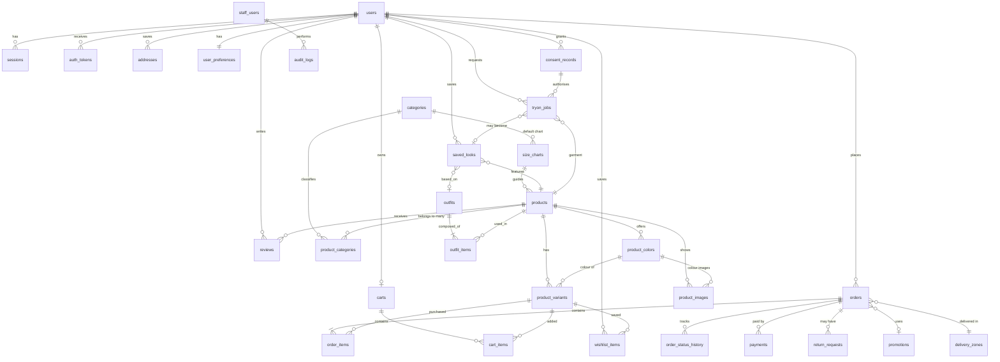

# Database Schema Documentation (SCHEMA.md)
## Bangladesh Men's Fashion AI E-Commerce Platform

| Field | Detail |
|---|---|
| **Document** | SCHEMA.md |
| **Version** | 1.0 (Draft for technical review) |
| **Last Updated** | 6 November 2026 |
| **Source of truth** | `PRD.md`, `APP_FLOW.md`, `UI_SPEC.md`; technical decisions from `TRD.md` |
| **Database** | PostgreSQL (accessed through Prisma) |

> **Key privacy rule.** The database stores **no customer photo bytes and no permanent reference to a customer's uploaded photo.** Table `tryon_jobs` holds *processing metadata only*. Temporary image files live in private object storage and are deleted after processing (`TRD.md` §8–9). An optional generated image may be kept only for a look the customer **explicitly saves**, with an expiry (`TRD.md` §9.5). Assumption IDs (TA-xx, C-x) refer to `TRD.md` §2.

---

## Table of Contents

1. Database Selection and Justification
2. Conventions
3. Entity Relationship Overview
4. Identity, Access and Consent
5. Catalogue
6. Cart, Delivery, Promotions, Orders and Payments
7. Wishlist, Reviews, Outfits and Saved Looks
8. AI Try-On Processing Metadata
9. Content and Marketing
10. Audit Log
11. Indexing Strategy
12. Data Validation Rules
13. Database Security and Sensitive Data Protection
14. Data Retention and Deletion Policy
15. Temporary Storage vs Permanent Business Data
16. Tables Intentionally Not Created
17. Table Release Matrix (MVP / Phase 2 / Future)
18. Requirement Traceability

---

## 1. Database Selection and Justification

**Choice: PostgreSQL** (single primary database).

| Need (source) | Why PostgreSQL fits |
|---|---|
| Orders, payments, stock must be correct and never duplicated (NFR-030, FR-080, FR-021) | Full ACID transactions, row-level locking, unique constraints |
| Strong relationships: products ↔ categories ↔ variants ↔ orders (FR-002, FR-008, FR-009) | Foreign keys with enforced integrity |
| Multi-category products and variant combinations | Join tables + composite unique constraints |
| Flexible, semi-structured data: size charts, homepage sections, FAQ (FR-010, FR-083) | `JSONB` columns with validation, without needing a second database |
| Keyword search over product name/category/colour (FR-003) | Built-in full-text search and `pg_trgm` for typo-tolerant matching (TA-17) |
| Bangla and English text (NFR-034) | Native UTF-8 storage and collation |
| Auditability and reporting (NFR-027, FR-087) | Mature SQL, read replicas and read-only roles available |
| Security (NFR-013, NFR-025) | TLS, encryption at rest (managed services), role-based DB permissions, parameterised queries |
| Small team, low ops burden | Widely supported managed offerings, strong beginner documentation |

**Why not a NoSQL document database?** Order totals, stock levels and payment status need multi-record transactions and relational integrity. A document store would push that integrity into application code, increasing the risk of overselling and inconsistent orders.

**Redis is not a system of record.** Rate-limit counters, queue entries and caches can be lost without losing business data (`TRD.md` §3.2).

---

## 2. Conventions

| Item | Convention |
|---|---|
| Naming | `snake_case` tables (plural) and columns |
| Primary keys | `id UUID` (`gen_random_uuid()`); non-guessable, safe to expose in URLs |
| Timestamps | `created_at`, `updated_at` as `timestamptz` (UTC); displayed in `Asia/Dhaka` |
| Soft delete | `deleted_at timestamptz NULL` **only** where history matters (products, users pending deletion). Personal data deletion is **hard delete or anonymisation**, not soft delete |
| Money | `NUMERIC(12,2)` BDT (TA-15); never floating point |
| Enumerations | `text` with `CHECK` constraints (easier to evolve than native enums); allowed values listed per table |
| Measurements | Inches (BR-016, BD-13) |
| Phone numbers | Normalised `+8801XXXXXXXXX` (BD-2) |
| Text | NFC-normalised Unicode |
| Foreign keys | Declared with explicit `ON DELETE` behaviour (listed per table) |
| Release tags | **[M]** MVP · **[P2]** Phase 2 · **[F]** Future |

---

## 3. Entity Relationship Overview



Graphical summary of domains:

| Domain | Tables |
|---|---|
| Identity & privacy | `users`, `staff_users`, `sessions`, `auth_tokens`, `addresses`, `user_preferences`, `consent_records` |
| Catalogue | `categories`, `products`, `product_categories`, `product_colors`, `product_variants`, `product_images`, `size_charts` |
| Commerce | `carts`, `cart_items`, `delivery_zones`, `promotions`, `orders`, `order_items`, `order_status_history`, `payments`, `return_requests` |
| Engagement | `wishlist_items`, `reviews`, `outfits`, `outfit_items`, `saved_looks` |
| AI | `tryon_jobs` |
| Content & ops | `content_blocks`, `newsletter_subscribers`, `audit_logs` |

**Total: 31 tables.** Each maps to a PRD/APP_FLOW requirement (Section 18); no table exists "just in case" (Section 16).

---

## 4. Identity, Access and Consent

### 4.1 `users` — customer accounts [M]
*FR-025–028, BD-2, TA-01, TA-04*

| Column | Type | Constraints / Notes |
|---|---|---|
| `id` | uuid | PK |
| `full_name` | text | NOT NULL, 1–100 chars |
| `email` | citext | UNIQUE (partial: where not null), lower-cased |
| `phone` | text | UNIQUE (partial: where not null); normalised `+8801[3-9]XXXXXXXX`; CHECK format |
| `email_verified_at` | timestamptz | NULL until verified (OQ-015) |
| `phone_verified_at` | timestamptz | NULL until verified |
| `password_hash` | text | NOT NULL; Argon2id string (includes salt/params). **Never returned by any API** |
| `age_status` | text | CHECK in (`unconfirmed`,`adult_confirmed`,`minor_policy_approved`); default `unconfirmed`. Drives the try-on age gate (TA-01). `minor_policy_approved` is unused until OQ-009 is decided |
| `terms_accepted_at` / `terms_version` | timestamptz / text | NOT NULL; FR-025 policy acceptance record |
| `status` | text | CHECK in (`active`,`locked`,`pending_deletion`); default `active` |
| `failed_login_count` / `locked_until` | int / timestamptz | Secondary brute-force record (primary counters in Redis) |
| `deletion_requested_at` | timestamptz | NULL unless an erasure request is pending (FR-028, OQ-019) |
| `created_at`, `updated_at` | timestamptz | |

CHECK: at least one of `email`, `phone` is NOT NULL.

### 4.2 `staff_users` — administrators [M]
*FR-088, NFR-026, PRD §20, TA-18*

Separate from `users` so customer accounts can never be elevated by a data change, and so admin authentication has its own lifecycle.

| Column | Type | Notes |
|---|---|---|
| `id` | uuid | PK |
| `full_name`, `email` | text, citext | `email` UNIQUE |
| `password_hash` | text | Argon2id |
| `role` | text | CHECK in (`super_admin`,`catalogue_manager`,`order_manager`,`content_manager`,`support_agent`,`analyst`). Mirrors PRD §20.1; final list pending OQ-036 |
| `mfa_secret_enc` | bytea | TOTP secret, **encrypted** with `FIELD_ENCRYPTION_KEY`; NULL until enrolled |
| `mfa_enabled` | boolean | Default false; enforced true in production |
| `status` | text | CHECK in (`active`,`disabled`) |
| `last_login_at` | timestamptz | |
| `created_by` | uuid | FK → `staff_users.id` (the creating Super Admin) |

**Role management.** Permissions are defined in code (`TRD.md` §10.3) rather than in extra `roles`/`permissions` tables. This keeps the model simple, makes the permission map reviewable in pull requests, and avoids the possibility of editing permissions through SQL injection or a data-entry mistake. If staff-editable permission matrices are ever required (PRD UI_SPEC AD-11 role editor), add `roles` and `role_permissions` in Phase 2.

### 4.3 `sessions` — server-side sessions [M]
*TRD §11*

| Column | Type | Notes |
|---|---|---|
| `id` | uuid | PK |
| `token_hash` | bytea | **SHA-256 of the session token**; the raw token exists only in the cookie. UNIQUE |
| `subject_type` | text | CHECK in (`customer`,`staff`) |
| `user_id` | uuid | FK → `users.id` ON DELETE CASCADE (customer) |
| `staff_user_id` | uuid | FK → `staff_users.id` ON DELETE CASCADE (staff). CHECK exactly one of the two is set |
| `csrf_secret_hash` | bytea | Per-session CSRF material (hashed) |
| `created_at`, `last_seen_at`, `expires_at`, `absolute_expires_at` | timestamptz | Idle + absolute timeouts (TA-08) |
| `revoked_at` | timestamptz | Logout / password change / admin revoke |
| `ip_hash`, `user_agent_hash` | bytea | Hashed (not raw) for anomaly signals |

### 4.4 `auth_tokens` — verification, OTP and reset tokens [M]
*FR-025, FR-027*

| Column | Type | Notes |
|---|---|---|
| `id` | uuid | PK |
| `user_id` | uuid | FK → `users` ON DELETE CASCADE |
| `purpose` | text | CHECK in (`email_verify`,`phone_otp`,`password_reset`) |
| `token_hash` | bytea | Hash of the code/link token; **never store the raw value** |
| `expires_at` | timestamptz | Short-lived |
| `used_at` | timestamptz | Single use |
| `attempts` | smallint | Max attempts enforced (TRD §17) |

One table serves all three purposes to avoid duplication.

### 4.5 `addresses` — address book [M, Should]
*FR-017, FR-029, BD-3, UI_SPEC §11.3*

| Column | Type | Notes |
|---|---|---|
| `id` | uuid | PK |
| `user_id` | uuid | FK → `users` ON DELETE CASCADE |
| `recipient_name` | text | NOT NULL |
| `phone` | text | Normalised BD mobile; CHECK format |
| `division`, `district`, `thana_upazila` | text | From controlled lists (UI_SPEC §11.3) |
| `address_line` | text | House/road/block/village, ≤ 300 chars |
| `landmark`, `postal_code` | text | Optional |
| `is_default` | boolean | At most one default per user (partial unique index) |

Orders **copy** the address into the order row (Section 6.5) so later edits never alter past orders (FR-029 acceptance).

### 4.6 `user_preferences` [M]
*FR-051, FR-052, FR-028, NFR-014, TA-16*

| Column | Type | Notes |
|---|---|---|
| `user_id` | uuid | PK, FK → `users` ON DELETE CASCADE |
| `style_preferences` | jsonb | Optional categories/styles/colours (validated schema) |
| `personalisation_enabled` | boolean | Default true; opt-out/reset (FR-052). Reset clears `style_preferences` |
| `marketing_email`, `marketing_sms` | boolean | Default false; backed by `consent_records` |
| `measurements_enc` | bytea | **Optional, field-encrypted** JSON (height, weight, chest, waist, etc. in inches). Stored **only** when the customer consents (NFR-014); NULL otherwise |
| `measurements_updated_at` | timestamptz | |
| `preferred_language` | text | Default `en` (TA-12) |

### 4.7 `consent_records` [M]
*CR-1–CR-6, FR-038, NFR-031, FR-078*

Append-only log of every consent event.

```sql
CREATE TABLE consent_records (
  id              uuid PRIMARY KEY DEFAULT gen_random_uuid(),
  user_id         uuid NOT NULL REFERENCES users(id) ON DELETE CASCADE,
  consent_type    text NOT NULL CHECK (consent_type IN (
                    'tryon_photo_processing',     -- required for try-on (BR-007)
                    'tryon_secondary_use',        -- optional, off by default (CR-5, BR-008)
                    'measurements_storage',       -- NFR-014
                    'marketing_email','marketing_sms',
                    'analytics_cookies','personalisation')),
  text_version    text NOT NULL,                  -- version of consent wording shown (CR-3)
  granted         boolean NOT NULL,               -- true = granted, false = withdrawn/declined
  created_at      timestamptz NOT NULL DEFAULT now(),
  source          text NOT NULL DEFAULT 'web'     -- e.g., tryon_page, profile_privacy
);
```

- **Never updated or deleted** while the account exists; withdrawal inserts a new row with `granted=false`. Current state = latest row per `(user_id, consent_type)`.
- Stores **no IP address or device fingerprint** (data minimisation). If a legal review requires one, add a hashed value.
- `tryon_jobs.consent_id` references the exact consent used for each job.
- Anonymous cookie-consent choices are held in the browser; they enter this table only for logged-in users.

---

## 5. Catalogue

### 5.1 `categories` [M]
*FR-002, PRD §12, OQ-004*

| Column | Type | Notes |
|---|---|---|
| `id` | uuid | PK |
| `slug` | text | UNIQUE, `^[a-z0-9-]+$` |
| `name` | text | NOT NULL |
| `kind` | text | CHECK in (`style`,`collection`). Style: the 7 categories. Collection: Seasonal, Premium (cross-cutting) |
| `description` | text | |
| `theme_key` | text | Optional page-palette key (`panjabi`,`old_money`,`streetwear`) used by the collection template (UI_SPEC §3.2). Stores a **key**, not colours |
| `sort_order` | int | Navigation ordering |
| `is_active` | boolean | |

Seed data: the nine categories listed in PRD §12 (Panjabi & Traditional Wear, Western Wear, Casual Wear, Old Money Fashion, Streetwear, Formal Wear, Smart Casual; collections: Seasonal Collections, Premium Collections). Product types (shirts, trousers, etc.) are **TBD (OQ-002)** and are therefore not modelled as a fixed table; `products.product_type` is a free, validated text attribute until decided.

### 5.2 `products` [M]
*FR-001, FR-006, FR-011, FR-012, FR-053, FR-079*

| Column | Type | Notes |
|---|---|---|
| `id` | uuid | PK |
| `slug` | text | UNIQUE |
| `sku` | text | UNIQUE (parent SKU) |
| `name` | text | NOT NULL |
| `description` | text | Sanitised (TRD §16) |
| `material_care` | text | Optional (FR-006) |
| `product_type` | text | Optional until OQ-002 resolved |
| `base_price` | numeric(12,2) | CHECK ≥ 0 |
| `sale_price` | numeric(12,2) | NULL when not discounted; CHECK `sale_price < base_price` |
| `sale_starts_at`, `sale_ends_at` | timestamptz | Scheduled discount; expired discounts revert automatically because the **effective price is computed from these dates** (FR-012) |
| `size_chart_id` | uuid | FK → `size_charts` ON DELETE SET NULL |
| `tryon_eligible` | boolean | Default false (FR-053). Must be false unless required source assets are approved (UI_SPEC AD-02) |
| `tryon_garment_class` | text | CHECK in (`upper`,`lower`,`full`,`traditional`) or NULL; maps to the AI adapter class |
| `badge` | text | Optional curated badge key (e.g., `premium`); "Sale" and "Try-On Ready" badges are derived, not stored |
| `status` | text | CHECK in (`draft`,`published`,`archived`) (FR-079) |
| `published_at`, `deleted_at` | timestamptz | |
| `search_vector` | tsvector | Generated from name, description, product_type, category names, colour names |
| `rating_count`, `rating_avg` | int, numeric(3,2) | **Denormalised aggregates** from approved reviews, updated transactionally (FR-033). NULL average when count = 0 → UI shows "No ratings yet" |
| `created_at`, `updated_at` | timestamptz | |

> Price examples in UI_SPEC are formatting samples only; production data comes from this table (UI_SPEC §4.9).

### 5.3 `product_categories` [M]
Join table for multi-category assignment (FR-002).

| Column | Notes |
|---|---|
| `product_id` FK → `products` ON DELETE CASCADE | Composite PK `(product_id, category_id)` |
| `category_id` FK → `categories` ON DELETE RESTRICT | |
| `sort_order` | Per-category ordering (e.g., featured first) |

### 5.4 `product_colors` [M]
*FR-008, UI_SPEC §7.3*

| Column | Type | Notes |
|---|---|---|
| `id` | uuid | PK |
| `product_id` | uuid | FK → `products` ON DELETE CASCADE |
| `name` | text | e.g., "Royal Maroon" (tooltip text) |
| `hex` | text | CHECK `^#[0-9A-Fa-f]{6}$` — swatch display |
| `tryon_supported` | boolean | Colour-level try-on eligibility (FR-041, FR-053) |
| `sort_order` | int | |

UNIQUE `(product_id, name)`.

### 5.5 `product_variants` [M]
*FR-009, FR-014, FR-080, BR-009, OQ-021*

One row per purchasable **colour × size** combination. Stock is tracked here.

```sql
CREATE TABLE product_variants (
  id            uuid PRIMARY KEY DEFAULT gen_random_uuid(),
  product_id    uuid NOT NULL REFERENCES products(id) ON DELETE CASCADE,
  color_id      uuid REFERENCES product_colors(id) ON DELETE RESTRICT,  -- NULL if product has no colour options
  size_label    text,                                                    -- e.g., 'M'; NULL if sizes don't apply
  sku           text NOT NULL UNIQUE,
  stock_qty     integer NOT NULL DEFAULT 0 CHECK (stock_qty >= 0),       -- never negative
  price_override numeric(12,2) CHECK (price_override IS NULL OR price_override >= 0),
  is_active     boolean NOT NULL DEFAULT true,
  created_at    timestamptz NOT NULL DEFAULT now(),
  updated_at    timestamptz NOT NULL DEFAULT now(),
  UNIQUE (product_id, color_id, size_label)
);
```

- Size labels are **not hardcoded** (UI_SPEC §6.5): whatever the business defines per product.
- `CHECK (stock_qty >= 0)` plus atomic `UPDATE … SET stock_qty = stock_qty - :q WHERE stock_qty >= :q` prevents overselling under concurrent orders.
- The inventory model (single warehouse vs multiple locations / pre-order, OQ-021) is assumed to be **single location**; multi-location would add an `inventory_levels` table in a later phase.
- Out-of-stock display policy (OQ-035) is a UI/query decision; data supports both.

### 5.6 `product_images` [M]
*FR-007, FR-008*

| Column | Type | Notes |
|---|---|---|
| `id` | uuid | PK |
| `product_id` | uuid | FK → `products` ON DELETE CASCADE |
| `color_id` | uuid | FK → `product_colors` ON DELETE SET NULL; NULL = applies to all colours |
| `storage_key` | text | Key in the **public** bucket (never a customer file) |
| `alt_text` | text | NOT NULL — accessibility (NFR-018, UI_SPEC §10.3) |
| `width`, `height` | int | Enables `3:4` layout without shift |
| `is_primary` | boolean | One primary per product (partial unique index) |
| `purpose` | text | CHECK in (`gallery`,`tryon_source`). `tryon_source` marks the garment image supplied to the AI adapter (assumption A-02) |
| `sort_order` | int | |

### 5.7 `size_charts` [M]
*FR-010, FR-049, BR-016, OQ-020*

| Column | Type | Notes |
|---|---|---|
| `id` | uuid | PK |
| `name` | text | e.g., "Panjabi chart" |
| `category_id` | uuid | Optional FK → `categories` (default chart for a category) |
| `unit` | text | CHECK = `'in'` (inches only, BR-016) |
| `chart_data` | jsonb | Validated structure: `{ sizes: [{label, chest:[min,max], waist:[min,max], length, shoulder, ...}] }` in inches |
| `how_to_measure` | text | Guidance text (FR-010) |

JSONB is used because garment types need different measurement columns; the application validates structure (Zod) on write. The rule-based size recommendation reads these ranges. A product without a chart means "Size Recommendation not offered" (AFQ-15).

---

## 6. Cart, Delivery, Promotions, Orders and Payments

### 6.1 `carts` and `cart_items` [M]
*FR-015, AFQ-03*

| `carts` column | Notes |
|---|---|
| `id` uuid PK | |
| `user_id` uuid | FK → `users` ON DELETE CASCADE; UNIQUE (one active cart per customer); NULL for guest carts |
| `guest_token_hash` bytea | UNIQUE; hash of guest cart cookie; NULL for user carts |
| `updated_at`, `expires_at` | Guest carts expire (e.g., 30 days, configurable) |

| `cart_items` column | Notes |
|---|---|
| `id` uuid PK | |
| `cart_id` | FK → `carts` ON DELETE CASCADE |
| `variant_id` | FK → `product_variants` ON DELETE CASCADE |
| `quantity` | smallint CHECK 1–10 (limit TBD, AFQ-23) |
| UNIQUE `(cart_id, variant_id)` | |

**No price columns** in cart tables: prices are always read live (BR-002, AFQ-24 requires showing changes before order placement).

### 6.2 `delivery_zones` [M]
*FR-086, BD-4–BD-8, OQ-005*

| Column | Type | Notes |
|---|---|---|
| `id` | uuid | PK |
| `name` | text | e.g., "Dhaka", "Outside Dhaka" (values configurable) |
| `matching_rules` | jsonb | Divisions/districts/thanas the zone covers (validated) |
| `charge` | numeric(12,2) | **Business-supplied (TBD)**; no default amount is seeded (BR-004) |
| `estimated_days_text` | text | NULL until business confirms (BD-8) |
| `is_active` | boolean | Inactive zone blocks ordering with a clear message |
| `sort_order` | int | |

### 6.3 `promotions` [M]
*FR-012 (campaign), FR-020, FR-084, BR-010, OQ-016*

| Column | Type | Notes |
|---|---|---|
| `id` | uuid | PK |
| `name` | text | |
| `code` | citext | UNIQUE, nullable (NULL = automatic campaign; non-null = coupon) |
| `discount_type` | text | CHECK in (`percent`,`fixed`) |
| `discount_value` | numeric(12,2) | CHECK > 0 (percent ≤ 100) |
| `starts_at`, `ends_at` | timestamptz | Scheduled activation/expiry |
| `min_order_amount` | numeric(12,2) | Optional |
| `usage_limit_total`, `usage_limit_per_user` | int | Optional |
| `used_count` | int | Incremented transactionally at order placement |
| `is_active` | boolean | |
| `created_by` | uuid | FK → `staff_users` |

Until OQ-016 is decided, **one promotion per order** (BR-010 proposed default) is enforced in code. Per-user usage is counted from `orders.promotion_id`, avoiding a separate redemptions table.

### 6.4 `orders` [M]
*FR-017–FR-023, FR-021, NFR-030, TA-05, TA-14*

```sql
CREATE TABLE orders (
  id                uuid PRIMARY KEY DEFAULT gen_random_uuid(),
  order_number      text NOT NULL UNIQUE,                 -- human-friendly, non-sequential-guessable
  user_id           uuid REFERENCES users(id) ON DELETE SET NULL,   -- NULL only if guest checkout enabled / user deleted
  guest_phone       text,                                  -- guest lookup (order no. + phone), only when TA-05 enabled
  idempotency_key   text NOT NULL,                         -- prevents duplicate orders (FR-021)
  status            text NOT NULL DEFAULT 'pending' CHECK (status IN
                      ('pending','confirmed','processing','shipped','delivered',
                       'cancelled','return_requested','returned')),         -- proposed set (TA-14)
  payment_method    text NOT NULL,                         -- validated against enabled methods (BR-004)
  payment_status    text NOT NULL DEFAULT 'unpaid' CHECK (payment_status IN
                      ('unpaid','pending','paid','failed','refunded')),
  -- address SNAPSHOT (copied, so later edits never alter past orders)
  ship_name         text NOT NULL,
  ship_phone        text NOT NULL,
  ship_division     text NOT NULL,
  ship_district     text NOT NULL,
  ship_thana        text NOT NULL,
  ship_address      text NOT NULL,
  ship_landmark     text,
  ship_postal_code  text,
  delivery_zone_id  uuid NOT NULL REFERENCES delivery_zones(id),
  promotion_id      uuid REFERENCES promotions(id),
  subtotal          numeric(12,2) NOT NULL CHECK (subtotal >= 0),
  discount_total    numeric(12,2) NOT NULL DEFAULT 0 CHECK (discount_total >= 0),
  delivery_charge   numeric(12,2) NOT NULL CHECK (delivery_charge >= 0),
  total             numeric(12,2) NOT NULL CHECK (total >= 0),
  tracking_reference text,                                 -- manual in MVP (OQ-022)
  customer_note     text,
  placed_at         timestamptz NOT NULL DEFAULT now(),
  updated_at        timestamptz NOT NULL DEFAULT now(),
  UNIQUE (user_id, idempotency_key),
  CHECK (total = subtotal - discount_total + delivery_charge)
);
```

Orders are **business records** and are kept for the legally required period (TBD). When a customer is erased, the order row is **anonymised** (name/phone/address replaced), not deleted (Section 14).

### 6.5 `order_items` [M]

| Column | Notes |
|---|---|
| `id` uuid PK | |
| `order_id` | FK → `orders` ON DELETE CASCADE |
| `variant_id` | FK → `product_variants` ON DELETE SET NULL (keeps history if a variant is later removed) |
| `product_name`, `variant_description`, `sku` | **Snapshots** (name, "Maroon / M", SKU) |
| `unit_price` | numeric(12,2) — **price charged at the time** (snapshot) |
| `quantity` | smallint CHECK > 0 |
| `line_total` | numeric(12,2); CHECK `= unit_price * quantity` |

### 6.6 `order_status_history` [M]
*FR-023, FR-081, NFR-027*

| Column | Notes |
|---|---|
| `id`, `order_id` FK ON DELETE CASCADE | |
| `from_status`, `to_status` | text |
| `changed_by_staff_id` | FK → `staff_users` ON DELETE SET NULL; NULL for system/customer cancel |
| `note` | text (internal) |
| `created_at` | timestamptz |

Gives the customer's tracking timeline and staff accountability.

### 6.7 `payments` [M for COD record · P2 for gateways]
*FR-019, NFR-024, PRD Security §7*

| Column | Type | Notes |
|---|---|---|
| `id` | uuid | PK |
| `order_id` | uuid | FK → `orders` ON DELETE CASCADE |
| `method` | text | `cod`, or provider key (Phase 2) |
| `provider` | text | NULL for COD |
| `provider_reference` | text | Provider transaction ID; UNIQUE per provider |
| `amount` | numeric(12,2) | Amount reported/verified |
| `currency` | char(3) | CHECK = `'BDT'` |
| `status` | text | CHECK in (`initiated`,`pending`,`succeeded`,`failed`,`cancelled`,`refunded`) |
| `verified_at` | timestamptz | Set only after server-side verification / signed webhook |
| `raw_event_hash` | bytea | Hash of last webhook payload for replay detection (**no card data is ever stored**) |
| `created_at`, `updated_at` | timestamptz | |

### 6.8 `return_requests` [M, Should]
*FR-024, OQ-008*

| Column | Notes |
|---|---|
| `id`, `order_id` (FK CASCADE), `order_item_id` (FK, nullable) | |
| `request_type` | CHECK in (`cancellation`,`exchange`,`return`) |
| `reason` | text, length-limited |
| `status` | CHECK in (`submitted`,`under_review`,`approved`,`rejected`,`completed`) |
| `handled_by_staff_id` | FK → `staff_users` ON DELETE SET NULL |
| `created_at`, `updated_at` | |

Eligibility rules are policy-driven (TBD); no evidence-upload column exists until approved (UI_SPEC PG-26).

---

## 7. Wishlist, Reviews, Outfits and Saved Looks

### 7.1 `wishlist_items` [M]
*FR-030, AFQ-10*

| Column | Notes |
|---|---|
| `id` uuid PK | |
| `user_id` | FK → `users` ON DELETE CASCADE |
| `product_id` | FK → `products` ON DELETE CASCADE |
| `color_id`, `variant_id` | Optional FKs (SET NULL) — store chosen colour/size "where available" |
| `created_at` | |
| UNIQUE `(user_id, product_id)` | One entry per product |

No price column: current price/availability is shown, not the historical price (UI_SPEC PG-13). Guest wishlist persistence is TBD (OQ-026) and, if allowed, is client-side only.

### 7.2 `reviews` [M, Should]
*FR-032, FR-033, FR-085, BR-011, OQ-017, UI_SPEC PG-27*

| Column | Type | Notes |
|---|---|---|
| `id` | uuid | PK |
| `product_id` | uuid | FK → `products` ON DELETE CASCADE |
| `user_id` | uuid | FK → `users` ON DELETE SET NULL (review may remain, author anonymised, per policy) |
| `order_item_id` | uuid | FK → `order_items`, nullable. Set when eligibility is "purchased/delivered"; **"Verified purchase" label is shown only if this is set and validated by the backend** (UI_SPEC PG-27) |
| `rating` | smallint | CHECK 1–5 |
| `title` | text | ≤ 100 chars |
| `body` | text | Plain text only, ≤ 2,000 chars |
| `status` | text | CHECK in (`pending`,`approved`,`rejected`,`removed`); default `pending` (BR-011) |
| `moderated_by_staff_id`, `moderated_at`, `moderation_reason` | | |
| `created_at` | timestamptz | |

UNIQUE `(user_id, product_id)` (one review per product per customer, an assumption; relax if the business decides otherwise).
**Customer review photos (FR-034, Could Have) are Phase 2** and would add `review_photos` with a public-display permission flag — not created now (Section 16).

### 7.3 `outfits` and `outfit_items` [M, Should]
*FR-042, FR-062 — staff-curated looks ("Shop the Look")*

| `outfits` column | Notes |
|---|---|
| `id`, `slug` (UNIQUE), `name`, `description` | |
| `cover_image_key` | Public bucket key |
| `is_active`, `sort_order` | |
| `created_by` | FK → `staff_users` |

| `outfit_items` column | Notes |
|---|---|
| `outfit_id` FK CASCADE, `product_id` FK RESTRICT | Composite PK `(outfit_id, product_id)` |
| `role` | Optional label (`top`,`bottom`,`footwear`,`accessory`) |
| `swap_group` | Optional — allows "swap items where allowed" (FR-042) |
| `sort_order` | |

Totals are computed live from current product prices (FR-042 acceptance). AI-generated outfits are Future; the same tables can hold them if approved.

### 7.4 `saved_looks` [M, Should]
*FR-031, FR-045, AFQ-18, TRD §9.5*

| Column | Type | Notes |
|---|---|---|
| `id` | uuid | PK |
| `user_id` | uuid | FK → `users` ON DELETE CASCADE |
| `name` | text | Customer-renamable (FR-031) |
| `product_id` | uuid | FK → `products`; the featured garment |
| `color_id` | uuid | FK → `product_colors` ON DELETE SET NULL |
| `outfit_id` | uuid | FK → `outfits` ON DELETE SET NULL; optional |
| `image_storage_key` | text | **NULL by default.** Set only if the customer clicks **Save Look** *and* `SAVED_LOOKS_STORE_IMAGE=true`. Points to the **generated** image in the private bucket (`saved-looks/…`). **Never the original uploaded photo** |
| `image_expires_at` | timestamptz | NOT NULL when `image_storage_key` is set (TA-10: default 30 days) |
| `share_token_hash` | bytea | **[P2]** UNIQUE; hash of private share token (FR-045); NULL = not shared |
| `share_expires_at`, `share_revoked_at` | timestamptz | **[P2]** Sharing is explicit, expiring and revocable |
| `created_at` | timestamptz | |

When `image_storage_key` is NULL the look is a *reference look* (product + colour [+ outfit]) that can be regenerated on request. This is the most privacy-protective configuration and the system default decision pending business/legal confirmation.

---

## 8. AI Try-On Processing Metadata

### 8.1 `tryon_jobs` [M]
*FR-039, FR-047, FR-048, FR-089, NFR-010, NFR-038, TRD §8*

**This table stores metadata about processing — never image content.**

```sql
CREATE TABLE tryon_jobs (
  id                 uuid PRIMARY KEY DEFAULT gen_random_uuid(),
  user_id            uuid NOT NULL REFERENCES users(id) ON DELETE CASCADE,   -- NOT NULL: account required (TA-03)
  consent_id         uuid NOT NULL REFERENCES consent_records(id),           -- the exact consent that authorised this job (BR-007)
  product_id         uuid NOT NULL REFERENCES products(id),
  color_id           uuid REFERENCES product_colors(id) ON DELETE SET NULL,
  status             text NOT NULL DEFAULT 'queued' CHECK (status IN
                       ('queued','processing','succeeded','failed','cancelled','expired','deleted')),
  error_code         text CHECK (error_code IN (
                       'INVALID_IMAGE','UNSAFE_CONTENT','PROVIDER_TIMEOUT','PROVIDER_REJECTED',
                       'PROVIDER_UNAVAILABLE','LIMIT_REACHED','CANCELLED','INTERNAL')),   -- safe, non-descriptive codes
  provider           text,                                    -- adapter name only, e.g. 'mock'
  provider_ref       text,                                    -- provider request id, for support only
  cost_units         numeric(10,4),                           -- only if returned by provider (FR-089)
  attempt_count      smallint NOT NULL DEFAULT 0,
  queued_at          timestamptz NOT NULL DEFAULT now(),
  started_at         timestamptz,
  completed_at       timestamptz,
  duration_ms        integer,
  -- TEMPORARY FILE POINTERS (cleared as files are deleted; see §15)
  input_storage_key  text,                                    -- temp source photo; set to NULL when deleted
  input_deleted_at   timestamptz,                             -- proof of deletion (audit evidence)
  result_storage_key text,                                    -- generated preview (temporary)
  result_expires_at  timestamptz,
  result_deleted_at  timestamptz,
  saved_look_id      uuid REFERENCES saved_looks(id) ON DELETE SET NULL,
  created_at         timestamptz NOT NULL DEFAULT now(),
  CONSTRAINT input_gone_after_finish CHECK (
    status IN ('queued','processing') OR input_storage_key IS NULL)   -- DB-level guard: finished jobs can't keep a source photo pointer
);
```

| Design point | Reason |
|---|---|
| **No** columns for image data, EXIF, face data, body measurements, filenames or image hashes | Data minimisation; nothing identifying the photo content is retained |
| `input_storage_key` is **NULL after completion** (enforced by the CHECK) | Makes "photo not retained" a database-level invariant, not just a convention |
| `input_deleted_at` | Verifiable evidence for *"Customer photo deletion verification"* tests (`TESTING.md` §11.12) |
| `consent_id` NOT NULL | A job cannot exist without recorded consent (BR-007) |
| `error_code` is a closed set | Raw provider messages could contain sensitive content; internal detail goes to redacted logs only |
| Counters derived from this table | Per-user limits (OQ-024), AI monitoring dashboard (FR-089), cost tracking, without viewing any photo |
| `deleted` status | Set by "Delete my try-on data" (TRD §9.6); the metadata row remains (no images) so usage counts stay accurate. Metadata rows are purged after the metadata retention window (Section 14) |

---

## 9. Content and Marketing

### 9.1 `content_blocks` [M]
*FR-054–FR-074 (homepage), FR-073 (FAQ), FR-076 (policy pages), FR-083, NFR-037*

One flexible, staff-editable content table avoids creating a table per homepage section.

| Column | Type | Notes |
|---|---|---|
| `id` | uuid | PK |
| `block_type` | text | CHECK in (`homepage_section`,`banner`,`announcement`,`faq`,`policy_page`,`brand_story`) |
| `key` | text | e.g., `hero`, `announcement_bar`, `privacy_policy`, `ai_tryon_notice` |
| `locale` | text | Default `en` (TA-12; add `bn` if approved, OQ-010) |
| `body` | jsonb | Structured content (titles, CTAs, FAQ items). Rich text is stored as sanitised Markdown/HTML (TRD §16) |
| `version` | int | Incremented on publish; **consent/policy text versions** (e.g., AI privacy notice) reference this (CR-3) |
| `status` | text | CHECK in (`draft`,`published`,`archived`) |
| `publish_starts_at`, `publish_ends_at` | timestamptz | Schedulable announcement bar/banners (FR-054) |
| `updated_by` | uuid | FK → `staff_users` |
| UNIQUE `(key, locale, version)` | |

Policy content (delivery, returns, privacy) is **supplied and approved by the business** and never seeded with placeholder text (FR-076, BR-004).

### 9.2 `newsletter_subscribers` [M, Should]
*FR-071, OQ-032*

| Column | Notes |
|---|---|
| `id`, `email` (citext UNIQUE) or `phone` | Channel TBD (OQ-032) |
| `consent_text_version`, `subscribed_at` | Opt-in evidence |
| `confirmed_at` | Double opt-in (recommended) |
| `unsubscribed_at` | Honoured immediately |

---

## 10. Audit Log

### 10.1 `audit_logs` [M]
*NFR-027, BR-020, FR-088, PRD §20.2 rules*

| Column | Type | Notes |
|---|---|---|
| `id` | bigserial | PK (ordering) |
| `actor_staff_id` | uuid | FK → `staff_users` ON DELETE SET NULL |
| `actor_role` | text | Role at the time |
| `action` | text | e.g., `product.price_update`, `order.status_update`, `customer.view`, `role.change`, `login.failed` |
| `entity_type`, `entity_id` | text, uuid | What was affected |
| `outcome` | text | `success`/`denied`/`error` |
| `change_summary` | jsonb | **Field names and old/new values for non-sensitive fields only** (price, stock, status). Passwords, tokens, personal photo content are never recorded (UI_SPEC AD-11) |
| `ip_hash` | bytea | Hashed |
| `created_at` | timestamptz | |

Append-only: the application DB role has `INSERT` and `SELECT` but **no `UPDATE`/`DELETE`** on this table. Security-relevant events (failed staff logins, permission denials) are also recorded.

---

## 11. Indexing Strategy

Principles: index for the queries the UI actually makes (UI_SPEC listing/search/filter patterns, APP_FLOW account pages); keep write cost low; verify with `EXPLAIN ANALYZE` before adding more.

| Table | Index | Purpose |
|---|---|---|
| `users` | UNIQUE partial on `email`, `phone` (where not null) | Login, duplicate prevention |
| `sessions` | UNIQUE `token_hash`; `(user_id)`; `(expires_at)` | Lookup per request; cleanup |
| `auth_tokens` | `(user_id, purpose)`; `(expires_at)` | Verification; expiry sweep |
| `addresses` | `(user_id)`; UNIQUE partial `(user_id) WHERE is_default` | Checkout; one default |
| `consent_records` | `(user_id, consent_type, created_at DESC)` | Latest-consent lookup |
| `categories` | UNIQUE `slug`; `(kind, sort_order)` | Navigation |
| `products` | UNIQUE `slug`, `sku`; `(status, published_at DESC)` **partial `WHERE status='published' AND deleted_at IS NULL`**; GIN on `search_vector`; GIN trigram on `name` | Listing, New Arrivals, search |
| `products` | `(tryon_eligible) WHERE tryon_eligible` partial | Eligible try-on lists |
| `product_categories` | PK `(product_id, category_id)`; `(category_id, sort_order)` | Category pages |
| `product_variants` | UNIQUE `sku`; `(product_id)`; `(product_id, color_id, size_label)` unique | PDP availability |
| `product_images` | `(product_id, color_id, sort_order)`; UNIQUE partial primary | Gallery |
| `cart_items` | UNIQUE `(cart_id, variant_id)` | Cart ops |
| `carts` | UNIQUE `user_id`; UNIQUE `guest_token_hash`; `(expires_at)` | Retrieval; expiry sweep |
| `orders` | UNIQUE `order_number`; UNIQUE `(user_id, idempotency_key)`; `(user_id, placed_at DESC)`; `(status, placed_at DESC)`; `(ship_phone)`; `(placed_at)` | History, admin search by number/phone/date (FR-081) |
| `order_items` | `(order_id)`; `(variant_id)` | Order detail; reporting |
| `order_status_history` | `(order_id, created_at)` | Timeline |
| `payments` | `(order_id)`; UNIQUE `(provider, provider_reference)` | Reconciliation; webhook idempotency |
| `wishlist_items` | UNIQUE `(user_id, product_id)`; `(user_id, created_at DESC)` | Wishlist page |
| `reviews` | `(product_id, status, created_at DESC)`; UNIQUE `(user_id, product_id)`; `(status)` | Public reviews; moderation queue |
| `saved_looks` | `(user_id, created_at DESC)`; `(image_expires_at) WHERE image_storage_key IS NOT NULL`; UNIQUE partial `share_token_hash` | Look list; expiry sweep |
| `tryon_jobs` | `(user_id, created_at DESC)` (per-user limits); `(status, queued_at)`; `(input_storage_key) WHERE input_storage_key IS NOT NULL` ; `(result_expires_at) WHERE result_storage_key IS NOT NULL` | Rate limits, worker/sweeper queries, deletion verification |
| `content_blocks` | `(block_type, key, locale, status)` | Page rendering |
| `audit_logs` | `(entity_type, entity_id, created_at DESC)`; `(actor_staff_id, created_at DESC)`; `(created_at)` | Review & investigation |

**Maintenance:** vacuum/analyse monitoring; review slow-query log monthly; drop unused indexes; partition `audit_logs` and `tryon_jobs` by month only if volume demands (Future).

---

## 12. Data Validation Rules

Validation is layered: **UI hint → API validation (Zod) → database constraint.** The database is the last line of defence and must reject impossible data even if the application has a bug.

| Data | API rule | DB-level enforcement |
|---|---|---|
| Bangladesh mobile | `^(\+8801|01)[3-9]\d{8}$`, normalised to `+8801[3-9]XXXXXXXX` (UI_SPEC §11.2, BD-2) | `CHECK (phone ~ '^\+8801[3-9][0-9]{8}$')` |
| Email | RFC-valid, ≤ 254 chars, lower-cased | `citext` unique |
| Password | ≥ 10 chars, not in common-password list (policy tunable) | Only the hash is stored |
| Price / money | ≥ 0, two decimals, max sensible value | `NUMERIC(12,2)` + `CHECK ≥ 0` |
| Sale price | Less than base price; dates ordered | `CHECK sale_price < base_price`; `CHECK sale_ends_at > sale_starts_at` |
| Stock | Integer ≥ 0 | `CHECK (stock_qty >= 0)` |
| Quantity | 1–10 (TBD, AFQ-23) | `CHECK` |
| Rating | 1–5 | `CHECK (rating BETWEEN 1 AND 5)` |
| Order totals | Server-calculated | `CHECK (total = subtotal - discount_total + delivery_charge)`; line total check |
| Currency | BDT only | `CHECK (currency = 'BDT')` |
| Status fields | Allow-listed values | `CHECK … IN (…)` |
| Slugs | `^[a-z0-9-]{1,100}$` | `CHECK` + UNIQUE |
| Hex colour | `^#[0-9A-Fa-f]{6}$` | `CHECK` |
| Size chart JSON | Zod schema; inches | `CHECK (unit = 'in')`; JSON validated in app |
| Text length | Name ≤ 200, description ≤ 5,000, review ≤ 2,000, address ≤ 300 | `varchar`/`CHECK (length(..) <= N)` |
| Address fields | Division/district/thana from controlled list | Validated in app against reference data |
| Dates | UTC, ISO-8601 | `timestamptz` |
| Rich text / CMS | Sanitised allow-list HTML (TRD §16) | Not enforceable in DB; enforced on write and render |
| Foreign keys | — | FK constraints with explicit `ON DELETE` |
| Idempotency | Header required for order placement | UNIQUE `(user_id, idempotency_key)` |

---

## 13. Database Security and Sensitive Data Protection

### 13.1 Access Control

| Control | Detail |
|---|---|
| Network | Database reachable only from the application tier (private network / allow-list). No public endpoint |
| TLS | Required for all connections |
| Roles | `app_rw` (DML only on application tables; **no DDL**, no superuser, `INSERT`/`SELECT` only on `audit_logs`), `migrator` (DDL; used only by CI/CD), `reporting_ro` (read-only; excludes credential and sensitive columns via views) |
| Credentials | In secret manager; rotated; never in code (TRD §12) |
| Row ownership | Enforced in the application layer (`WHERE user_id = :me`); optional Postgres Row-Level Security as defence-in-depth for customer-scoped tables (Phase 2 hardening) |
| Parameterised access only | Prisma; unsafe raw queries forbidden (TRD §18.1) |
| Admin DB access | No routine human access to production; break-glass access is time-limited and logged |

### 13.2 Sensitive Data Protection Matrix

| Data | Protection |
|---|---|
| Passwords | Argon2id hash only; never logged or returned |
| Session tokens, reset/OTP tokens | Stored as **hashes**; raw value only in cookie/email/SMS; short expiry, single use |
| TOTP (MFA) secrets | Encrypted at rest with application key |
| Body measurements | Optional; field-level encrypted (`measurements_enc`); only with consent; deletable (FR-028) |
| Phone, email, addresses | DB encryption at rest; excluded from logs; masked in admin lists where full value is unnecessary; order snapshots anonymised on erasure |
| Payment data | **No card data stored.** Only provider reference, status, amount (NFR-024) |
| Try-on photos | **Not in the database.** Only temporary storage keys and deletion timestamps |
| Generated images of saved looks | Private bucket, owner-only, expiring |
| Consent records | Append-only evidence |
| Backups | Encrypted, access-restricted, short documented retention |
| API responses | Built from DTO allow-lists; sensitive columns can't be serialised accidentally |
| Exports/reporting | Aggregated; analysts see no personal photos or credentials (FR-087) |

### 13.3 Integrity and Resilience

- Transactions for order placement (stock decrement + order + items + promotion usage + payment record), consent + job creation, and review aggregate updates.
- Automated backups with a **tested restore** (NFR-028; RPO/RTO TBD, OQ-029).
- Migrations are version-controlled, reviewed, backward-compatible (expand → migrate → contract).
- Staging uses synthetic data only; production data is never copied to development.

---

## 14. Data Retention and Deletion Policy

> Retention periods below marked **(proposed)** are technical defaults. PRD OQ-013/OQ-019 require business and legal confirmation before launch (NFR-015, NFR-033). All periods are configuration values.

### 14.1 Retention Table

| Data | Retention | Deletion mechanism |
|---|---|---|
| **Customer source photo (temporary file)** | **Deleted immediately after AI processing ends (success, failure, or cancel).** Safety sweeper deletes any leftover older than 15 min (proposed); bucket lifecycle backstop ≤ 1 day | Worker `finally` → failure hook → sweeper → lifecycle rule. DB shows `input_deleted_at` |
| **Generated result (unsaved)** | 60 minutes after generation (proposed) | Sweeper by `result_expires_at`; customer "Delete" |
| **Generated image of a saved look** | Until customer deletes it, or 30 days (proposed) — only if `SAVED_LOOKS_STORE_IMAGE=true` | Delete look; expiry sweeper; account deletion |
| **Reference saved look (no image)** | Until the customer deletes it or the account is deleted | Hard delete |
| **`tryon_jobs` metadata (no images)** | 90 days (proposed) for usage/cost/failure analysis, then purged or aggregated | Scheduled purge |
| **Consent records** | Life of account + retention window required as proof (TBD, legal) | Anonymised/removed with account per policy |
| **Account data (`users`, `addresses`, `user_preferences`, `wishlist_items`, carts)** | Until account deletion | Hard delete after erasure request is processed (window TBD, OQ-019) |
| **Saved body measurements** | Until customer removes them or withdraws consent | Immediate column null-out |
| **Orders, order items, payments, status history** | Legally required business-record period (TBD, OQ-019) | On customer erasure, **anonymise** personal fields (`ship_*`, `guest_phone`, `customer_note`), retain amounts/items for accounting |
| **Reviews** | While published, or until removed | On account deletion, anonymise author (`user_id` → NULL) unless the customer requests removal |
| **Sessions** | Until expiry/revocation + 7 days | Scheduled purge |
| **Auth tokens (OTP/reset/verify)** | Until expiry + 24 h | Scheduled purge |
| **Guest carts** | 30 days idle (proposed) | Scheduled purge |
| **Audit logs** | Long-term (e.g., 1–2 years, TBD) | Archive/purge by policy |
| **Application logs** | Short period (TBD) | Log platform retention; contain no photos or secrets |
| **Newsletter subscribers** | Until unsubscribe | Hard delete on request |
| **Backups** | Short documented window; deleted data ages out with backup rotation | Backup lifecycle |

### 14.2 Customer-Initiated Deletion Flows

| Action | Effect |
|---|---|
| **Delete my try-on data** (Profile → Privacy; try-on "Delete my photo/Delete image") | Cancels and deletes any temp files; deletes generated results and saved-look images; sets jobs to `deleted`; shows confirmation (FR-047, FR-028, AFQ-18) |
| **Withdraw try-on consent** | Inserts `granted=false` consent record; blocks new jobs; triggers the deletion above (CR-4) |
| **Remove saved measurements** | Nulls `measurements_enc` immediately |
| **Delete saved look** | Hard delete row and image (FR-031) |
| **Request account deletion** | Sets `status=pending_deletion`; after the configured window: delete personal rows, anonymise orders/reviews, revoke sessions, delete stored images, confirm to the customer. Retained data and reasons are documented in the privacy notice |

### 14.3 Automated Jobs (Sweeper)

| Job | Frequency | Action |
|---|---|---|
| Temp-file sweep | Every few minutes | Delete `tmp/` objects older than threshold; mark orphaned jobs; null `input_storage_key`; record `input_deleted_at` |
| Result expiry | Every few minutes | Delete results past `result_expires_at` |
| Saved-look image expiry | Daily | Delete images past `image_expires_at`; null key |
| Token/session purge | Daily | Delete expired rows |
| Guest cart purge | Daily | Delete expired carts |
| Metadata purge | Daily/weekly | Delete aged `tryon_jobs` metadata |
| **Deletion verification check** | Hourly | Alert if any `tmp/` object or `input_storage_key` exceeds threshold (`TESTING.md` §13) |

---

## 15. Temporary Storage vs Permanent Business Data

| Aspect | Temporary (privacy-sensitive) | Permanent business data |
|---|---|---|
| Examples | Source photo, unsaved generated result | Products, orders, reviews, consent records, audit logs |
| Location | **Private object storage**, `tmp/` prefix | PostgreSQL (+ public bucket for product images) |
| In the database? | **No bytes.** Only metadata in `tryon_jobs` | Yes |
| Lifetime | Seconds to minutes (hours maximum by backstop) | Business/legal retention |
| Who can access | Owning customer only (signed URL); no staff role | Role-based |
| Backed up? | **No** (not in DB; temp prefix excluded from backups) | Yes |
| Logged? | Never content; only IDs/outcomes | IDs and changes (no secrets) |
| Deletion | Automatic, layered, verified | Per Section 14 |

**Optional, opt-in storage** (saved-look generated image) sits between the two: private, owner-only, expiring, deletable, and disabled entirely by configuration if the business/legal decision is "never store".

---

## 16. Tables Intentionally Not Created

To honour "do not introduce unnecessary tables," the following were **considered and excluded**:

| Not created | Reason | When to reconsider |
|---|---|---|
| `uploaded_photos` / `user_photos` | Would be permanent storage of personal photos — prohibited by default | Only if a future, separately consented, legally reviewed "saved photo profile" feature is approved |
| `roles`, `permissions`, `role_permissions` | Permission map lives in code (TRD §10.3) | If staff-editable role matrix is required |
| `brands` | Business model (own brand vs multi-brand) undecided (OQ-001); name can be a product attribute if needed | If OQ-001 = multi-brand |
| `product_types` | Taxonomy undecided (OQ-002) | After OQ-002 |
| `review_photos` | Customer photo reviews are Could Have (FR-034) | Phase 2 |
| `product_views` / `search_history` / `events` | Consent-gated analytics; MVP recommendations use wishlist, orders and stated preferences only; viewing signals stay client-side/analytics-tool side | Phase 2 personalisation |
| `recommendation_*` | Rule-based recommendations are computed from existing tables | ML personalisation (Future) |
| `inventory_levels` / `warehouses` | Single-location assumption (OQ-021) | If multi-location or pre-order |
| `coupon_redemptions` | Derivable from `orders.promotion_id` | If complex stacking rules (OQ-016) |
| `notifications` | Sent via provider; outcome in provider/logs. Store only if in-app notification centre is added | Phase 2 |
| `contact_messages` | Support channel is TBD (OQ-018); likely handled by email/helpdesk | If form-based and stored |
| `languages` / translation tables | English at launch (TA-12) | If Bangla approved (OQ-010): add translation columns or `*_translations` |
| `wallet`, `loyalty_*` | Out of initial scope (PRD §24.3, §25) | Future |
| `shipments` / `courier_events` | Manual tracking reference in MVP (OQ-022) | Courier integration (Future) |

---

## 17. Table Release Matrix

| Table | MVP | Phase 2 | Future |
|---|:--:|:--:|:--:|
| users, staff_users, sessions, auth_tokens, consent_records | ✅ | | |
| addresses | ✅ (Should) | | |
| user_preferences | ✅ | | |
| categories, products, product_categories, product_colors, product_variants, product_images, size_charts | ✅ | | |
| carts, cart_items, delivery_zones, promotions | ✅ | | |
| orders, order_items, order_status_history | ✅ | | |
| payments | ✅ (COD record) | Gateway fields in use | |
| return_requests | ✅ (Should) | | |
| wishlist_items | ✅ | | |
| reviews | ✅ (Should) | review_photos table | |
| outfits, outfit_items | ✅ (Should) | | AI-generated outfits |
| saved_looks | ✅ (Should; share columns unused) | Share columns activated (FR-045) | |
| tryon_jobs | ✅ (single garment pilot) | Colour-change / compare metadata | Multi-garment job items (`tryon_job_items`) |
| content_blocks, newsletter_subscribers | ✅ | | |
| audit_logs | ✅ | | |
| roles / role_permissions | | ✅ (if editable matrix needed) | |
| review_photos, behavioural events | | ✅ (consent-gated) | |
| courier/shipment tables | | | ✅ |

---

## 18. Requirement Traceability

| Requirement | Schema element |
|---|---|
| FR-002 multi-category | `categories`, `product_categories` |
| FR-008/009/014/080 variants and stock | `product_colors`, `product_variants` |
| FR-010/049 size guide and recommendation | `size_charts` (inches) |
| FR-012 scheduled discounts | `products.sale_*`, `promotions` |
| FR-015 persistent cart | `carts`, `cart_items` |
| FR-021/NFR-030 duplicate-safe orders | `orders.idempotency_key` unique |
| FR-023 tracking | `order_status_history`, `orders.tracking_reference` |
| FR-025–029 accounts | `users`, `auth_tokens`, `addresses`, `user_preferences` |
| FR-030 wishlist | `wishlist_items` |
| FR-031/045 saved looks | `saved_looks` |
| FR-032/033/085 reviews | `reviews` + product aggregates |
| FR-038, CR-1–6, NFR-031 consent | `consent_records` |
| FR-039/047/048/053/089 try-on | `tryon_jobs`, `products.tryon_eligible`, `product_colors.tryon_supported` |
| FR-042/062 curated outfits | `outfits`, `outfit_items` |
| FR-079–086 admin | all catalogue/commerce tables + `audit_logs` |
| FR-083 content, FR-071 newsletter, FR-073/076 | `content_blocks`, `newsletter_subscribers` |
| FR-086 delivery zones | `delivery_zones` |
| FR-088, NFR-026/027 RBAC, MFA, audit | `staff_users`, `audit_logs` |
| NFR-012–015 privacy, retention | Sections 13–15 |
| NFR-024 no card storage | `payments` stores references only |
| BR-016 inches | `size_charts.unit = 'in'` |
| BD-2 phone, BD-3 address | `users.phone` check, `addresses` |

*End of document — SCHEMA.md v1.0 (Draft)*
