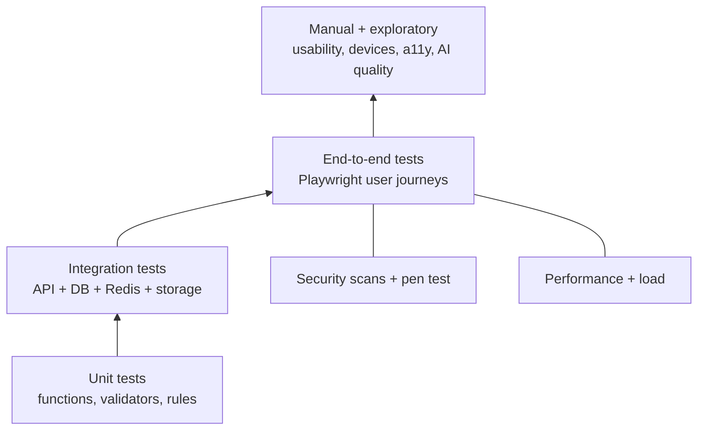
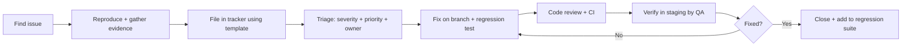

# Testing Strategy (TESTING.md)
## Bangladesh Men's Fashion AI E-Commerce Platform

| Field | Detail |
|---|---|
| **Document** | TESTING.md |
| **Version** | 1.0 (Draft) |
| **Last Updated** | 6 November 2026 |
| **Source of truth** | `PRD.md` (FR/NFR/BR/AC), `APP_FLOW.md`, `UI_SPEC.md` |
| **Companions** | `TRD.md` (controls under test), `SCHEMA.md` (data rules), `COMPONENTS.md` (UI under test), `PLAN.md` Stage M10 |

> **Honest scope.** Passing these tests shows the system meets the stated requirements and common security expectations. It does **not** prove the application is "hack-proof" or "compliant" with any regulation. Compliance needs legal review (PRD NFR-033) and an independent security assessment (Section 20).
>
> **Safety rules for security testing.** Run attack-style tests **only** against your own local or staging environments, with synthetic data. Never test against production without written approval, and never use real customer photos or data.

---

## Table of Contents

1. Testing Strategy
2. Environments, Tools and Test Data
3. Unit Testing
4. Integration Testing
5. Backend and API Testing
6. Frontend Testing
7. Database Testing
8. Authentication Testing
9. Authorization Testing
10. AI Virtual Try-On and Image Upload Testing
11. Security Testing (OWASP-Based)
12. Performance and Load Testing
13. Continuous Deletion Verification (Scheduled Checks)
14. Responsive and Cross-Browser Testing
15. Accessibility Testing
16. Business-Logic, Checkout and Localisation Testing
17. Acceptance Criteria
18. Bug Reporting Process
19. Pre-Deployment Checklist
20. Independent Security Review / Penetration Test
21. OWASP Top 10 Review Matrix
22. Regression Schedule and Traceability

---

## 1. Testing Strategy

### 1.1 Principles

| # | Principle | Why |
|---|---|---|
| 1 | **Test the risk, not just the code.** Highest effort goes to money (orders, stock), identity (auth, sessions), privacy (photos, consent) and AI cost. | These cause the most business damage. |
| 2 | **Shift left.** Unit, integration and lint/security scans run on every pull request. | Cheaper to fix early. |
| 3 | **Test pyramid.** Many fast unit tests, fewer integration/API tests, a focused set of end-to-end (E2E) tests. | Fast feedback, stable suites. |
| 4 | **Security tests are automated where possible** and repeated every release (regression). | Security bugs reappear. |
| 5 | **Server-side truth.** Every rule is tested at the API, not only in the UI (client checks are advisory). | `TRD.md` §5.3. |
| 6 | **AI never blocks shopping.** Every AI test includes "shop still works" assertions. | AP-5, AP-6, NFR-029. |
| 7 | **Privacy is a tested behaviour.** Photo deletion is verified by automated checks, not assumed. | BR-007/008, FR-047. |

### 1.2 Test Levels

### 1.3 Test Types Overview

| Type | Section | Automated? | When |
|---|---|:--:|---|
| Unit | 3 | ✅ | Every commit/PR |
| Integration | 4 | ✅ | Every PR |
| Backend / API | 5 | ✅ | Every PR |
| Frontend (component + E2E) | 6 | ✅ | PR (component), nightly (E2E), pre-release (full) |
| Database | 7 | ✅ | Every PR (migrations), pre-release |
| Authentication / Authorization | 8, 9 | ✅ | Every PR |
| AI try-on + uploads | 10 | ✅ + manual quality | PR, nightly, pre-release |
| Security | 11 | ✅ + manual | PR (scans), pre-release (full), after major changes |
| Performance | 12 | ✅ (scripted) | Pre-release; monthly |
| Deletion verification | 13 | ✅ (scheduled) | Continuous |
| Responsive / cross-browser | 14 | ✅ + manual | Pre-release |
| Accessibility | 15 | ✅ + manual | PR (automated), pre-release (manual) |
| Business-logic / localisation | 16 | ✅ + manual | PR/pre-release |

### 1.4 Release Stages and Gates

| Stage | Gate |
|---|---|
| Pull request | Lint, type-check, unit + integration + API tests, dependency audit, secret scan all pass |
| Staging deploy | Smoke tests + nightly E2E pass |
| Release candidate | Full regression, security suite (Section 11), performance, accessibility, cross-browser, deletion verification, checklist (Section 19) |
| Production | Sign-off by QA lead, security owner and business owner; rollback ready |

---

## 2. Environments, Tools and Test Data

### 2.1 Environments

| Environment | Purpose | Data | AI provider |
|---|---|---|---|
| Local / CI | Dev + automated tests; ephemeral DB, Redis, S3-emulator | Seed/fake | **Mock** |
| Staging | Production-like; security scans; load tests; UAT | **Synthetic only** | Mock, or provider **sandbox** with test photos from consenting staff volunteers |
| Production | Live; smoke tests only | Real | Real (kill switch available) |

### 2.2 Tooling (recommended; replace with equivalents as needed)

| Need | Tool |
|---|---|
| Unit/integration | Vitest or Jest; Supertest (HTTP); Testcontainers or Docker Compose (Postgres, Redis, S3 emulator) |
| Component/UI | React Testing Library; Storybook interaction tests |
| E2E/cross-browser | Playwright (Chromium, WebKit, Firefox) + real-device checks |
| Accessibility | axe-core (CI), Lighthouse, manual keyboard + screen reader (NVDA/VoiceOver/TalkBack) |
| Performance | Lighthouse CI, WebPageTest (throttled profile), k6 (load) |
| Security | OWASP ZAP (baseline/active scan on staging), Semgrep/ESLint security rules, gitleaks/trufflehog, `npm audit`/OSV, Trivy (containers), Burp Suite Community (manual), sqlmap (staging only), `testssl.sh`/SSL Labs, securityheaders-style checks |
| API contract | OpenAPI schema validation (Schemathesis/Dredd-style fuzzing on staging) |
| Visual | Playwright screenshot comparison against approved Figma references |

### 2.3 Test Data

| Data | Rule |
|---|---|
| Users | Seeded customers (verified/unverified/locked/minor-unconfirmed/adult-confirmed), staff for every role, one Super Admin with MFA test secret |
| Catalogue | Synthetic products covering: multi-category, sale price (active/expired/scheduled), no sizes, out-of-stock variants, try-on eligible/ineligible, no images, very long names, Bangla names |
| Photos | **Synthetic or volunteer-consented test images only**; plus an attack corpus (Section 10.4) stored outside the app repo's production data. No real customer photos, ever |
| Payments | Provider sandbox/test mode only (Phase 2); COD for MVP |
| Phones | Valid and invalid Bangladesh samples (Section 16) |
| Secrets | Test-only values; never production keys |

---

## 3. Unit Testing

**Goal:** verify small pieces of logic in isolation. **Target (proposed):** ≥ 80% line coverage overall; ≥ 90% branch coverage for security- and money-critical modules (auth, RBAC, pricing, order totals, consent, try-on state machine, upload validators, retention logic).

| ID | Unit under test | Cases | Expected result |
|---|---|---|---|
| UT-01 | `normalizePhone()` | `01712345678`, `+8801712345678`, `017-1234 5678`, `01212345678` (invalid prefix), `0171234567` (short), letters | Valid → `+8801712345678`; invalid → rejected |
| UT-02 | `formatBDT()` | `2450`, `12500`, `0`, `"2450.00"`, large values | `৳ 2,450`, `৳ 12,500`, `৳ 0`… (symbol before, space, comma separators; UI_SPEC §11.1) |
| UT-03 | `calcOrderTotal()` | Subtotal, promo percent/fixed, delivery, zero delivery, rounding | `total = subtotal − discount + delivery`; two decimals; never negative |
| UT-04 | `effectivePrice()` | No sale; sale active; sale scheduled (future); sale expired | Correct price at given time; reverts after `sale_ends_at` (FR-012) |
| UT-05 | Promotion rules | Expired, not started, below minimum, over usage limit, second promo | Rejected with specific reason; only one promo per order (BR-010) |
| UT-06 | Size recommendation | Between sizes, below/above chart range, missing inputs, no chart | Size / "between sizes" / "insufficient data"; never guesses (FR-049) |
| UT-07 | Zod schemas (each endpoint) | Missing fields, wrong types, extra fields, oversize strings, arrays where scalar expected | Rejected (`.strict()`); error messages safe |
| UT-08 | Password policy | Short, common password, strong passphrase | Per policy; no composition gimmicks |
| UT-09 | Token utilities | Generate/hash/compare reset & session tokens; expiry | Random, unique, constant-time compare, hash stored not raw |
| UT-10 | CSRF utility | Valid/invalid/missing/other-session token | Only valid token for the session accepted |
| UT-11 | Return-to-origin validator | `/checkout`, `//evil.com`, `https://evil.com`, `javascript:alert(1)`, `/\evil.com` | Only internal allow-listed relative paths accepted (APP_FLOW §18.2) |
| UT-12 | Try-on state machine | Legal/illegal transitions; failure from each state | Illegal transitions rejected; every terminal state triggers deletion hook |
| UT-13 | Retention calculator | Job finished + TTL; saved-look expiry; config changes | Correct expiry timestamps |
| UT-14 | Upload validator | MIME vs magic bytes mismatch, size boundary (max, max+1), dimension limits | Per TA-09; boundary behaviour exact |
| UT-15 | Log redactor | Objects with `password`, `token`, `authorization`, phone, image buffer | Sensitive fields replaced with `[REDACTED]`/omitted |
| UT-16 | DTO mappers | Row containing `password_hash`, `token_hash`, `mfa_secret_enc` | Never present in output |
| UT-17 | Permission map | Each role × each capability | Matches PRD §20.2 exactly (table-driven) |
| UT-18 | HTML sanitiser | ``, `">`, `'-alert(1)-'`, `<svg onload=alert(1)>` | Displayed as literal text; no script execution; CSP blocks inline |
| XSS-02 | Product reviews (stored) | Same payloads + `<a href="javascript:…">` | Stored/rendered as text; admin moderation view also safe |
| XSS-03 | Registration name, address fields, order notes (stored → admin order screen/emails) | Payloads | Escaped everywhere (storefront, admin, emails, exports) |
| XSS-04 | CMS content (policy/FAQ/banners/announcement/brand story) | Script, iframe, event handlers, `javascript:` and `data:` URLs, SVG/MathML, CSS injection | Sanitised on write **and** render |
| XSS-05 | URL parameters (`returnTo`, filter params, error messages) | Payloads | Not reflected unescaped; open redirects rejected |
| XSS-06 | DOM XSS | Hash/query used by client code | No `innerHTML` sinks with untrusted data (lint + review) |
| XSS-07 | Try-on text fields (look names, renaming) | Payloads | Escaped |
| XSS-08 | CSP effectiveness | Inject inline script in a test page/staging | Blocked; CSP reports show violation; no `unsafe-eval` |
| XSS-09 | Cookie theft attempt | `document.cookie` after a simulated XSS | Session cookie not readable (`HttpOnly`) |
| XSS-10 | File-based XSS | Upload SVG/HTML as image (UP-M03) | Rejected |
| XSS-11 | Automated scan | ZAP active scan | No XSS findings |

### 11.3 CSRF (cookie-authenticated flows)

| ID | Scenario | Expected |
|---|---|---|
| CSRF-01 | Cross-origin form POST to each state-changing endpoint with victim's cookies, no token | 403; no change |
| CSRF-02 | Valid session but token from a different session | 403 |
| CSRF-03 | Missing/forged `Origin` or `Referer` | 403 |
| CSRF-04 | State-changing action via `GET` | Not possible / 405 |
| CSRF-05 | CORS: preflight from unlisted origin; wildcard attempts; credentials | Blocked; no `Access-Control-Allow-Origin: *` with credentials |
| CSRF-06 | Cookie `SameSite` behaviour (cross-site navigation POST) | Cookie not sent (Lax/Strict) |
| CSRF-07 | Login CSRF (forced login) | Protected |
| CSRF-08 | Payment webhook (no cookies) | Exempt from CSRF but signature-verified (API-15) |

### 11.4 Broken Access Control (OWASP A01)

Execute Section 9 in full plus:

| ID | Scenario | Expected |
|---|---|---|
| BAC-01 | IDOR across every ID-bearing endpoint (orders, addresses, wishlist, looks, jobs, consents, reviews) — swap IDs between two test users | 404 each |
| BAC-02 | Vertical privilege escalation via client-supplied role/flags | Ignored |
| BAC-03 | Forced browsing: admin URLs, API docs, `/healthz` details, `.env`, `.git`, source maps, backup files, storage bucket listing | Not exposed (404/403); API docs not public in production |
| BAC-04 | Direct storage access | Private bucket object URLs without signature → 403; bucket listing disabled; no public ACL |
| BAC-05 | Signed URL tampering (change key/expiry) | Rejected |
| BAC-06 | Method tampering (`PUT` instead of `POST`, `HEAD`/`OPTIONS` quirks) | Consistent authorization |
| BAC-07 | Mass assignment on every create/update | Only allow-listed fields applied |
| BAC-08 | Guest order lookup (if enabled) | Order number + phone required; rate-limited; no enumeration |

### 11.5 Authentication Attacks

| ID | Attack | Expected |
|---|---|---|
| AA-01 | Credential stuffing (many accounts, few passwords, rotating IPs in test) | Per-account and per-IP controls trigger; alerts raised |
| AA-02 | Username/phone enumeration via login, register, forgot-password, verification, timing | Uniform responses/timing (AUTH-08, AUTH-13) |
| AA-03 | Weak password acceptance | Rejected (AUTH-05) |
| AA-04 | Session fixation / hijack with stolen cookie after logout or password change | Rejected (revoked) |
| AA-05 | JWT/alg attacks (if any tokens used) | N/A for sessions; verify no unsigned tokens accepted |
| AA-06 | OTP/verification brute force | Attempt limit + invalidation |
| AA-07 | Reset-token guessing/reuse/host-header poisoning in reset links | Fails; links built from configured origin, not request `Host` |
| AA-08 | MFA bypass attempts (skip step, replay code, brute-force) | Server enforces MFA state; code replay rejected; throttled |
| AA-09 | Default/seed credentials | None exist in staging/production |
| AA-10 | Password change without current password | Rejected |

### 11.6 Brute-Force Protection

| ID | Scenario | Expected |
|---|---|---|
| BF-01 | 6th wrong password within window for one account (limit 5/15 min — configurable) | Locked/backoff with generic message; `Retry-After`; legit user later succeeds after window or recovery |
| BF-02 | Many accounts from one IP | IP throttle triggers |
| BF-03 | Distributed attempts on one account | Account-level limit triggers regardless of IP |
| BF-04 | Lockout abuse (attacker locks victim) | Mitigated: backoff not permanent lock; victim can reset via verified channel |
| BF-05 | Registration, forgot-password, OTP-send, newsletter, contact floods | Rate-limited |
| BF-06 | Admin login brute force | Stricter limits + alert |
| BF-07 | Logging | Failed attempts logged (no passwords), alert thresholds fire |

### 11.7 Rate Limiting

| ID | Scenario | Expected |
|---|---|---|
| RL-01 | Exceed each endpoint group limit in `TRD.md` §17 | 429 with `Retry-After`; counters reset after window |
| RL-02 | Bypass attempts: spoofed `X-Forwarded-For`, rotating headers, changing case in path | Not bypassed (trusted-proxy config correct) |
| RL-03 | Per-user vs per-IP keys after login | Both enforced |
| RL-04 | Try-on limits (hour/day) and global concurrency | Enforced; costs capped |
| RL-05 | Large request bodies / slowloris-style slow requests | Timeouts and size limits apply |
| RL-06 | Redis unavailable | Defined behaviour: sensitive endpoints fail closed (documented), browsing continues |
| RL-07 | Legitimate burst (flash sale simulation) | No false lockouts of normal users (tuning, Section 12) |

### 11.8 Malicious File Uploads

Execute Section 10.3 (UP-M01…M16) in full; additionally verify: uploaded files are never served from the app origin with executable content types; `Content-Type`/`nosniff`/`Content-Disposition` correct on any file response; storage objects not executable; AV scan (if used) quarantines EICAR.

### 11.9 API Key and Secret Exposure

| ID | Check | Expected |
|---|---|---|
| KEY-01 | Search **client bundles, source maps, HTML, JSON responses, error pages, headers** for secret patterns and known prefixes (AI/provider keys, DB URLs, `SESSION_SECRET`) | **None found** |
| KEY-02 | Inspect network traffic during try-on, checkout, admin | No third-party API keys; AI calls only from the server |
| KEY-03 | `NEXT_PUBLIC_*` review | Only non-secret values |
| KEY-04 | Repository scan incl. full git history (gitleaks/trufflehog) | Clean; CI blocks commits with secrets |
| KEY-05 | `.env` / config files reachable by URL | 404 |
| KEY-06 | Logs and error reports | Keys redacted |
| KEY-07 | Container image layers | No secrets baked in (Trivy secret scan) |
| KEY-08 | Verbose errors/stack traces on malformed input | Not returned |
| KEY-09 | **Key revocation drill (staging):** revoke AI key → observe | Try-on fails safely; shop unaffected; new key deployed from secret manager; old key proven dead; runbook steps timed and recorded (PRD Security §8) |
| KEY-10 | Spend guard | Provider budget alert/kill switch tested |
| KEY-11 | Least privilege of keys | Storage credential limited to required buckets/actions; verified by attempting forbidden actions |

### 11.10 Session Security

| ID | Check | Expected |
|---|---|---|
| SESS-01 | Cookie attributes in every environment except local HTTP | `HttpOnly`, `Secure`, `SameSite`, `__Host-` prefix where used |
| SESS-02 | Cookie not readable by JS; token not in `localStorage`/URL/logs | Verified |
| SESS-03 | Rotation on login and privilege change | New ID |
| SESS-04 | Idle and absolute timeout enforced server-side | Expired session rejected even if cookie persists |
| SESS-05 | Logout / password change / reset revokes sessions | Old cookies rejected |
| SESS-06 | Concurrent sessions list and remote revoke | Works |
| SESS-07 | Session ID entropy / predictability | Random, long, unique |
| SESS-08 | Admin vs customer cookie separation | Distinct names/scopes; admin `SameSite=Strict` |
| SESS-09 | Caching of authenticated pages | `Cache-Control: no-store`; back-button after logout shows no private data |
| SESS-10 | Session data at rest | DB stores only hashes |

### 11.11 Sensitive Data Leakage

| ID | Check | Expected |
|---|---|---|
| LEAK-01 | API responses | No `password_hash`, `token_hash`, `mfa_secret_enc`, internal flags, other users' data |
| LEAK-02 | Error responses | Generic, no SQL/stack/path/version |
| LEAK-03 | Logs | No passwords, tokens, OTPs, full phone/address, image data, API keys (log-scan on test run) |
| LEAK-04 | URLs | No sensitive data in URLs/query strings (session, tokens beyond one-time reset links, photos) |
| LEAK-05 | Third-party requests | No personal data to analytics before consent; no photo to anyone except the AI provider |
| LEAK-06 | Referrer leakage | `Referrer-Policy` set; reset links not leaked via Referer |
| LEAK-07 | Public caches/CDN | Private responses not cached; try-on objects never in CDN |
| LEAK-08 | Admin lists | Sensitive fields masked per role |
| LEAK-09 | Backups/exports | No try-on photos; access restricted |
| LEAK-10 | Source maps/debug endpoints in production | Disabled |
| LEAK-11 | Email/SMS content | No passwords; reset links single-use |
| LEAK-12 | Metadata | EXIF/GPS stripped from stored images |
| LEAK-13 | Verbose headers | No `X-Powered-By`/server version |

### 11.12 Customer Photo Deletion Verification

This is the most important privacy test. It must pass before launch and after every change to the try-on module.

| ID | Scenario | Verification method | Expected |
|---|---|---|---|
| DEL-01 | Success path | After job `succeeded`, list `tmp/{jobId}/` in private bucket and query DB | `input.*` **absent**; DB `input_storage_key IS NULL`, `input_deleted_at` set; only `result.*` remains until TTL |
| DEL-02 | Provider error | Force `PROVIDER_REJECTED` | Source absent; status `failed` |
| DEL-03 | Provider timeout | Force timeout | Source absent; status `failed` |
| DEL-04 | User cancel (queued and processing) | Cancel | Source absent; status `cancelled` |
| DEL-05 | **Worker crash** mid-job | Kill worker process after upload | Failure hook/sweeper removes source within threshold; job marked failed/expired |
| DEL-06 | **API crash after storage write, before enqueue** | Simulate | Orphan removed by sweeper; no stuck `queued` row |
| DEL-07 | Redis loss (queue wiped) | Flush queue with pending jobs | Sweeper finds orphans (>15 min proposed) and deletes |
| DEL-08 | Storage delete failure (simulate error on delete) | Inject failure | Retried; alert raised; lifecycle backstop eventually removes; `input_deleted_at` not set until truly deleted |
| DEL-09 | Result TTL | Advance clock past `result_expires_at` | Result object deleted; status `expired` |
| DEL-10 | Delete my try-on data | Use endpoint | All temp + saved images deleted; jobs `deleted`; confirmation |
| DEL-11 | Consent withdrawal | Withdraw | Same as DEL-10; new jobs blocked |
| DEL-12 | Account deletion | Erase account | No images for that user in any bucket prefix; metadata handled per policy |
| DEL-13 | Saved look delete / expiry | Delete; wait for expiry | Image removed |
| DEL-14 | **Photo never in other places** | Search DB dumps, Redis keys/values, application logs, CDN cache, error-tracker events, backups, provider-facing requests (must contain only what the adapter sends) for image bytes/known hash of the test photo | **Not found** outside private temp storage during processing |
| DEL-15 | Rejected uploads (UP-M*, unsafe content) | After rejection | Nothing stored |
| DEL-16 | Lifecycle rule | Inspect bucket config | `tmp/` expiry configured; block-public-access on |
| DEL-17 | DB invariant | Attempt to violate (DB-04) | Rejected |
| DEL-18 | Provider retention check (process) | Review provider contract/settings vs privacy notice | Notice wording matches provider retention terms (legal sign-off) |
| DEL-19 | Timing evidence | Measure time from provider response to deletion over 100 jobs | p99 below the documented threshold; evidence retained in test report |

---

## 12. Performance and Load Testing

### 12.1 Front-End Performance (PRD NFR-001/002/007; targets are *proposed*)

| ID | Test | Method | Target |
|---|---|---|---|
| PERF-01 | Core Web Vitals on Home, Listing, PDP | Lighthouse CI + WebPageTest with mid-range Android + throttled 3G/4G profile (BD-18); real-user monitoring after launch | LCP ≤ 2.5 s (p75), INP ≤ 200 ms (p75), CLS ≤ 0.1 |
| PERF-02 | Page weight/images | Check formats (WebP/AVIF), sizes, lazy loading, `3:4` reserved space | No layout shift; optimised sizes |
| PERF-03 | JS bundle budget | Bundle analysis in CI | Budget set per route; regressions fail CI |
| PERF-04 | Search latency | 50 concurrent users | ≤ 1 s typical (NFR-004) |

### 12.2 Load and Stress (k6)

| ID | Scenario | Expected |
|---|---|---|
| LOAD-01 | Baseline browsing mix (home/listing/PDP/search) | Error rate < 1%; stable latency |
| LOAD-02 | **Seasonal peak simulation** (expected concurrency TBD, OQ-029; start with a multiple of the baseline) | Checkout remains correct and responsive (NFR-008) |
| LOAD-03 | Checkout under load with concurrent last-unit purchases | No oversell; no duplicate orders |
| LOAD-04 | Try-on queue burst (mock provider with realistic latency) | Queue absorbs; per-user limits hold; browsing unaffected (NFR-010) |
| LOAD-05 | Soak test (several hours) | No memory leaks; connection pools stable; no orphaned temp files |
| LOAD-06 | Failure injection | Kill API/worker pods; DB failover; Redis restart | Recovery without data loss; consistent state |
| LOAD-07 | Rate-limit tuning | Legitimate traffic not blocked; abusive traffic blocked |
| LOAD-08 | 10× catalogue volume | Listing/search/admin queries still within targets (NFR-009) |
| LOAD-09 | CDN/cache effectiveness | High hit rate on product images; private responses uncached |

Performance results are recorded with environment details; any regression above agreed thresholds blocks release.

---

## 13. Continuous Deletion Verification (Scheduled Checks)

Runs **in production and staging**, not just before launch, because privacy guarantees can silently regress.

| Check | Frequency | Pass condition | On failure |
|---|---|---|---|
| Orphan scan: list `tmp/` objects older than the safety threshold (TA-10: 15 min proposed) | Every 15 min | **Zero** objects | Page the on-call; delete; investigate; incident record |
| DB invariant scan: `tryon_jobs` where status ∉ (queued, processing) AND `input_storage_key IS NOT NULL` | Hourly | Zero rows | Alert; fix; root cause |
| Stale jobs: `queued/processing` older than max duration | Every 5 min | Zero | Auto-fail + cleanup + alert |
| Result/saved-image expiry: objects past `result_expires_at`/`image_expires_at` | Hourly | Zero | Alert; run sweeper |
| Lifecycle rule presence on private bucket | Daily | Config matches policy | Alert |
| Synthetic canary: automated test account uploads a test image, completes a job, verifies deletion | Daily (and after each deploy) | DEL-01 passes | Block rollout / alert |
| Public-access audit: private bucket not public; no CDN rule for `tmp/` | Daily | Pass | Alert |
| Log scan for image bytes/keys/tokens | Daily | Zero | Alert; purge logs; fix redaction |

---

## 14. Responsive and Cross-Browser Testing

### 14.1 Viewports (UI_SPEC §8, §16.6)

| Class | Test widths (px) | Notes |
|---|---|---|
| Mobile | 320, 360, 375, 390, 414 | Smallest supported = 320 |
| Tablet | 768, 820, 1024 (landscape tablet) | Breakpoint boundaries 767/768 and 1023/1024 |
| Desktop | 1280, 1440, 1920 | Container max 1280 |

### 14.2 Responsive Test Cases

| ID | Check | Expected |
|---|---|---|
| RESP-01 | No horizontal page scroll at 320 px on every unique template (Home, Listing, Collection, PDP, Cart, Checkout, Try-On, Account, Auth, Admin) | None (NFR-005) |
| RESP-02 | Navigation transforms: desktop links ↔ hamburger drawer ↔ bottom nav | Correct per breakpoint; bottom nav hidden in checkout and during try-on generation |
| RESP-03 | Grid columns | 2 / 2 / 3–4 columns per UI_SPEC §8.2 |
| RESP-04 | Cart/checkout layout | 60/40 on desktop; single column on mobile |
| RESP-05 | PDP | Stacked on mobile (gallery → details → actions) |
| RESP-06 | Try-on | Split view on desktop; vertical stack + sticky bottom bar on mobile; canvas fits viewport height without overflow on short screens |
| RESP-07 | Touch targets | ≥ 44×44 px with ≥ 8 px spacing on touch viewports |
| RESP-08 | Tables | Convert to labelled cards on narrow screens (customer pages) |
| RESP-09 | Modals/sheets | Full-height scrollable sheets on mobile with visible close |
| RESP-10 | Text scaling | 200% zoom and OS large-text settings; no clipped content |
| RESP-11 | Orientation changes | Layout reflows; try-on photo not lost |
| RESP-12 | Safe areas (notched phones) | Fixed bars don't overlap content |
| RESP-13 | Long content | Long product names, Bangla text, large numbers wrap without breaking layout |
| RESP-14 | Image behaviour | 3:4 ratio preserved; no stretch |
| RESP-15 | Low-bandwidth profile (NFR-007) | Usable; skeletons show; key content before heavy media |

### 14.3 Cross-Browser Matrix (PRD NFR-006; supported-version policy TBD → proposed: latest two stable versions)

| Browser | Platforms | Priority |
|---|---|---|
| Chrome | Android (mid-range device), Windows, macOS | **P1** |
| Safari | iOS (recent two major versions), macOS | **P1** |
| Samsung Internet | Android | **P1** (common in Bangladesh market) |
| Firefox | Windows/macOS/Android | P2 |
| Edge | Windows | P2 |
| Opera Mini/older Android WebView | Smoke only | P3 (document limits) |

| ID | Check | Expected |
|---|---|---|
| XB-01 | Core journey (browse → cart → checkout) on every P1/P2 browser | Pass |
| XB-02 | Cookies: `Secure`, `SameSite`, `__Host-` prefix, CSRF header flow | Works on all (Safari ITP, Samsung Internet) |
| XB-03 | File input / drag-drop / camera permissions for try-on | Works; graceful fallback where drag-drop unavailable |
| XB-04 | Fonts (Cormorant/Plus Jakarta/Hind Siliguri) incl. Bangla rendering | Correct glyphs; fallbacks acceptable |
| XB-05 | CSS features (aspect-ratio, `:focus-visible`, backdrop, sticky) | Graceful degradation |
| XB-06 | Payment/redirect flows (Phase 2) | Return correctly; no lost cart |
| XB-07 | CSP/headers don't break any browser | No console CSP errors in normal use |
| XB-08 | Safari private mode / storage blocked | App works without `localStorage` (try/catch, fallbacks) |

---

## 15. Accessibility Testing (WCAG 2.1 AA — NFR-016–019)

| ID | Test | Method | Expected |
|---|---|---|---|
| A11Y-01 | Automated scan every template/state | axe-core in CI + Lighthouse | No critical/serious violations |
| A11Y-02 | Keyboard-only run of all journeys (browse, search, PDP, cart, checkout, auth, try-on, account, admin) | Manual | Everything reachable/operable; logical order; **visible focus** |
| A11y-03 | Modals/drawers/popups | Manual | Focus trap; `Escape`; focus returns to trigger (UI_SPEC §10.2); try-on welcome popup dismissible and non-blocking (NFR-019) |
| A11Y-04 | Screen reader pass (NVDA + Chrome/Firefox, VoiceOver iOS/macOS Safari, TalkBack) on Home, PDP, cart/checkout, login/register, try-on, order history | Manual | Landmarks, headings H1→H6, names for icon buttons, form labels/errors, live-region announcements (cart count, results count, toasts, processing status) |
| A11Y-05 | Colour contrast | Automated + manual with design tokens | Meets AA; review items flagged in `COMPONENTS.md` §21.3 (Gold focus ring on beige, Sage placeholder/tag text, cream-on-gold) and record design decisions |
| A11Y-06 | Non-colour cues | Manual | Out-of-stock, errors, sale, password strength, selected states have text/icon/shape cues |
| A11Y-07 | Forms | Manual | Visible labels; errors linked (`aria-describedby`), summary, `autocomplete`; error messages specific (NFR-021) |
| A11Y-08 | Images | Review | Meaningful `alt` for product images; decorative empty `alt`; AI result `alt` text |
| A11Y-09 | Try-on specifics | Manual | Upload via button; consent checkbox native with disabled-reason; progress announced; disclaimer in reading order |
| A11Y-10 | Motion | Toggle `prefers-reduced-motion` | Zoom/pulse/slide animations suppressed |
| A11Y-11 | Zoom/reflow | 200% and 400% zoom at 1280 px | No loss of content/function |
| A11Y-12 | Touch/pointer | Mobile | Targets ≥ 44 px; no gesture-only actions (carousel buttons exist) |
| A11Y-13 | Language | Inspect | `lang` attributes (`en`, `bn` for Bangla content) |
| A11Y-14 | Time limits | Toast duration, session warnings | ≥ 4 s, pausable; session expiry handled gracefully |
| A11Y-15 | Pre-launch audit | Independent or documented WCAG 2.1 AA audit | Passed (NFR-016 proposed target) |

---

## 16. Business-Logic, Checkout and Localisation Testing

### 16.1 Bangladesh-Specific Cases (PRD §19, UI_SPEC §11)

| ID | Scenario | Expected |
|---|---|---|
| BD-T01 | Currency display on all pages | `৳ 2,450` format everywhere; identical price at listing/PDP/cart/checkout (BR-002) |
| BD-T02 | Phone validation matrix | `01[3-9]XXXXXXXX` and `+8801[3-9]XXXXXXXX` accepted; `011`, `012`, short/long, non-digits rejected |
| BD-T03 | Address form | Division → District → Thana dependent dropdowns; landmark optional; required fields enforced |
| BD-T04 | Dhaka serviceability | Serviceable address → configured charge; non-serviceable → clear message **before** payment (BD-4, FR-018) |
| BD-T05 | No hard-coded policy data | With no zones/charges/payment/policies configured, the UI shows nothing unconfirmed (BR-004) — no sample amounts |
| BD-T06 | Payment methods | Only enabled methods listed; disabling one removes it immediately |
| BD-T07 | Inches | Size guide and recommendation use inches only (BR-016) |
| BD-T08 | Bangla text | Names/addresses in Bangla stored/displayed/searchable correctly (NFR-034) |
| BD-T09 | Time zone/dates | Dhaka local time; correct around midnight |
| BD-T10 | Mobile-network resilience | Interrupted connection during checkout → no duplicate/lost order (NFR-030) |

### 16.2 Order and Pricing Logic

| ID | Scenario | Expected |
|---|---|---|
| BL-01 | Price change between cart and placement | Shown; customer must accept (AFQ-24) |
| BL-02 | Sale expiry at checkout moment | Order uses effective price at placement |
| BL-03 | Coupon invalid/expired/over limit/second coupon | Clear message; one promotion per order (BR-010) |
| BL-04 | Cancel order | Status/history; stock restored per policy (TBD) |
| BL-05 | Return/exchange request when policy not configured | Option hidden (FR-024) |
| BL-06 | Review eligibility | Per approved rule (OQ-017); "Verified purchase" only if backend confirms |
| BL-07 | Out-of-stock display | Per decision OQ-035; never purchasable |
| BL-08 | Try-on never blocks purchase | Disable AI services → full purchase succeeds (BR-014) |

---

## 17. Acceptance Criteria

### 17.1 Release Exit Criteria (all required for production launch)

| # | Criterion |
|---|---|
| 1 | **100% of PRD "Must Have" acceptance criteria pass** (MVP rows of PRD §24.3), verified by test records |
| 2 | Zero open **Critical or High** defects; Medium defects have approved workarounds/plans |
| 3 | All Section 8, 9 and 11 security cases pass; no open security finding above Low without written risk acceptance by the business owner |
| 4 | **Section 11.12 (photo deletion) 100% pass** and Section 13 scheduled checks running in staging with zero violations for an agreed period |
| 5 | No API key/secret found in client bundles, repo history, logs or images (KEY-01…07) |
| 6 | Try-on works only with recorded consent (TO-05) and never blocks shopping (BR-014, NFR-029) |
| 7 | Core Web Vitals targets met on key pages under the mobile profile (or documented, approved exceptions) |
| 8 | Load test shows checkout stable at agreed peak (OQ-029 once defined) with no oversell/duplicate orders |
| 9 | WCAG 2.1 AA audit passed for critical journeys (NFR-016); contrast flags in `COMPONENTS.md` §21.3 resolved or accepted by design owner |
| 10 | Responsive + cross-browser matrix passed for all P1 browsers/devices, no horizontal scroll at 320 px |
| 11 | Backup restore drill and key-revocation drill completed and documented |
| 12 | Legal/business launch blockers (`PLAN.md` §3) closed: privacy notice/consent text approved, policies published (no placeholders), age policy implemented |
| 13 | Independent penetration test completed with high-severity findings fixed and retested (Section 20) — *recommended; if waived, the waiver is documented by the business owner* |
| 14 | Pre-deployment checklist (Section 19) signed |

### 17.2 Coverage Targets (proposed)

| Area | Target |
|---|---|
| Unit coverage | ≥ 80% lines; ≥ 90% branches on security/money-critical modules |
| Requirement coverage | Every MVP FR/NFR/BR in the traceability matrix (Section 22) has ≥ 1 automated or documented manual test |
| Route authorization coverage | 100% of routes in the route-registry test |
| Component state coverage | All states in `COMPONENTS.md` exercised in Storybook/RTL |
| E2E | All journeys E2E-01…14 green on Chromium, WebKit, Firefox in CI nightly |

### 17.3 Flaky-Test Policy

A test that fails intermittently is fixed or quarantined within one sprint with a ticket; quarantined security or deletion tests are **not** allowed (they block the release).

---

## 18. Bug Reporting Process

### 18.1 Workflow

### 18.2 Bug Report Template

| Field | Content |
|---|---|
| Title | Short, specific |
| ID / Related requirement | e.g., FR-046, NFR-012 |
| Environment | Staging/production; app version/commit; browser/OS/device; viewport |
| Preconditions | Account/role, feature flags |
| Steps to reproduce | Numbered |
| Expected vs actual result | |
| Evidence | Screenshot/video, HTTP request/response (**redacted**), `requestId`, console/log excerpts |
| Severity | See 18.3 |
| Regression? | Previously worked? Last good version |
| Notes | Suspected area |

**Never attach** real customer data, real photos, passwords, tokens, or API keys to a bug report. Redact before uploading.

### 18.3 Severity and Response Targets (proposed)

| Severity | Definition | Examples | Target response |
|---|---|---|---|
| **Critical (S1)** | Data breach, privacy violation, security compromise, checkout down, wrong charges, widespread outage | Photo retained after processing; auth bypass; secret exposed; oversell; payments marked paid wrongly | Immediate: stop-ship/hotfix; kill switch if needed; incident process |
| **High (S2)** | Major feature broken, no workaround, serious security weakness | Try-on consent bypass; XSS stored; cannot place orders on a browser | Fix before release |
| **Medium (S3)** | Feature impaired with workaround; accessibility barrier on non-critical path | Filter state lost; contrast failure; layout break on one device | Scheduled fix; may ship with approval |
| **Low (S4)** | Cosmetic/minor | Spacing, copy typo | Backlog |

### 18.4 Security Vulnerability Handling

1. Report privately to the security owner (not in public channels).
2. Classify using severity above plus likelihood/impact; reference OWASP category.
3. For S1/S2: contain (feature flag/kill switch, rotate keys, block route), fix, add regression test, review logs for exploitation, document, notify per legal obligations (TBD).
4. Post-incident review within an agreed window; update tests and docs.
5. Provide a way for researchers/users to report issues (security contact page) after launch.

### 18.5 Defect Metrics

Track: open defects by severity, escape rate (found in production), mean time to fix, reopen rate, flaky-test count, security findings by OWASP category.

---

## 19. Pre-Deployment Checklist

Tick every item; attach evidence (links to reports). Owner initials and date per item.

### 19.1 Functional and Quality
- [ ] All MVP Must-Have acceptance criteria pass (PRD §24.3 mapping)
- [ ] E2E suite green on Chromium, WebKit, Firefox; manual checks on real iPhone, mid-range Android, Samsung Internet
- [ ] Responsive checks done at 320/375/768/1024/1280; no horizontal scroll
- [ ] Accessibility audit complete; keyboard and screen-reader passes done
- [ ] Performance budgets and Core Web Vitals met on the mobile profile
- [ ] Load test passed at agreed peak; try-on queue burst tested
- [ ] No open Critical/High defects
- [ ] Content: policies, FAQ, delivery/payment/returns details **business-approved**; no placeholder or fabricated content; claims approved (BR-003, BR-004)
- [ ] Only confirmed payment methods and delivery zones enabled; amounts match business-supplied values

### 19.2 Security
- [ ] Section 11 suites all pass; ZAP scan has no High/Medium unresolved findings
- [ ] HTTPS enforced; HSTS; TLS config tested (A/A+ equivalent); HTTP redirects
- [ ] Security headers and CSP verified in production-like environment (no violations in normal flows)
- [ ] CSRF, rate limits, brute-force protections verified in staging with production-like config
- [ ] Cookies `HttpOnly; Secure; SameSite`; session timeouts set (TA-08)
- [ ] Admin: MFA enforced for **all** staff; default/seed accounts removed; Super Admin bootstrap secret rotated
- [ ] RBAC matrix test and route-registry test pass; no route without policy
- [ ] **No secrets** in repo history, bundles, images, logs; `.env` files not deployed with images; secrets in secret manager
- [ ] Production keys differ from staging; least-privilege storage/DB credentials
- [ ] **AI key revocation drill completed**; provider spend alerts and kill switch verified
- [ ] Dependency audit and container scan: no unresolved High/Critical vulnerabilities
- [ ] API docs/debug endpoints/source maps disabled or protected in production
- [ ] Error pages generic; no stack traces; logging redaction verified
- [ ] Penetration test done (or waiver documented) and findings retested

### 19.3 Privacy and AI
- [ ] **Photo deletion verification (11.12) passed**; Section 13 scheduled checks active with alerts routed
- [ ] Private bucket: block-public-access on, encryption on, lifecycle rule on `tmp/`
- [ ] Consent flow verified (no upload before consent; API rejects without consent); consent text version recorded
- [ ] Privacy notice/AI Try-On notice approved by legal and **matches the AI provider's actual retention/training terms**
- [ ] Age-gate behaviour matches the approved policy (OQ-009); try-on disabled for unapproved cases
- [ ] Disclaimers + "AI-Generated" badge present on every preview path
- [ ] "Delete my try-on data", consent withdrawal, measurement deletion and account deletion tested end-to-end
- [ ] Try-on feature flag/kill switch tested; per-user limits set
- [ ] Analytics and non-essential cookies load only after consent
- [ ] Backups contain no try-on images; backup retention documented

### 19.4 Operations
- [ ] Production infrastructure provisioned per `TRD.md` §22; DB/Redis not publicly reachable
- [ ] Monitoring, alerting, uptime checks, log shipping active; on-call/contact list ready
- [ ] Backups running; **restore drill** succeeded; RPO/RTO documented
- [ ] CI/CD: staging → approval → production; rollback tested
- [ ] Migrations applied safely; seed/demo data **removed** from production
- [ ] Support channels, order-handling process and staff training complete
- [ ] Incident-response and key-rotation runbooks accessible
- [ ] Domain, DNS, certificates, email/SMS sender authentication (SPF/DKIM/DMARC) configured
- [ ] Smoke test plan for go-live and first-hour monitoring assigned

### 19.5 Sign-off

| Role | Name | Date | Signature |
|---|---|---|---|
| QA lead | | | |
| Security owner | | | |
| Technical lead | | | |
| Business owner | | | |
| Legal/privacy reviewer (policy items) | | | |

---

## 20. Independent Security Review / Penetration Test

**Recommended before launch** and after major changes (new payment gateway, new AI provider, multi-garment try-on).

| Item | Detail |
|---|---|
| Scope | Storefront, API, admin area, authentication/session, try-on upload and deletion pipeline, storage configuration, CI/CD and secrets handling, infrastructure configuration |
| Method | OWASP Web Security Testing Guide (WSTG), OWASP ASVS (Level 2 as a reference target), API security testing; configuration review of cloud storage, headers, TLS |
| Rules of engagement | Staging environment with synthetic data; written authorisation; defined time window; no real customer data/photos; testers receive test accounts for each role |
| Specific objectives | Attempt to (a) read another customer's data, (b) reach admin functions as a customer, (c) bypass consent for try-on, (d) retrieve any stored source photo or another user's result, (e) extract API keys, (f) abuse uploads for code execution or DoS, (g) bypass rate limits to drive up AI cost, (h) escalate privileges, (i) tamper with prices/orders/payments |
| Output | Report with severity, evidence, remediation; retest after fixes; summary for the business owner |
| Acceptance | No unresolved High/Critical findings; Medium findings fixed or risk-accepted in writing |

Note: a clean report reduces risk; it does not guarantee absence of vulnerabilities.

---

## 21. OWASP Top 10 (2021) Review Matrix

Used as a **review reference** at design review, before release, and after major changes.

| OWASP | Test coverage in this document | Pass condition |
|---|---|---|
| **A01 Broken Access Control** | §9, §11.4, AZ-*, BAC-*, DEL-14 | All role/ownership tests pass; no staff access to try-on images |
| **A02 Cryptographic Failures** | AUTH-09, §11.9–11.11, DB-15, TLS tests (§11.13 below), headers | TLS 1.2+, HSTS, Argon2id, hashed tokens, encrypted fields, no sensitive data in clear |
| **A03 Injection** | §11.1 (SQLi), §11.2 (XSS), UP-M*, UT-18 | No injectable parameters; sanitisation works |
| **A04 Insecure Design** | §10, §11.12, §13, RL-*, TO-05/24 | Privacy-by-design behaviours verified; abuse cases (cost, enumeration) covered |
| **A05 Security Misconfiguration** | Header/CSP tests, BAC-03/04, KEY-05/08, DB-07, §19.2 | Hardened config; no default creds; private buckets; no verbose errors |
| **A06 Vulnerable Components** | CI audit/Trivy, §11.14 | No unresolved High/Critical |
| **A07 Identification & Auth Failures** | §8, §11.5, §11.6, §11.10 | Strong auth, throttling, MFA for staff, session security |
| **A08 Software & Data Integrity Failures** | API-15 (webhook signatures), CI/CD review, lockfile integrity, idempotency IT-04 | Signed webhooks, protected pipeline, reproducible builds |
| **A09 Logging & Monitoring Failures** | LEAK-03, BF-07, AZ-15, §13 alerts | Security events logged without secrets; alerts fire in drills |
| **A10 SSRF** | SSRF-01…03 below | Server never fetches user-supplied URLs |

### 21.1 Additional Security Cases

| ID | Test | Expected |
|---|---|---|
| **TLS-01 (§11.13)** | `testssl.sh`/SSL Labs; HTTP→HTTPS redirect; mixed content scan | TLS 1.2+ only, strong ciphers, HSTS present, no mixed content |
| **HDR-01** | Check headers on HTML, API, static and error responses | CSP, `nosniff`, `Referrer-Policy`, `Permissions-Policy`, frame-ancestors, `Cache-Control: no-store` for private routes |
| **DEP-01 (§11.14)** | `npm audit`/OSV, Trivy image scan, license check, lockfile integrity | No unresolved High/Critical; pinned versions |
| **SSRF-01** | Supply internal URLs (`http://169.254.169.254`, `localhost`) in any URL-like field (image URLs, links) | Rejected; none are fetched server-side |
| **SSRF-02** | Try-on garment URL manipulation (client tries to pass its own garment URL) | Ignored; server uses catalogue data only |
| **SSRF-03** | Worker egress | Only AI provider/storage/notification hosts reachable |
| **BL-SEC-01** | Business-logic abuse: negative quantities, coupon replay, race on coupon usage, price tampering, skipping checkout steps, replaying order requests | Rejected/idempotent |
| **DOS-01** | Large JSON, deeply nested JSON, regex-heavy inputs (ReDoS), huge pagination, expensive search patterns | Limits/timeouts apply; service stays responsive |
| **CLICK-01** | Embed site in an iframe from another origin | Blocked by `frame-ancestors` |

---

## 22. Regression Schedule and Traceability

### 22.1 Regression Schedule

| Trigger | Suites |
|---|---|
| Every PR | Unit, integration, API, component, lint, SAST, dependency/secret scans, a11y (axe) on changed components |
| Nightly | Full E2E on three engines, DB suite, deletion canary (Section 13), ZAP baseline |
| Weekly | Dependency/container scans, performance smoke |
| Pre-release | Everything in Sections 3–16, 21; cross-browser/device manual; checklist (Section 19) |
| After incident or major change (new provider, payment, upload logic) | Full security + deletion suites; consider pen-test retest |
| Quarterly | Backup restore drill, key-revocation drill, accessibility re-audit, cross-browser refresh |

### 22.2 Traceability (representative)

| Requirement | Tests |
|---|---|
| FR-001–014 Catalogue | API-01–03, FE-02–05, E2E-02, UT-04, DB-10 |
| FR-015–024 Cart/Checkout/Orders | IT-03–06, API-04–07, E2E-03/04, BL-*, BD-T* |
| FR-025–028 Accounts/Auth | AUTH-*, AA-*, BF-*, FE-09/10, E2E-05, IT-16 |
| FR-030/031 Wishlist/Saved looks | IT-09, E2E-06, TO-18/19, AZ-02 |
| FR-032/033 Reviews | IT-10, API-09, XSS-02, FE-19 |
| FR-035–040 Try-on | TO-01–08/22, FE-11–14 |
| FR-038 Consent | TO-04–07, TO-21, DB-05 |
| FR-046 Add to cart from preview | TO-09 |
| FR-047 Retention/deletion | TO-17/20, DEL-01–19, §13 |
| FR-048 Failure fallback | TO-10/11/12, IT-12, E2E-09 |
| FR-049/050 Size recommendation | UT-06, API-08, E2E-07, TO-23 |
| FR-053 Eligibility | TO-02, TO-25 |
| FR-079–089 Admin | E2E-12, AZ-05–15, IT-07, audit tests |
| FR-088 RBAC | UT-17, §9 |
| NFR-001–011 Performance/scale | §12, DB-09/11 |
| NFR-005–007 Responsive/browsers | §14 |
| NFR-012/013 Photo access/encryption | AZ-11/16, BAC-04, UP-09, DEL-* |
| NFR-014/015/031 Privacy, retention, consent | DEL-*, DB-13/16, TO-05/06 |
| NFR-016–019 Accessibility | §15 |
| NFR-023 Auth security | §8, §11.5–11.6 |
| NFR-024 Payments | API-15 |
| NFR-025 OWASP | §11, §21 |
| NFR-027 Audit log | IT-07, DB-06, AZ-15 |
| NFR-028 Backup | DB-14, drills |
| NFR-029 AI outage | TO-11/24, IT-12, BL-08 |
| NFR-030 Order consistency | IT-04/05, DB-11/12, BD-T10 |
| NFR-038 AI content safety | TO-26 |
| NFR-039 AI labelling | TO-22, FE-13 |
| NFR-040 AI quality | TO-27 |
| PRD Security §1–8 | §8, §9, §10, §11, §13 |
| UI_SPEC §13.2 handoff checklist | FE-12/13, RESP-07, BD-T01 |

*End of document — TESTING.md v1.0 (Draft)*
