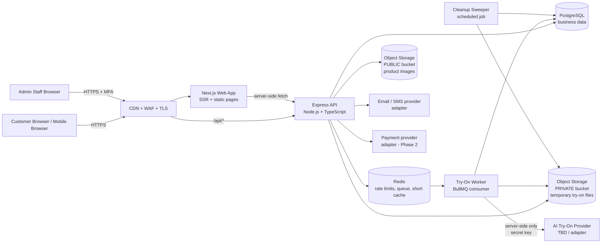
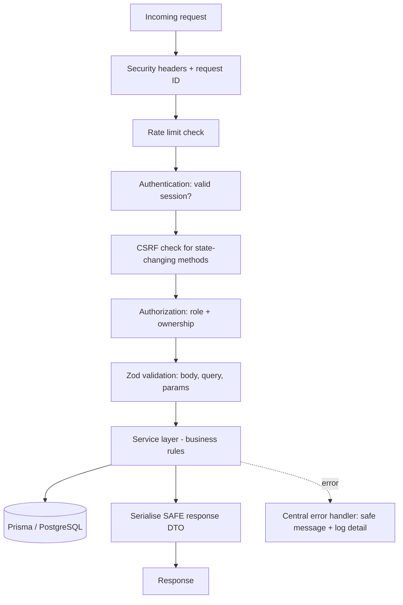
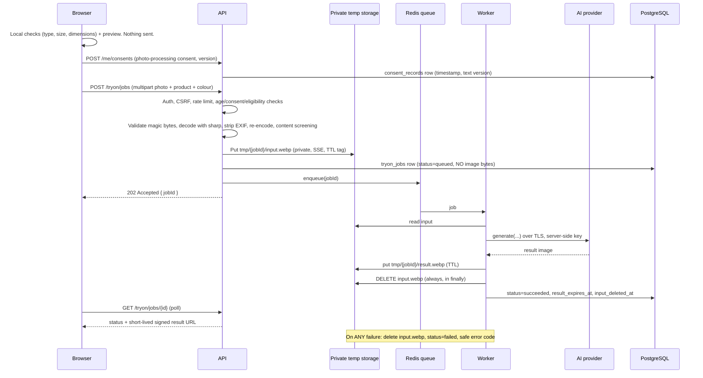
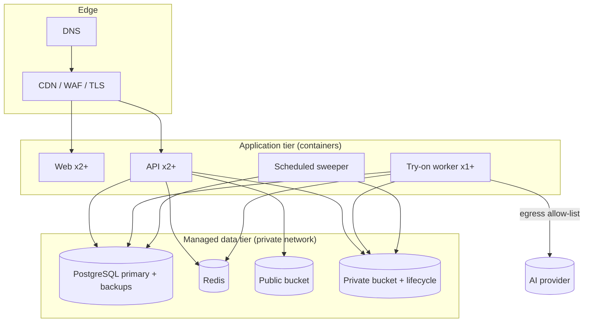

# Technical Requirements Document (TRD)
## Bangladesh Men's Fashion AI E-Commerce Platform

| Field | Detail |
|---|---|
| **Document** | TRD.md |
| **Version** | 1.0 (Draft for technical review) |
| **Last Updated** | 6 November 2026 |
| **Source of truth** | `PRD.md` v1.0, `APP_FLOW.md` v1.1, `UI_SPEC.md` (final) |
| **Companion documents** | `SCHEMA.md`, `PLAN.md`, `COMPONENTS.md`, `TESTING.md`, `README.md` |

> **Scope.** This document defines *how* the platform is built. It does not change any requirement in the PRD, APP_FLOW or UI_SPEC. Where those documents leave a technical decision open (marked **TBD**), this TRD records an explicit, reversible **Technical Assumption (TA-xx)** in Section 2. Nothing here claims the system is "hack-proof" or "compliant" with any regulation; compliance requires legal review (PRD NFR-033, OQ-019).

---

## Table of Contents

1. Technical Goals and Principles
2. Technical Assumptions and Resolved Conflicts
3. System Architecture
4. Technology Stack and Rationale
5. Frontend Architecture
6. Backend Architecture
7. API Architecture
8. AI Virtual Try-On Architecture
9. Image Upload and Temporary Storage
10. Authentication and Authorization
11. Session Management and CSRF
12. API Key and Secret Management
13. Environment Variable Management
14. Database Integration
15. Data Privacy and Protection
16. Input Validation and Output Encoding
17. Rate Limiting and Abuse Protection
18. Injection, XSS and Related Web Protections
19. HTTPS and Security Headers
20. Error Handling and Logging
21. Payments and Third-Party Integrations
22. Deployment Architecture
23. Scalability and Performance
24. Observability, Backup and Recovery
25. MVP vs Phase 2 vs Future Technical Requirements
26. OWASP Top 10 Mapping
27. Requirement Traceability

---

## 1. Technical Goals and Principles

| # | Principle | Why it matters | PRD anchor |
|---|---|---|---|
| P1 | **Secure by default.** Every endpoint denies access unless explicitly allowed. | Most e-commerce breaches come from missing access checks, not exotic attacks. | NFR-023, NFR-025, FR-088 |
| P2 | **Privacy by design.** Customer photos are processed temporarily and deleted; nothing is stored "just in case". | Photos are the most sensitive data the platform handles. | BR-007, BR-008, FR-047, NFR-012–015 |
| P3 | **Backend-only secrets.** No API key, token or credential ever reaches the browser. | A leaked AI key means someone else spends the business's money. | PRD Security §3 |
| P4 | **Shopping never depends on AI.** AI features fail independently of browsing and checkout. | Revenue depends on the basics. | AP-5, AP-6, BR-014, NFR-029 |
| P5 | **Keep it simple.** One database, one backend, one frontend, one cache/queue. Add components only when a requirement needs them. | A beginner team can build, secure and operate this. | — |
| P6 | **Vendor-neutral AI.** The AI provider sits behind an adapter interface. | PRD OQ-011 has not chosen a provider; switching must not require rewrites. | AP-7 |
| P7 | **Configuration over code for business TBDs.** Delivery zones, payment methods, upload limits, retention TTLs, feature flags are configuration. | PRD BR-004: nothing unconfirmed may be hardcoded or displayed. | BR-004, FR-086 |

---

## 2. Technical Assumptions and Resolved Conflicts

### 2.1 Conflicts Found Between Source Documents and the Brief

| ID | Conflict | Resolution | Rationale |
|---|---|---|---|
| **C-1** | Project brief states target age **18–30**; PRD §3/§9 and UI_SPEC §1.3 state **15–40**. | **PRD/UI_SPEC are retained as source of truth (15–40).** The system supports all ages for *browsing and purchasing*; **personal-photo try-on is gated to users who have confirmed they are 18 or older** until the business approves a minors policy (PRD OQ-009, a launch blocker per APP_FLOW §12.2). | The brief says "do not contradict existing requirements." The gate is the safest technical default and is removable by a configuration flag once legal approves. |
| **C-2** | PRD §16.4 leaves "stored for reuse across sessions or processed per session only" as **TBD (OQ-013)**. The brief and PRD Security §5 require **no permanent storage by default**. | **Resolved provisionally: per-request temporary processing.** The uploaded source photo is **never** persisted beyond processing. Generated results live only for a short TTL unless the customer explicitly saves a look. | Brief + PRD Security §5 are explicit. Business/legal must still confirm the numbers (TA-10). |
| **C-3** | APP_FLOW §12 offers both "account required" and "guest allowed" for try-on (AFQ-04). UI_SPEC §14 says: *do not assume guest try-on is allowed; show the configured authentication gate.* | **Default: account required (`TRYON_REQUIRE_ACCOUNT=true`).** Configurable. | Consent records, per-user limits and abuse control need an identity. The flag preserves both APP_FLOW options. |
| **C-4** | PRD FR-031 says deleting a saved look removes the generated image; APP_FLOW AFQ-18 says deleting a photo deletes derived looks. With no permanent source photo, "delete my photo" mainly means *delete any in-flight temp files and saved generated images*. | Implemented as a single **"Delete my try-on data"** operation (Section 9.6). | Matches both documents without contradiction. |

### 2.2 Technical Assumptions Register

| ID | Assumption | Status | Reversible by |
|---|---|---|---|
| **TA-01** | Age gate for try-on per C-1 (`users.age_status`). | Provisional | Flag `TRYON_REQUIRE_ADULT` after OQ-009 |
| **TA-02** | Source photo is never persisted; result image TTL and saved-look behaviour per Section 9. | Provisional | Business + legal sign-off (OQ-013) |
| **TA-03** | Try-on requires an account (C-3). | Provisional | `TRYON_REQUIRE_ACCOUNT` |
| **TA-04** | Account identifier: email **or** Bangladesh mobile number (at least one). Verification channel is behind a `NotificationProvider` interface. OTP vs email-link is open (OQ-015). | Open | Adapter swap |
| **TA-05** | Guest checkout is supported by the data model but **disabled** until OQ-014 is decided (`GUEST_CHECKOUT_ENABLED=false`). | Open | Flag |
| **TA-06** | Stack: Next.js + TypeScript (web), Node.js + Express + TypeScript (API), PostgreSQL + Prisma, Redis (rate limiting + queue), S3-compatible private object storage. See Section 4. | Recommended | Team decision before Phase 1 |
| **TA-07** | Cash on Delivery is the only payment method *assumed technically available at launch, if the business confirms it* (BR-015). MFS/online gateways are Phase 2 via `PaymentProvider` adapter. Provider names are not selected. | Open (OQ-007) | Adapter |
| **TA-08** | Session lifetimes (PRD/AFQ-26 undefined): customer idle 24 h / absolute 30 days; admin idle 15 min / absolute 8 h. | Proposed | Config |
| **TA-09** | Upload limits (PRD "TBD"): JPEG, PNG, WebP; ≤ 8 MB; shortest side ≥ 512 px; longest side ≤ 6,000 px. HEIC is not supported in MVP. | Proposed | Config |
| **TA-10** | Retention numbers: temp source photo deleted immediately after the provider responds (safety sweeper deletes anything older than 15 min); unsaved result TTL 60 min; saved look TTL 30 days. | Proposed | Config + legal |
| **TA-11** | Rate-limit numbers in Section 17 are starting points to tune after load testing. | Proposed | Config |
| **TA-12** | English at launch; UTF-8 everywhere; Bangla fonts available (UI_SPEC §3.3). Content model is locale-aware (`SCHEMA.md`). | Open (OQ-010) | Content |
| **TA-13** | Hosting in the nearest major cloud region with acceptable latency for Bangladesh (commonly Singapore), behind a CDN. Data-residency must be reviewed by legal. | Proposed | Hosting decision |
| **TA-14** | Order statuses (PRD TBD): `pending`, `confirmed`, `processing`, `shipped`, `delivered`, `cancelled`, `return_requested`, `returned`. Stored as validated text, configurable in code. | Proposed | Business |
| **TA-15** | Money is stored as `NUMERIC(12,2)` in BDT. All price and total calculation happens on the server. | Decided | — |
| **TA-16** | MVP size recommendation is rule-based over size-chart data (PRD FR-049). Measurements are used transiently unless the customer consents to save them. | Decided | — |
| **TA-17** | MVP search uses PostgreSQL full-text search plus trigram matching. A dedicated search engine is a Future item. | Recommended | Scale |
| **TA-18** | The admin area is a separate route group (`/admin`) and API namespace (`/api/v1/admin`) with a separate cookie, session store scope and mandatory MFA (proposed in NFR-026). | Recommended | — |

---

## 3. System Architecture

### 3.1 High-Level Diagram



### 3.2 Component Responsibilities

| Component | Responsibility | Does NOT do |
|---|---|---|
| **Next.js web app** | Rendering storefront and admin UI, SEO, responsive layouts, form UX, client-side pre-checks | Hold secrets, call the AI provider, enforce security rules on its own |
| **Express API** | The single source of truth for authentication, authorization, validation, pricing, orders, consent, rate limits | Render pages |
| **PostgreSQL** | Permanent business data (`SCHEMA.md`) | Store photo bytes |
| **Redis** | Rate-limit counters, try-on job queue, short-lived cache | Hold permanent data (everything in Redis can be lost without data loss) |
| **Private object storage** | Temporary try-on source/result files, short TTL, no public access | Serve files directly to the internet |
| **Public object storage + CDN** | Product images and banners | Hold anything customer-specific |
| **Try-On Worker** | Pull a job, call the AI provider, write result, delete source, update job status | Accept HTTP traffic |
| **Cleanup Sweeper** | Safety-net deletion of expired temp files and expired saved looks; expired tokens/sessions | Replace explicit deletion (it is a backstop) |

### 3.3 Why This Architecture

| Decision | Reason |
|---|---|
| **Separate web app and API** | The API contains all security logic and can be tested independently. It also lets a future mobile app reuse the same API (PRD §25 #7). |
| **Modular monolith, not microservices** | Microservices add network, deployment and debugging complexity a small team does not need. Modules (`auth`, `catalog`, `orders`, `tryon`, `admin`) are separated in code and can be extracted later if scale demands. |
| **Async try-on via queue** | AI generation can take many seconds (provider-dependent, PRD NFR-003). A queue keeps HTTP requests short, lets us limit concurrency per provider (NFR-010) and isolates AI outages (NFR-029). |
| **Two object-storage buckets** | Product images are public and cacheable; try-on files are private and short-lived. Separate buckets mean a mistake in one policy cannot expose the other. |

---

## 4. Technology Stack and Rationale

| Layer | Recommendation | Why | Alternatives considered |
|---|---|---|---|
| **Language** | **TypeScript** (web + API + shared) | One language end to end; types catch many bugs before runtime; shared validation schemas. | Plain JavaScript (fewer guardrails) |
| **Frontend framework** | **Next.js (React, App Router)** | Server rendering and static generation give fast first paint on slow mobile networks (NFR-001, NFR-007) and good SEO (NFR-036). Large ecosystem and beginner resources. | Vite + React SPA (weaker SEO and first-load speed) |
| **Styling** | **Tailwind CSS** with the exact token mapping in UI_SPEC §13.1 | UI_SPEC already defines the Tailwind mapping. | CSS Modules |
| **Icons** | **Lucide** | Specified in UI_SPEC §3.7. | Feather |
| **Fonts** | Cormorant Garamond, Plus Jakarta Sans, Hind Siliguri via `next/font` (self-hosted) | Specified in UI_SPEC §3.3. Self-hosting avoids third-party font requests and layout shift. | Google Fonts CDN |
| **Frontend data/forms** | Server components + `fetch`; **React Hook Form + Zod** for forms | Zod schemas are shared with the API, so client and server rules cannot drift. | Formik |
| **Backend runtime** | **Node.js (LTS) + Express** | Most widely documented Node framework; simple mental model for beginners; mature security middleware (`helmet`, `express-rate-limit`, `cors`). | Fastify, NestJS (more concepts to learn) |
| **Validation** | **Zod** | Runtime validation with TypeScript inference; used on every request body, query and parameter. | Joi, class-validator |
| **ORM** | **Prisma** | Parameterised queries by default (SQL-injection defence, Section 18), typed models, migrations. | Raw SQL (higher injection risk), TypeORM |
| **Database** | **PostgreSQL** | Relational integrity for orders, inventory and pricing; transactions; JSONB for size charts/content; full-text and trigram search. Detailed justification in `SCHEMA.md` §1. | MongoDB (weaker fit for transactional order/stock data) |
| **Cache / queue** | **Redis + BullMQ** | One dependency serves rate limiting, try-on job queue and caching. | Postgres-based queue (viable but adds load to the primary DB) |
| **Object storage** | **S3-compatible** (any provider) via AWS SDK | Lifecycle (auto-expiry) rules, private buckets, signed URLs, provider-portable. | Local disk (not scalable or safe on multiple servers) |
| **Image processing** | **sharp** (server-side) | Decode, validate, resize, strip metadata and re-encode uploads; also creates optimised product images. | ImageMagick (larger attack surface) |
| **Password hashing** | **Argon2id** | Current OWASP-recommended password hashing algorithm; resistant to GPU cracking. | bcrypt (acceptable fallback) |
| **Logging** | **pino** with redaction | Fast structured JSON logs, field-level redaction of secrets. | winston |
| **Testing** | Vitest/Jest, Supertest, Playwright, axe-core, k6 | See `TESTING.md`. | — |
| **Containerisation** | **Docker** | Same runtime in dev, staging and production. | Bare-metal installs |
| **CI/CD** | **GitHub Actions** (or equivalent) | Automated tests, dependency audit and secret scanning on every change. | GitLab CI |
| **Edge** | CDN + WAF + managed TLS (e.g., Cloudflare class of service) | HTTPS, caching of product images close to Bangladesh users, basic DDoS and bot protection. | Direct origin exposure |

**Dependency policy.** Each new dependency must be justified in a pull request, have active maintenance, and pass `npm audit` (or equivalent). Lock files are committed. This limits supply-chain risk (OWASP A06/A08).

---

## 5. Frontend Architecture

### 5.1 Structure

```
apps/web/
├── app/                      # Next.js App Router
│   ├── (storefront)/         # Customer pages (PG-01 … PG-32)
│   ├── (account)/            # Authenticated customer pages
│   ├── admin/                # Admin screens (AD-01 … AD-11), separate layout
│   └── api/                  # ONLY thin proxies if needed; no business logic or secrets
├── components/               # Reusable UI (see COMPONENTS.md)
│   ├── ui/                   # Buttons, inputs, modals, toasts
│   ├── commerce/             # ProductCard, Gallery, SizeSelector, CartSummary
│   ├── tryon/                # Upload, preview, consent, result
│   └── layout/               # Announcement bar, navbar, footer
├── lib/                      # API client, formatters (৳), validators
├── styles/                   # Tailwind config = UI_SPEC token mapping
└── tests/
```

### 5.2 Rendering Strategy

| Page type | Strategy | Why |
|---|---|---|
| Homepage, category, collection, product details | Server-side rendering with caching / revalidation | Fast first load on mobile, SEO, content updates by staff appear quickly |
| Cart, checkout, account, try-on | Client-interactive pages with authenticated API calls | Private, per-user data; must never be cached publicly |
| Admin | Client-interactive, `noindex`, no caching | Sensitive, role-restricted |

### 5.3 Frontend Rules

1. **No secrets in frontend code.** Only variables prefixed `NEXT_PUBLIC_` reach the browser, and they may contain only non-secret values (API base URL, public site name). A CI check fails the build if a secret-pattern string is found in the client bundle.
2. **The frontend is untrusted.** Client-side validation (e.g., file type/size, phone format) improves usability only. The API re-validates everything.
3. **Prices and totals shown in the UI come from the API.** The UI never computes the amount charged (BR-002, FR-018).
4. **Render user text as text.** React escapes by default; `dangerouslySetInnerHTML` is banned by lint rule except for sanitised CMS content (Section 18.2).
5. **Design tokens come only from the Tailwind config** that mirrors UI_SPEC §13.1. No hardcoded hex values in components.
6. **Performance budget** targets PRD NFR-001/002/007: optimised `next/image` (WebP/AVIF), lazy-loaded below-the-fold sections, `3:4` image containers to prevent layout shift.
7. **Feature flags** (from the API) hide features not yet approved: guest checkout, language switch, outfit try-on, payment methods (UI_SPEC §14).
8. **Local pre-processing of the photo** (preview, type/size/dimension check) happens in the browser before any upload and nothing is transmitted before consent (APP_FLOW AS-03, D4–D6).

### 5.4 Client State

| State | Where | Notes |
|---|---|---|
| Auth state | HTTP-only cookie (invisible to JS) + `GET /me` | Tokens are never placed in `localStorage` (XSS would steal them) |
| Cart | Server (logged in); signed, HttpOnly cart cookie for guests | Guest-cart merge rule is TBD (AFQ-03); default: merge, summing quantities up to stock |
| Try-on session | In-memory React state only | The selected photo is held as an in-memory object URL and revoked after upload/exit; never saved to `localStorage`/IndexedDB |
| UI preferences | `localStorage` (non-sensitive only, e.g., dismissed announcement bar, cookie choice) | |

---

## 6. Backend Architecture

### 6.1 Structure

```
apps/api/src/
├── main.ts                  # Server bootstrap
├── config/                  # Typed, validated environment config (fails fast if invalid)
├── middleware/              # auth, rbac, csrf, rateLimit, validate, errorHandler, requestId
├── modules/
│   ├── auth/                # register, login, logout, reset, verification
│   ├── users/               # profile, addresses, preferences, privacy centre
│   ├── catalog/             # products, categories, variants, search, size charts
│   ├── cart/ + orders/      # cart, checkout, orders, payments, delivery zones
│   ├── wishlist/ + looks/   # wishlist, saved looks, outfits
│   ├── reviews/
│   ├── tryon/               # consent, uploads, jobs, provider adapter, cleanup
│   ├── sizing/              # size recommendation (rule-based)
│   ├── content/             # homepage sections, policies, FAQ, newsletter
│   └── admin/               # staff auth, RBAC admin, audit log, moderation, reports
├── providers/               # adapters: ai/, payment/, notification/, storage/
├── jobs/                    # BullMQ workers + scheduled sweeper
├── lib/                     # logger, crypto, errors, money, phone
└── prisma/                  # schema.prisma, migrations, seed
```

### 6.2 Request Pipeline (applies to every endpoint)



This order matches the "Secure API Request Flow" in APP_FLOW (Frontend → authentication → authorization → validation → rate limit → processing → safe response). Rate limiting runs first for cheap rejection of floods, then again with per-user keys after authentication.

### 6.3 Layering Rules

| Layer | Rule |
|---|---|
| **Route/controller** | Parses HTTP only; no business logic. |
| **Service** | All business rules (stock, pricing, eligibility, consent checks). Receives an already-authenticated actor. |
| **Repository (Prisma)** | Data access only. Never builds SQL from strings. |
| **DTO mappers** | Every response is built from an explicit allow-list of fields. Database rows are **never** returned directly (prevents leaking `password_hash`, internal IDs, tokens). |

### 6.3.1 Critical Server-Side Business Rules

| Rule | Enforcement |
|---|---|
| Price, discount, delivery charge and total computed on server from DB values (BR-002, FR-018) | `orders` service recalculates at placement; client-sent amounts are ignored |
| Stock decremented atomically at order placement | Single DB transaction with row-level lock on variants; fails safely if insufficient |
| Duplicate order submission prevented (FR-021, NFR-030) | Client-generated **idempotency key** unique per order attempt |
| Try-on only for eligible products (FR-053) | Checked in the job-creation service, not just hidden in the UI |
| Try-on requires valid recorded consent (BR-007) | Checked server-side; job creation refused without a matching consent record |
| Only confirmed payment methods and active delivery zones accepted (BR-004, FR-086) | Validated against configuration |
| Reviews published only after moderation (BR-011) | Status machine in service layer |

---

## 7. API Architecture

### 7.1 Conventions

| Item | Convention |
|---|---|
| Style | REST over HTTPS, JSON bodies (`multipart/form-data` for photo upload only) |
| Base path | `/api/v1` (customer) and `/api/v1/admin` (staff) |
| Versioning | URL version; breaking changes require `v2` |
| IDs | UUIDs (non-guessable; reduces enumeration attacks) |
| Money | Decimal string in BDT (`"2450.00"`); formatting (`৳ 2,450`) is a UI concern |
| Pagination | Cursor or `page`/`limit` with maximum `limit` (e.g., 50) |
| Errors | RFC-7807-style JSON: `{ "error": { "code": "VALIDATION_FAILED", "message": "...", "requestId": "..." } }` |
| Documentation | OpenAPI 3 generated from Zod schemas; served only in non-production or behind admin auth |
| Idempotency | `Idempotency-Key` header on order placement and payment initiation |

### 7.2 Endpoint Catalogue

Release column: **M** = MVP, **P2** = Phase 2, **F** = Future. Auth column: **Pub** = public, **Cust** = customer session, **Staff** = staff session + permission.

| Group | Method & path | Auth | Rel. | Purpose (requirement) |
|---|---|---|---|---|
| **Auth** | `POST /auth/register` | Pub | M | FR-025 |
| | `POST /auth/login` | Pub | M | FR-026 |
| | `POST /auth/logout` | Cust | M | FR-026 |
| | `POST /auth/verify` | Pub | M | Verification (OQ-015) |
| | `POST /auth/password/forgot` | Pub | M | FR-027 |
| | `POST /auth/password/reset` | Pub | M | FR-027 |
| | `GET /me` | Cust | M | Current user, flags |
| **Account** | `PATCH /me` · `POST /me/password` | Cust | M | FR-028 |
| | `GET/POST/PATCH/DELETE /me/addresses` | Cust | M (Should) | FR-029 |
| | `GET/PATCH /me/preferences` | Cust | M | FR-051, FR-052 |
| | `GET/POST /me/consents` · `POST /me/consents/{type}/withdraw` | Cust | M | CR-3, CR-4, NFR-031 |
| | `POST /me/deletion-request` | Cust | M | FR-028 (OQ-019) |
| **Catalogue** | `GET /categories` | Pub | M | FR-002 |
| | `GET /products` (filters, sort, search) | Pub | M | FR-001, 003–005 |
| | `GET /products/{slug}` | Pub | M | FR-006–012, 014 |
| | `GET /products/{id}/size-chart` | Pub | M | FR-010 |
| | `GET /products/{id}/related` | Pub | M (Should) | FR-013 |
| | `GET /search/suggest` | Pub | M | UI_SPEC §4.3 |
| **Sizing** | `POST /sizing/recommend` | Pub/Cust | M (Should) | FR-049, FR-050 |
| **Wishlist** | `GET/POST/DELETE /wishlist` | Cust | M | FR-030 |
| **Cart** | `GET/POST/PATCH/DELETE /cart` | Pub/Cust | M | FR-015 |
| | `POST /cart/coupon` | Pub/Cust | M (Should) | FR-020 |
| **Checkout** | `GET /delivery/quote` | Pub/Cust | M | FR-018 |
| | `POST /orders` (Idempotency-Key) | Cust (Pub if guest enabled) | M | FR-017–021 |
| | `GET /orders` · `GET /orders/{id}` | Cust | M | FR-022, 023 |
| | `POST /orders/{id}/requests` | Cust | M (Should) | FR-024 |
| | `POST /payments/{orderId}/initiate` · `POST /webhooks/payments/{provider}` | Cust / signed webhook | P2 | FR-019 (MFS/online) |
| **Try-On** | `GET /tryon/config` | Cust | M | Limits, accepted types, eligibility |
| | `POST /tryon/jobs` (multipart) | Cust | M | FR-036, 038, 039 |
| | `GET /tryon/jobs/{id}` | Cust (owner) | M | Status polling |
| | `GET /tryon/jobs/{id}/result` | Cust (owner) | M | Short-lived signed URL |
| | `DELETE /tryon/jobs/{id}` · `DELETE /me/tryon-data` | Cust (owner) | M | FR-047 |
| **Looks** | `GET/POST/PATCH/DELETE /looks` | Cust | M (Should) | FR-031 |
| | `POST /looks/{id}/share` · `DELETE /looks/{id}/share` · `GET /shared/{token}` | Cust / Pub | P2 | FR-045 |
| | `GET /outfits` · `GET /outfits/{slug}` | Pub | M (Should) | FR-042, 062 |
| **Reviews** | `GET /products/{id}/reviews` · `POST /products/{id}/reviews` | Pub / Cust | M (Should) | FR-032, 033 |
| **Content** | `GET /content/{key}` · `POST /newsletter` | Pub | M | FR-054–074 |
| **Admin** | `POST /admin/auth/login` (+MFA) | Pub | M | NFR-026 |
| | `/admin/products`, `/admin/inventory`, `/admin/orders`, `/admin/promotions`, `/admin/delivery-zones`, `/admin/content` | Staff | M | FR-079–086 |
| | `/admin/reviews`, `/admin/customers`, `/admin/reports`, `/admin/tryon/metrics` | Staff | M (Should) | FR-082, 085, 087, 089 |
| | `/admin/staff`, `/admin/audit-log` | Super Admin | M | FR-088, NFR-027 |

> There is **no endpoint that lists or downloads other customers' try-on images**. Staff access to customer photos (PRD §20.2 "Restricted") is **not implemented in MVP**: with no stored source photos there is nothing to review. Moderation of uploads is automated at upload time (Section 8.5). If a future policy needs staff review, it requires a separate, audit-logged design.

### 7.3 Example: Order Placement Contract

```http
POST /api/v1/orders
Idempotency-Key: 6f1c1d2e-...-b7
X-CSRF-Token: <token>
Content-Type: application/json

{
  "addressId": "uuid",
  "paymentMethod": "cod",
  "couponCode": null,
  "items": [{ "variantId": "uuid", "quantity": 1 }]
}
```

The server **ignores any client-supplied prices**, recalculates from the database, verifies stock, delivery zone and payment-method availability, then returns the order summary or a safe error.

---

## 8. AI Virtual Try-On Architecture

### 8.1 Provider-Neutral Adapter

PRD OQ-011 has not selected an AI provider. All provider specifics live behind one interface:

```ts
interface TryOnProvider {
  readonly name: string;
  generate(input: {
    personImage: Buffer;          // sanitised, re-encoded
    garmentImageUrl: string;      // from catalogue (public product image)
    category: "upper" | "lower" | "full" | "traditional"; // eligibility class
    requestId: string;
  }, opts: { timeoutMs: number; signal: AbortSignal }): Promise<{
    resultImage: Buffer;
    providerRef?: string;
    costUnits?: number;           // only if returned by provider (UI_SPEC §6.4)
  }>;
}
```

| Rule | Why |
|---|---|
| The API key is read from server environment variables only and used inside the worker | PRD Security §3 |
| Every call has a timeout and abort signal | NFR-003; prevents hung jobs consuming capacity |
| Provider errors are mapped to internal codes (`PROVIDER_TIMEOUT`, `PROVIDER_REJECTED`, `PROVIDER_UNAVAILABLE`) | Raw provider messages may leak internals and must never reach the customer |
| A `MockTryOnProvider` ships with the codebase | Enables development, automated tests and demos without spending money or sending real photos |

### 8.2 Provider Selection Criteria (decision for OQ-011)

Before choosing a provider, evaluate and document:

| Criterion | What to verify |
|---|---|
| **Data retention** | Does the provider keep submitted images? For how long? Can retention be disabled? |
| **Training use** | Provider contractually does not train on submitted images (supports BR-008). |
| **Data location and processor terms** | Where images are processed; a data-processing agreement exists (legal review, D-06). |
| **Quality for target garments** | Panjabi, shirts, trousers on real Bangladeshi test photos (NFR-040). |
| **Latency, rate limits, price per generation** | Drives per-user limits (OQ-024) and cost monitoring (FR-089). |
| **Moderation / safety** | Built-in unsafe-content handling (NFR-038). |
| **Failure behaviour** | Clear error codes, timeout handling. |

> **Privacy consequence:** "We delete our temporary copy" is *not* the same as "nobody keeps the photo." If the chosen provider retains images, the privacy notice (UI_SPEC §6.2, APP_FLOW D6) must say so accurately. This is why provider retention terms are a selection criterion, not an afterthought.

### 8.3 Try-On Job Lifecycle



### 8.4 States and Deletion Guarantees

| State | Source photo exists? | Result exists? | Trigger to next state |
|---|---|---|---|
| `queued` | Yes (temp, private) | No | Worker picks job |
| `processing` | Yes | No | Provider responds / fails / times out |
| `succeeded` | **No** (deleted) | Yes, until TTL | Customer views; TTL expires or customer deletes or saves a look |
| `failed` | **No** (deleted) | No | Customer retries (needs new upload; see 8.6) |
| `cancelled` | **No** (deleted) | No | Customer cancels |
| `expired` | No | **No** (deleted) | Sweeper |

**Deletion is layered (defence in depth):**

1. **Primary:** the worker deletes the source in a `finally` block (success, failure and cancellation).
2. **Queue failure handler:** if a job exhausts retries or crashes, a failure hook deletes `tmp/{jobId}/*`.
3. **Sweeper (every few minutes):** deletes any temp object older than the safety threshold (TA-10) and marks stale jobs `expired`/`failed`.
4. **Storage lifecycle rule:** the private bucket's `tmp/` prefix auto-expires objects after the shortest period the storage provider supports (commonly 1 day), as a last-resort backstop.
5. **Verification:** automated tests and a scheduled check assert that no `tmp/` object older than the threshold exists (`TESTING.md` §13).

### 8.5 Upload Screening

Performed in the API *before* anything is written to storage (Section 9.3): magic-byte check, decode, dimension limits, metadata strip. Content screening (unsafe/inappropriate content, no person, multiple people) uses a screening step (provider-native moderation or a dedicated moderation service; **TBD**, PRD FR-089/NFR-038). Rejection returns a neutral message and the photo is discarded immediately, never sent to the AI provider.

### 8.6 Retry Behaviour

APP_FLOW AFQ-17 says retry reuses the photo without a new upload. Because the source is deleted after each attempt, the **MVP retry requires re-selecting the photo** (which is still in the browser's memory, so the customer only taps "Retry" and the browser re-submits it). Consent is **not** asked again unless the consent-text version changed. This keeps the "no server-side retention" promise while giving the one-tap retry the flow expects.

### 8.7 Cost and Abuse Control

| Control | Detail |
|---|---|
| Per-user limits | Daily and per-hour generation caps (OQ-024; values configurable) |
| Global concurrency | Worker concurrency matches provider limits; excess jobs wait in queue (NFR-010) |
| Circuit breaker | After N consecutive provider failures, new jobs fail fast with a friendly "unavailable" state and the rest of the site is unaffected (NFR-029) |
| Spend visibility | Counters from `tryon_jobs` metadata feed the admin AI-monitoring screen (FR-089) |
| Kill switch | `FEATURE_TRYON_ENABLED` can be turned off without redeploying code |

### 8.8 AI Size Recommendation (separate)

Per PRD AP-2 and FR-050, size recommendation is a **separate module** (`modules/sizing`) with separate endpoints and disclaimers. MVP logic is rule-based: compare customer inputs (inches) with the product's size-chart ranges and return a size, an "unsure / between sizes" state, or "insufficient data". It never uses the try-on image. Inputs are processed transiently and saved to `user_preferences` only with explicit consent (NFR-014).

---

## 9. Image Upload and Temporary Storage

### 9.1 Principles

1. The **source photo is never written to the database** and never to permanent storage.
2. Temporary files live only in a **private bucket**, encrypted at rest, under unguessable keys, with a TTL.
3. Photos are **never** logged, cached by a CDN, or placed in URLs.
4. The browser never receives a long-lived link to a customer photo.

### 9.2 Storage Layout

| Bucket | Visibility | Prefix | Content | Lifetime |
|---|---|---|---|---|
| `{app}-public` | Public via CDN | `products/`, `content/` | Product images, banners | Permanent (business data) |
| `{app}-private` | **Private**, no public ACL, block-public-access on | `tmp/{jobId}/input.webp` | Sanitised source photo | Deleted at end of processing; sweeper ≤ 15 min |
| | | `tmp/{jobId}/result.webp` | Generated preview | TTL 60 min unless saved |
| | | `saved-looks/{userId}/{lookId}.webp` | Generated image of an **explicitly saved** look only | TTL 30 days (configurable), deleted with the look |

Keys use random UUIDs. Original filenames are discarded (prevents path traversal and metadata leakage).

### 9.3 Upload Security Pipeline

| Step | Control | Defends against |
|---|---|---|
| 1 | Authentication + CSRF + rate limit before reading the body | Anonymous/abusive uploads |
| 2 | Body size cap at the HTTP layer (e.g., 9 MB, TA-09 + overhead) with streaming limits (`multer`/`busboy`) | Memory exhaustion / DoS |
| 3 | **Allow-list** of MIME types **and** verification of file *signature (magic bytes)*; `Content-Type` and extension are not trusted | Disguised executables, polyglot files |
| 4 | Decode with `sharp` with pixel-count limit (`limitInputPixels`) | Decompression bombs |
| 5 | Dimension rules (min/max) | Poor quality / abuse |
| 6 | **Re-encode** to a fresh WebP/JPEG and **strip all metadata** (EXIF incl. GPS) | Embedded payloads, location leakage |
| 7 | Content screening (Section 8.5) | Unsafe content (NFR-038) |
| 8 | Write to private storage with server-side encryption and random key | Data at rest exposure (NFR-013) |
| 9 | Enqueue job with only `jobId` (not the image) | Photo bytes in Redis/logs |

The same pipeline (minus the AI steps) is reused for optional review photos (FR-034, Could Have) and admin product images, each with its own bucket/prefix and limits.

### 9.4 Result Delivery

The result is returned through a **signed URL valid for a few minutes**, generated on request for the owning customer only, with `Cache-Control: private, no-store`. If the customer reloads after TTL expiry, the UI shows the "expired" state defined in APP_FLOW §12.4 (Retention expiry).

### 9.5 Saved Looks (FR-031, Should Have)

| Aspect | Design |
|---|---|
| What is saved | Product/colour references (and outfit reference) **plus**, only if the customer clicks **Save Look**, a copy of the *generated* image |
| What is never saved | The original uploaded photo |
| Warning to customer | Before saving, the UI states that the saved image contains an AI-generated picture of them, is private, and expires/deletes per policy |
| Deletion | Deleting a look deletes the stored image immediately; account deletion deletes all looks; expiry sweeper deletes after TTL |
| Sharing | Phase 2 (FR-045): private, revocable, expiring token link; explicit confirmation of exactly what is shared (APP_FLOW D15) |

> Whether saving the generated image at all is acceptable is a business/legal question (A-04, OQ-013). The system supports a configuration (`SAVED_LOOKS_STORE_IMAGE=false`) that saves only product/colour references and lets the customer regenerate on demand. This is the most privacy-protective setting.

### 9.6 "Delete My Try-On Data"

`DELETE /me/tryon-data` (also triggered by consent withdrawal, CR-4):

1. Cancels queued/processing jobs and deletes their temp files.
2. Deletes all generated results and saved-look images for the user.
3. Marks job rows `deleted` (metadata remains for audit/cost counters but contains no images or personal content).
4. Returns a confirmation that states what was deleted. UI copy must not promise instantaneous deletion beyond what the process guarantees (UI_SPEC §6.5): customer-visible deletion is immediate; storage deletion completes within the sweeper/lifecycle window.

---

## 10. Authentication and Authorization

### 10.1 Customer Authentication

| Aspect | Design | Why |
|---|---|---|
| Identifiers | Email and/or Bangladesh mobile number (normalised to `+8801XXXXXXXXX`) | PRD FR-025, BD-2; normalised storage prevents duplicate accounts |
| Password hashing | **Argon2id** with per-password salt and tuned cost parameters | PRD Security §1: never store plain text; resists cracking |
| Password policy | Minimum length 10; check against common-password list; no composition gimmicks; strength meter in UI (UI_SPEC Security UI §2) | Length and breach-resistance beat complexity rules |
| Login errors | Always generic: "Incorrect details" (APP_FLOW I2); constant-time comparison; same response time for unknown accounts | Prevents account enumeration |
| Brute-force protection | Per-account and per-IP throttling with exponential backoff and temporary lock; CAPTCHA step-up after repeated failures (optional) | NFR-023, FR-026 |
| Verification | Via `NotificationProvider`: email link or phone OTP (OQ-015). Codes are random, single-use, short-lived, hashed at rest, attempt-limited | FR-027, FR-025 |
| Password reset | Neutral response whether or not the account exists (APP_FLOW I7); token hashed, single-use, expires; all sessions revoked on reset | FR-027 |
| Re-authentication | Required for password change, phone/email change and account deletion | AFQ-27 |

### 10.2 Staff (Admin) Authentication

| Aspect | Design |
|---|---|
| Separate login endpoint, cookie and session scope | Compromise of a customer session cannot reach admin APIs (TA-18) |
| **MFA (TOTP)** mandatory for all staff in production | PRD NFR-026 (proposed); admin accounts are the highest-value targets |
| Short idle timeout (TA-08) and "session expired" screen | UI_SPEC Security UI §5 |
| Optional IP allow-listing / VPN for Super Admin | Extra layer; business choice |
| Staff accounts created only by Super Admin; no public admin registration | Prevents privilege escalation by signup |

### 10.3 Authorization (RBAC + Ownership)

Two checks, both mandatory:

1. **Role/permission check (RBAC)** — is this role allowed this capability? Derived from PRD §20.2.
2. **Ownership check** — does this record belong to the requester? (Prevents IDOR / broken object-level authorization.)

```ts
// Permission map in code (single source of truth), derived from PRD §20.2
const PERMISSIONS = {
  super_admin:       ["*"],  // still audit-logged
  catalogue_manager: ["product:crud", "inventory:crud", "sizechart:crud", "tryon_eligibility:update"],
  order_manager:     ["order:read", "order:update", "delivery_zone:read"],
  content_manager:   ["content:crud", "promotion:crud"],
  support_agent:     ["order:read", "customer:read_limited", "review:moderate"],
  analyst:           ["report:read"],
} as const;
```

| Rule | Detail |
|---|---|
| Deny by default | A route without an explicit `requirePermission()`/`requireCustomer()` fails the build via a route-registry test |
| Ownership | Every customer-scoped query includes `WHERE user_id = :currentUser`. Foreign IDs return **404**, not 403, to avoid confirming existence |
| Server-side only | Hiding a button in the UI is never treated as security |
| Sensitive staff actions | Price change, refund/cancellation, role change, data export → confirmation + audit log (NFR-027, UI_SPEC Security UI §5) |
| Customer try-on data | Only the owning customer can access; **no staff role** has any access in MVP (Section 7.2 note) |

---

## 11. Session Management and CSRF

### 11.1 Sessions

| Aspect | Design | Why |
|---|---|---|
| Mechanism | **Server-side sessions** referenced by an opaque, random session ID in a cookie | Instant revocation on logout/password change; no sensitive data in the browser |
| Storage | `sessions` table in PostgreSQL stores only a **hash** of the session ID (SCHEMA.md) | A database leak does not reveal usable session IDs |
| Cookie flags | `HttpOnly`, `Secure`, `SameSite=Lax` (customer) / `Strict` (admin), `Path=/`, cookie name prefix `__Host-` where possible | Blocks JS theft (XSS), plain-HTTP leakage and most CSRF |
| Rotation | New session ID after login and privilege change (prevents session fixation) | OWASP session guidance |
| Lifetime | Idle + absolute timeouts (TA-08); "remember me" extends absolute only | AFQ-26 |
| Logout | Server invalidates session, clears cookie, redirects to Login (APP_FLOW "Secure Session & Logout Flow") | |
| Revocation | Password change/reset and "log out of all devices" revoke all user sessions | |
| Concurrent sessions | Allowed; listed in account security settings | UI_SPEC Security UI §4 |

*Why sessions rather than JWT in localStorage?* Browser-readable tokens are exposed to any XSS bug. HttpOnly server sessions keep the credential out of reach of JavaScript and are trivial to revoke. JWTs may be used later for a native mobile app (Future) with short lifetimes and refresh rotation.

### 11.2 CSRF Protection

CSRF applies because authentication uses cookies.

| Layer | Control |
|---|---|
| 1 | `SameSite` cookies (Lax/Strict) block cross-site POSTs in modern browsers |
| 2 | **Synchronizer / double-submit CSRF token** required in `X-CSRF-Token` on every `POST`, `PUT`, `PATCH`, `DELETE`; token bound to the session |
| 3 | `Origin`/`Referer` header verified against the allow-listed site origin for state-changing requests |
| 4 | CORS restricted to the exact web origin with credentials; no wildcard |
| 5 | State-changing operations are never performed by `GET` |

Payment-provider webhooks are **exempt from CSRF** (they carry no cookies) but must pass **signature verification** (Section 21).

---

## 12. API Key and Secret Management

### 12.1 Secret Inventory

| Secret | Used by | Where stored |
|---|---|---|
| AI provider API key | Try-on worker only | Secret manager / server env |
| Database URL & credentials | API, worker, migrations | Secret manager |
| Redis URL | API, worker | Secret manager |
| Object-storage keys (or IAM role) | API, worker, sweeper | Prefer **IAM role/workload identity**; else secret manager |
| Session/CSRF signing secrets, field-encryption key | API | Secret manager |
| Email/SMS provider keys | API | Secret manager |
| Payment provider keys + webhook secret (Phase 2) | API | Secret manager |
| MFA encryption key (TOTP secrets at rest) | API | Secret manager |

### 12.2 Rules

1. **Backend-only.** Secrets exist only in server runtime environments. They are never prefixed `NEXT_PUBLIC_`, never bundled, never in HTML, never in API responses, never in error messages.
2. **Not in source control.** `.env*` files are git-ignored; only `.env.example` with placeholder values is committed. Secret scanning (e.g., gitleaks) runs in CI and as a pre-commit hook.
3. **Least privilege.** The storage credential used by the API can only access the two buckets and only the needed actions; the AI key (where the provider supports it) is scoped/limited by spend and IP.
4. **Separate keys per environment.** Development, staging and production never share keys. Developers use the mock AI provider by default.
5. **Rotation.** Keys rotate on a schedule and immediately on suspicion.
6. **Revocation runbook** (PRD Security §8): (a) revoke the key at the provider; (b) issue a new key into the secret manager; (c) redeploy/restart workers; (d) review provider usage and logs for abuse; (e) record the incident. The runbook is tested once before launch (`TESTING.md` §11.9).
7. **Spend guard.** Provider-side budget alerts and a kill switch (`FEATURE_TRYON_ENABLED`) limit damage if a key is abused.

---

## 13. Environment Variable Management

### 13.1 Approach

- A single typed config module (`config/`) validates all variables with Zod **at startup**; the process refuses to start on missing or malformed values (prevents running half-configured).
- Variables are grouped by sensitivity. `NEXT_PUBLIC_*` variables are public by design and contain **no** secrets.

### 13.2 Variable Catalogue (names only; values are never committed)

| Variable | Sensitive | Purpose |
|---|---|---|
| `NODE_ENV` | No | `development` / `test` / `staging` / `production` |
| `APP_ORIGIN` | No | Allowed web origin (CORS, CSRF origin check) |
| `NEXT_PUBLIC_API_BASE_URL` | No | API URL for the browser |
| `NEXT_PUBLIC_SITE_NAME` | No | Brand name (final name TBD) |
| `DATABASE_URL` | **Yes** | PostgreSQL connection string |
| `REDIS_URL` | **Yes** | Redis connection |
| `SESSION_SECRET` / `CSRF_SECRET` | **Yes** | Signing secrets |
| `FIELD_ENCRYPTION_KEY` | **Yes** | Encrypts saved measurements / TOTP secrets |
| `STORAGE_ENDPOINT`, `STORAGE_REGION` | No | Object storage location |
| `STORAGE_ACCESS_KEY_ID`, `STORAGE_SECRET_ACCESS_KEY` | **Yes** | Storage credentials (omit if using IAM role) |
| `STORAGE_PUBLIC_BUCKET`, `STORAGE_PRIVATE_BUCKET` | No | Bucket names |
| `AI_PROVIDER` | No | `mock` or adapter name |
| `AI_PROVIDER_API_KEY` | **Yes** | Provider credential (worker only) |
| `AI_PROVIDER_TIMEOUT_MS`, `AI_WORKER_CONCURRENCY` | No | Tuning |
| `TRYON_*` (`FEATURE_TRYON_ENABLED`, `TRYON_REQUIRE_ACCOUNT`, `TRYON_REQUIRE_ADULT`, `TRYON_MAX_FILE_MB`, `TRYON_RESULT_TTL_MIN`, `TRYON_DAILY_LIMIT`, `SAVED_LOOKS_STORE_IMAGE`, `SAVED_LOOK_TTL_DAYS`) | No | Business-tunable flags/limits (TA-02, TA-03, TA-09, TA-10) |
| `GUEST_CHECKOUT_ENABLED` | No | TA-05 |
| `NOTIFY_PROVIDER`, `NOTIFY_API_KEY` | key **Yes** | Email/SMS |
| `PAYMENT_PROVIDER`, `PAYMENT_API_KEY`, `PAYMENT_WEBHOOK_SECRET` | keys **Yes** | Phase 2 |
| `LOG_LEVEL` | No | Logging verbosity |
| `SENTRY_DSN` (or equivalent) | Moderate | Error reporting (scrubbed) |

### 13.3 Per-Environment Handling

| Environment | Secret source | AI provider | Data |
|---|---|---|---|
| Local dev | `.env` (git-ignored) copied from `.env.example` | `mock` | Seed/fake data only |
| CI | CI secret store (test values) | `mock` | Ephemeral DB |
| Staging | Secret manager | Sandbox/test credentials | Synthetic data only; **no real customer data or photos** |
| Production | Secret manager (access limited to deploy role) | Production key | Real data |

---

## 14. Database Integration

Full design is in `SCHEMA.md`. Integration rules:

| Rule | Detail |
|---|---|
| Access path | Prisma Client only; no string-concatenated SQL. Where raw SQL is unavoidable (full-text search), use Prisma's tagged-template parameterised form. |
| Connection | TLS-encrypted, connection pooling (e.g., PgBouncer or provider pooler) |
| Accounts | Separate DB roles: **migration role** (DDL, used only in CI/CD), **application role** (DML only, no DDL, no superuser), **read-only reporting role** |
| Transactions | Order placement, stock changes, coupon redemption and consent+job creation run in transactions |
| Concurrency | Row-level locking / atomic `UPDATE … WHERE stock >= :qty` for inventory |
| Migrations | Versioned, reviewed, applied by CI/CD; destructive migrations need a backup first |
| Seeds | Seed scripts contain **no real credentials**; admin bootstrap uses a one-time secret |
| Time | All timestamps stored as UTC (`timestamptz`); displayed in `Asia/Dhaka` |

---

## 15. Data Privacy and Protection

### 15.1 Data Classification

| Class | Examples | Controls |
|---|---|---|
| **Highly sensitive** | Customer try-on photos and generated images; saved body measurements | Temporary processing, private storage, field encryption for measurements, no logging, owner-only access |
| **Sensitive personal** | Name, phone, email, addresses, order history, consent records | Encryption in transit/at rest, access control, minimal logging |
| **Credentials** | Password hashes, session hashes, MFA secrets, API keys | Argon2id, hashing/encryption, secret manager, never logged |
| **Business** | Products, prices, stock, content | Standard integrity controls, audit logging of staff changes |

### 15.2 Controls

| Requirement | Implementation | PRD anchor |
|---|---|---|
| Encryption in transit | TLS 1.2+ everywhere (browser↔edge, edge↔origin, API↔DB/Redis/storage/AI provider) | NFR-013 |
| Encryption at rest | Managed DB and storage encryption; field-level encryption for measurements and TOTP secrets | NFR-013 |
| Data minimisation | Only fields required by a feature; measurements optional and consent-gated; no photo persistence | NFR-014 |
| Consent | `consent_records` (type, version, timestamp, granted/withdrawn); processing refused without a valid record; separate consent for any secondary use, off by default | BR-007/008, CR-1–6, NFR-031 |
| No secondary use | No training, marketing or public display of photos. No analytics events contain image data | BR-008 |
| Retention and deletion | Section 9 and `SCHEMA.md` §14; customer-initiated deletion honoured; automatic expiry | FR-047, NFR-015, BR-018 |
| Data subject requests | Export/delete workflows for account data (process and legal exceptions TBD, OQ-019) | FR-028 |
| Staff access | Least privilege; sensitive reads (customer details) audit-logged; no staff access to try-on images | NFR-012, NFR-027 |
| No sale of data | Not sold to third parties (PRD BR-017, proposed) | |
| Logs | No photos, passwords, tokens, API keys, full phone numbers or full addresses in logs (Section 20) | PRD Security §4 |
| Third parties | Only processors with agreements; AI provider terms reviewed (Section 8.2) | D-06 |
| Cookies/analytics | Non-essential cookies/analytics only after consent (FR-078, NFR-032) | |
| Minors | Try-on photo processing gated by age confirmation until policy approved (TA-01) | OQ-009 |

> **Compliance statement.** This design applies widely recognised privacy practices. It is **not** a claim of compliance with any specific law. A Bangladesh-qualified legal review of the privacy policy, consent text, data location, retention and minors handling is required before launch (NFR-033, D-06).

---

## 16. Input Validation and Output Encoding

| Practice | Detail |
|---|---|
| **Validate at the boundary** | Every route declares Zod schemas for `body`, `query`, `params`, `headers` where relevant. Unknown fields are rejected (`.strict()`). |
| **Allow-lists over block-lists** | Enumerations for category, sort, status; regex for slugs (`^[a-z0-9-]{1,100}$`). |
| **Bangladesh phone** | Accept `01[3-9]XXXXXXXX` (11 digits) and `+8801[3-9]XXXXXXXX`; normalise before storage (UI_SPEC §11.2, BD-2). |
| **Address** | Division/district/thana from a controlled list; free-text fields length-limited. |
| **Numeric limits** | Quantity min/max, price ranges, pagination `limit` caps. |
| **Normalisation** | Trim, Unicode NFC normalise (Bangla-safe), case-fold emails. |
| **File inputs** | Section 9.3. |
| **Sanitisation of rich text** | Staff-authored CMS content (policies, FAQ, brand story) is stored as structured data or Markdown and sanitised with an allow-list HTML sanitiser (e.g., DOMPurify/sanitize-html) on write **and** render. Raw script/iframe/event-handler attributes are removed. |
| **Output encoding** | React auto-escapes; search query and all user text rendered as text (UI_SPEC PG-07). JSON responses use `Content-Type: application/json` and `nosniff`. |
| **Server-side wins** | Client validation is convenience; server validation is the control. |

---

## 17. Rate Limiting and Abuse Protection

Starting values (TA-11) — tune with load testing and monitoring. Limits are keyed by IP *and*, once authenticated, by user/account. Counters live in Redis; exceeding returns **429** with `Retry-After`.

| Endpoint group | Proposed limit | Extra protection |
|---|---|---|
| Global baseline (per IP) | 300 requests / min | WAF bot rules |
| `POST /auth/login` | 5 failures / 15 min per account+IP; 20 / 15 min per IP | Exponential backoff, temporary lock, optional CAPTCHA, alert on spikes |
| `POST /auth/register` | 5 / hour per IP | Email/phone verification required |
| Verification / OTP / forgot password | 3 sends / hour per identifier; 5 verify attempts per code | Code invalidated after attempts; neutral responses |
| Search / suggest | 60 / min per IP | Cache popular queries |
| `POST /orders` | 10 / hour per user | Idempotency key |
| `POST /tryon/jobs` | Per hour and per day per user (config, e.g., 5 / hour, 15 / day); global concurrency cap | Per-IP cap too; circuit breaker; cost alerts |
| `GET /tryon/jobs/{id}` (polling) | 60 / min per user | Recommended poll interval ≥ 2 s with backoff |
| Contact/newsletter forms | 5 / hour per IP | Honeypot field + spam protection (UI_SPEC PG-28) |
| Admin login | 5 / 15 min | MFA; alert to Super Admin |
| Payment webhooks | Allow provider IP/signature only | Reject unsigned |

Additional abuse controls: request body size limits, request timeouts, pagination caps, disabled verbose errors, and suspicious-activity alerts (PRD Security §8).

---

## 18. Injection, XSS and Related Web Protections

### 18.1 SQL Injection (OWASP A03)

| Control | Detail |
|---|---|
| ORM with parameterised queries | Prisma never interpolates user data into SQL strings |
| Raw SQL policy | Only via `Prisma.sql` tagged templates; code review rule + lint check forbids `$queryRawUnsafe`/`$executeRawUnsafe` |
| Validated inputs | Sort fields and filter keys are mapped from allow-lists, never passed through as column names |
| Least-privilege DB role | Application role cannot run DDL or access system tables |
| Search | Full-text queries use `plainto_tsquery` / parameterised `ILIKE` with escaped wildcards |
| Testing | Automated injection payload tests (`TESTING.md` §11.1) |

### 18.2 Cross-Site Scripting (OWASP A03)

| Control | Detail |
|---|---|
| Default escaping | React escapes text; `dangerouslySetInnerHTML` forbidden except for sanitised CMS HTML |
| **Content-Security-Policy** | Restrict scripts to self (with nonces for Next.js inline scripts); no `unsafe-eval`; restrict `img-src`, `connect-src`, `frame-ancestors` (Section 19) |
| Sanitise on input and on output | For staff-authored content (Section 16) |
| URL handling | Only `https:`/relative URLs allowed in user/staff-provided links; `javascript:` rejected |
| Cookies | `HttpOnly` so XSS cannot read session cookies |
| Reviews | Plain text only (no HTML); length limits; output-escaped |
| Search query reflection | Rendered as text, never as markup |

### 18.3 Other Web Risks

| Risk | Control |
|---|---|
| Clickjacking | `frame-ancestors 'none'` / `X-Frame-Options: DENY` |
| SSRF (OWASP A10) | The API never fetches arbitrary user-supplied URLs. Garment image URLs for the AI call come from the catalogue database only; outbound allow-list for the worker |
| Open redirect | "Return-to-origin" (APP_FLOW §18.2) accepts only relative internal paths validated against an allow-list |
| Mass assignment | DTO allow-lists; `role`, `isAdmin`, `price`, `status` can never be set from a customer request |
| IDOR | Ownership checks and UUIDs (Section 10.3) |
| Path traversal | Storage keys are server-generated; filenames discarded |
| HTTP parameter pollution | Zod rejects arrays where scalars are expected |
| Prototype pollution | Strict schemas; no deep-merge of user input into objects |
| Clickjack-safe uploads | Storage serves with `Content-Disposition` and correct `Content-Type`, `nosniff` |

---

## 19. HTTPS and Security Headers

| Item | Setting |
|---|---|
| HTTPS | Mandatory in staging and production; HTTP redirects to HTTPS at the edge; TLS 1.2+ (1.3 preferred); automatic certificate renewal |
| HSTS | `Strict-Transport-Security: max-age=31536000; includeSubDomains` (add `preload` only after confirming all subdomains support HTTPS) |
| CSP | `default-src 'self'; script-src 'self' 'nonce-…'; style-src 'self' 'unsafe-inline'*; img-src 'self' data: blob: <cdn-origin>; font-src 'self'; connect-src 'self' <api-origin>; frame-ancestors 'none'; base-uri 'self'; form-action 'self'; object-src 'none'` *(inline styles only if Tailwind/Next requirement demands; prefer nonces/hashes)* |
| `X-Content-Type-Options` | `nosniff` |
| `Referrer-Policy` | `strict-origin-when-cross-origin` |
| `Permissions-Policy` | Disable unused features; `camera=()` until camera capture is approved (TBD, PRD §16.4), then `camera=(self)` on the try-on route only |
| `Cross-Origin-Opener-Policy` | `same-origin` |
| `Cache-Control` | `no-store` for authenticated, account, admin and try-on responses; long-lived immutable for fingerprinted static assets and product images |
| CORS | Exact `APP_ORIGIN` only, credentials on, no wildcard |
| Cookies | `Secure`, `HttpOnly`, `SameSite` (Section 11) |
| Server banner | `X-Powered-By` removed |
| Admin | `X-Robots-Tag: noindex` |

`helmet` (Express) and Next.js header configuration apply these centrally. Headers are verified in CI and in the pre-deployment checklist.

---

## 20. Error Handling and Logging

### 20.1 Error Handling

| Rule | Detail |
|---|---|
| Central error handler | Maps internal errors to safe messages and codes. Stack traces, SQL, file paths and provider messages are **never** returned (UI_SPEC Security UI §6) |
| Consistent format | `{ error: { code, message, requestId } }` |
| User-facing tone | Specific, polite, actionable (NFR-021) |
| Status codes | 400 validation, 401 unauthenticated, 403 forbidden (staff routes), 404 not found (also for foreign resources), 409 conflict (duplicate/stock), 413 too large, 415 unsupported type, 422 business-rule failure, 429 rate limit, 5xx generic |
| Auth failures | Generic (Section 10.1) |
| Try-on failures | Neutral messages mapped from internal codes per UI_SPEC §6.6; the cart/browsing is never affected (FR-048) |
| Unhandled errors | Caught globally; process stays up; alert raised |
| React error boundaries | Friendly fallback pages ("Page not found", "Something went wrong"); no technical details |

### 20.2 Logging

| Aspect | Design |
|---|---|
| Format | Structured JSON via pino with `requestId`, route, status, latency, user ID (not PII) |
| **Redaction** | Authorization/cookie headers, `password`, tokens, API keys, OTPs, full phone numbers, address lines, file contents and any image data are redacted before writing |
| Security events logged | Failed/successful logins, lockouts, password resets, MFA events, permission denials, rate-limit hits, consent changes, try-on job outcomes (no images), deletion events, admin actions, key-rotation events |
| Audit log (business) | `audit_logs` table for staff actions on prices, stock, orders, content, roles, customer-data access (NFR-027, PRD BR-020). Append-only, reviewable by Super Admin |
| Retention | Application logs: short, defined period (TBD); audit logs: longer. Neither contains photos |
| Access | Log platform restricted to engineers; production logs are not copied to developer machines |
| Monitoring and alerts | Spikes in 401/403/429/5xx, login-failure bursts, try-on failure/cost spikes, storage objects older than TTL, certificate expiry |

---

## 21. Payments and Third-Party Integrations

### 21.1 Integration Map

| Integration | Purpose | Interface | Release | Status |
|---|---|---|---|---|
| AI try-on provider | Single-garment try-on | `TryOnProvider` | MVP (pilot) | **TBD** (OQ-011) |
| Email / SMS provider | Verification, order notifications | `NotificationProvider` | MVP | **TBD** (OQ-031, D-11) |
| Object storage + CDN | Images, temp files | `StorageProvider` | MVP | Provider TBD |
| Cash on Delivery | Payment method | internal | MVP *if confirmed* | OQ-007, BR-015 |
| MFS / card gateway | Payments | `PaymentProvider` | Phase 2 | **TBD** (OQ-007) |
| Courier / delivery partner | Tracking automation | `CourierProvider` | Future (manual status updates in MVP) | OQ-022 |
| Analytics | KPIs | Consent-gated client script | MVP (Should) | TBD, FR-078 |
| Error monitoring | Diagnostics | SDK with scrubbing | MVP | |
| Social feed | Instagram section | Curated links | Could Have | OQ-025 |

### 21.2 Payment Security (PRD Security §7, NFR-024)

| Control | Detail |
|---|---|
| No card data on our servers | Hosted/redirect payment pages or provider SDK tokens; the platform never sees or stores card numbers (keeps PCI scope minimal) |
| Server-side verification | Order is marked paid **only** after server-to-server verification with the provider or a **signature-verified webhook** — never because the browser says so |
| Webhooks | Verify signature + timestamp; idempotent handling; replay protection; IP allow-list where supported; respond 2xx only after processing |
| Amount integrity | Provider-reported amount and currency compared with the order total before marking paid |
| Unknown status | "Payment pending" state with reconciliation job (AFQ-25) |
| Provider keys | Backend-only (Section 12) |
| Only confirmed methods shown | Checkout lists only enabled methods (BR-004, UI_SPEC §11.4) |

### 21.3 Adapter Rule

Every external integration is wrapped in an adapter with timeout, retry (idempotent calls only), circuit breaker, safe error mapping and a mock for tests. Outbound calls are TLS-only and, where possible, restricted to known hosts.

---

## 22. Deployment Architecture

### 22.1 Environments

| Environment | Purpose | Data |
|---|---|---|
| Local | Development with Docker Compose (Postgres, Redis, local S3-compatible emulator, mock AI) | Seed/fake |
| Staging | Production-like testing, QA, security scans, load tests | Synthetic only |
| Production | Live | Real |

### 22.2 Topology (Production)



| Aspect | Recommendation | Reason |
|---|---|---|
| Hosting | Managed container platform or small VM cluster; managed PostgreSQL and Redis | Less operational burden for a small team; managed patching and backups |
| Network | DB, Redis and private bucket reachable only from the application tier (no public endpoints) | Reduces attack surface |
| Workers | Run as a separate process/container from the API | Heavy AI jobs cannot starve web requests |
| CI/CD | PR checks → build → test → security scans → staging deploy → manual approval → production deploy; one-command rollback | Repeatable, auditable releases |
| Config | Secrets injected at runtime from the secret manager; never baked into images | Section 12 |
| Images | Minimal base images, non-root user, vulnerability scan on build | Container hardening |
| Zero downtime | Rolling deploys; DB migrations are backward-compatible (expand → migrate → contract) | Protects checkout during campaigns (NFR-008, NFR-011) |

---

## 23. Scalability and Performance

| Concern | Approach | PRD anchor |
|---|---|---|
| Mobile page speed | SSR/ISR, CDN caching, `next/image`, WebP/AVIF, responsive image sizes, code splitting, font subsetting; budget LCP ≤ 2.5 s, INP ≤ 200 ms (proposed targets) | NFR-001, 002, 007 |
| Slow networks | Skeleton loaders that preserve layout (UI_SPEC §5.3), progressive image loading, compressed responses | NFR-007, BD-18 |
| Seasonal peaks | Horizontal scaling of stateless web/API; CDN absorbs read traffic; Redis caching for hot catalogue queries; DB connection pooling; load test before launch | NFR-008 |
| Search | Postgres full-text + trigram indexes (TA-17); suggest results cached; upgrade path to a search engine | NFR-004 |
| Database | Indexing strategy in `SCHEMA.md`; read replica if reporting load grows; pagination caps | NFR-009 |
| AI load | Queue, concurrency caps, per-user limits, circuit breaker, timeouts | NFR-003, 010, 029 |
| Checkout resilience | Transactions, idempotency keys, no dependency on AI/search | NFR-030 |
| Catalogue growth | Stable IDs, cursor pagination, image pipeline; tested at 10× volume | NFR-009 |
| Static content | Policies/FAQ cached and revalidated on publish | NFR-037 |

Performance is *measured*, not assumed: Lighthouse CI on key pages, real-user monitoring after launch, and k6 load tests (`TESTING.md` §12).

---

## 24. Observability, Backup and Recovery

| Item | Requirement |
|---|---|
| Health checks | `/healthz` (liveness) and `/readyz` (DB, Redis, storage reachable) — no sensitive details |
| Metrics | Request rate/latency/errors, queue depth, try-on success/failure/latency, DB pool, cache hit rate |
| Alerts | Error-rate spikes, queue backlog, provider failures, storage TTL violations, cert expiry, disk/DB capacity |
| Backups | Automated daily database backups plus point-in-time recovery where available; encrypted; stored separately; **restore tested** before launch (NFR-028; RPO/RTO **TBD**, OQ-029) |
| Backups and deletion | Backups contain **no try-on photos** (never in DB). Deleted personal data may persist in backups until rotation; backup retention is kept short and documented in the privacy notice |
| Disaster recovery | Documented runbook: restore DB, redeploy containers from registry, rotate secrets |
| Incident response | Basic runbook: detect → contain (kill switch, key revocation) → assess → notify as legally required (TBD) → fix → review |

---

## 25. MVP vs Phase 2 vs Future Technical Requirements

Aligned with PRD §24.4 (Release 1 = MVP, Release 2 = Phase 2, Release 3 = Future).

| Capability | MVP (Release 1) | Phase 2 (Release 2) | Future (Release 3+) |
|---|---|---|---|
| Core stack (web, API, Postgres, Redis, storage) | ✅ | | |
| Catalogue, search (Postgres FTS), filters, sorting, size guide | ✅ | | Dedicated search engine |
| Cart, checkout, orders, order history | ✅ | | |
| Payments | COD (if confirmed) | MFS / online gateways, webhooks, reconciliation | BNPL, instalments |
| Auth, RBAC, sessions, CSRF, rate limiting, audit log | ✅ | Social login (if approved) | Native-app token auth |
| Admin: products, inventory, orders, content, promotions, zones | ✅ | Customer mgmt, moderation, reports polish | Advanced analytics, marketing automation |
| AI try-on, single garment (pilot, eligible products) | ✅ | Colour change, compare, quality tuning | Complete outfit try-on (feasibility), video/AR try-on |
| Photo handling: temp storage + guaranteed deletion | ✅ | | |
| Saved looks | ✅ (Should; reference-only or short-TTL image) | Share links (FR-045) | Community features |
| Curated outfits (Shop the Look) | ✅ (Should) | | AI-generated outfit suggestions |
| Size recommendation | Rule-based on size charts (Should) | Tuning with real data | ML fit prediction from returns |
| Recommendations | Rule-based + fallback (Should) | Expanded rules | ML personalisation |
| Reviews and ratings | Should-have text reviews with moderation | Reviews with customer photos (FR-034) | |
| Notifications | Order confirmation + status (email/SMS per OQ-031) | WhatsApp (if approved) | Lifecycle campaigns |
| Delivery | Zones/charges config, manual tracking numbers | | Courier API integration, nationwide logistics |
| Languages | English; i18n-ready | Bangla (if approved) | |
| Observability | Logs, metrics, alerts, backups | Real-user monitoring dashboards | |
| Hosting | Single region + CDN | Autoscaling tuned from load data | Multi-region / read replicas |
| Native apps | — | — | iOS/Android |

---

## 26. OWASP Top 10 (2021) Mapping

| OWASP category | Primary controls in this TRD | Sections |
|---|---|---|
| **A01 Broken Access Control** | Deny-by-default RBAC, ownership checks, UUIDs, 404 for foreign resources, no staff access to try-on images, admin MFA | 10, 7.2 |
| **A02 Cryptographic Failures** | TLS everywhere, HSTS, Argon2id, hashed tokens/sessions, field encryption, secrets in manager, encrypted storage/backups | 11, 12, 15, 19 |
| **A03 Injection** | Prisma parameterisation, Zod validation, CSP, output encoding, sanitised CMS content | 16, 18 |
| **A04 Insecure Design** | Privacy-by-design try-on pipeline, layered deletion, threat-driven limits, kill switches, consent gating | 8, 9, 17 |
| **A05 Security Misconfiguration** | Typed config validation, security headers, least-privilege DB/storage, private buckets, no verbose errors, hardened containers | 13, 19, 22 |
| **A06 Vulnerable & Outdated Components** | Lock files, dependency audit and update cadence in CI, minimal dependencies, image scanning | 4, 22 |
| **A07 Identification & Authentication Failures** | Strong hashing, brute-force limits, MFA for staff, generic errors, session rotation/revocation, single-use reset tokens | 10, 11, 17 |
| **A08 Software & Data Integrity Failures** | Signed webhooks, CI/CD controls, locked dependencies, no unsigned auto-updates, idempotency | 21, 22 |
| **A09 Security Logging & Monitoring Failures** | Structured logs with redaction, audit log, alerts, incident runbook | 20, 24 |
| **A10 SSRF** | No user-controlled outbound URLs, egress allow-list for worker | 18.3, 22 |

OWASP is used as a **review reference**, not as a certification. A pre-launch security review and penetration test are required (`TESTING.md` §11, §20).

---

## 27. Requirement Traceability

| Source requirement | Where addressed |
|---|---|
| PRD Security §1 Authentication | §10, §11, §17 |
| PRD Security §2 Authorization | §10.3, §7.2 |
| PRD Security §3 API security | §8.1, §12, §17 |
| PRD Security §4 Data protection | §15, §19, §20 |
| PRD Security §5 Image privacy | §8, §9 |
| PRD Security §6 Input/application security | §16, §18 |
| PRD Security §7 Payment security | §21.2 |
| PRD Security §8 Monitoring | §17, §20, §24 |
| APP_FLOW "AI Virtual Try-On Secure Flow" | §8.3, §9.3 |
| APP_FLOW "Secure API Request Flow" | §6.2 |
| APP_FLOW "Secure Session & Logout Flow" | §11 |
| UI_SPEC Security & Privacy UI | §10.1, §15, `COMPONENTS.md` §17 |
| PRD NFR-001–011 (performance, scale) | §23 |
| PRD NFR-012–015, 031 (privacy) | §9, §15 |
| PRD NFR-023–028 (security, audit, backup) | §10–12, §20, §24 |
| PRD FR-053, FR-089 | §8, §7.2 |

*End of document — TRD.md v1.0 (Draft)*
